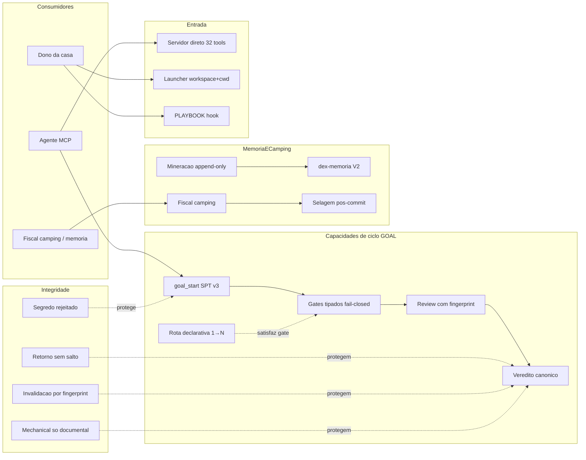

# CAPACITY — Mapa de Capacidades dex-PPIRTV

> Fotografia estática gerada pela skill `dex-mapa-capacidades` no corte
> **commit `947fdb4` (2026-10-18)**. Não é checklist vivo: nova medição exige
> novo pedido/execução da skill. Não editar à mão o veredito das linhas —
> regenerar. Espelho comentado (matriz de 10 colunas com limites por linha):
> `.agents/AUDITORIAS/2026-10-18-mapa-capacidades-947fdb4.md` (local, não
> versionado).

## Identidade da fotografia

## Reavaliação 2026-11-05 — recuperação pública do snapshot (#6)

Base `ada0c0d`, Trilho `2026-11-05-recuperacao-snapshot-publica`.
Delta focal em `src/review-snapshot.ts` e no tipo Flow: status projeta o escopo
recuperado sem escrita; evidencia aceita persiste a mesma lista e o registro
de exclusoes legadas. Declaracoes, delecoes e fronteiras continuam estritas.
RED preservado em `.agents/receipts/snapshot-publica-20261105/red.log`;
GREEN e replay em `tests/review-snapshot-recovery.test.ts`.
Validacao final: 17 focais; `npm run check` com 794 passed/4 skipped/62 arquivos;
MCP novo com 32 tools. Uma rodada anterior falhou por EPERM no lock de reuniao;
log preservado e bateria isolada 24/24, sem alterar o lock neste corte.
Limite: recuperacao sintetica nao certifica fechamento do consumidor externo;
runtime persistente exige carregar o build final. Neste host, reinicio nativo
foi confirmado depois do build. Publicacao para revisao no PR #7; atualizacao
documental de fechamento sem novo comportamento. Matriz historica abaixo preservada.

## Reavaliação 2026-11-05 — verdict-learning SHRINK (issue #5.2)

Trilho `2026-11-05-verdict-learning-filtro-findings` (flow
`flow_20261105192958447_2993_0001`): SHRINK do camping flow-engine —
`deriveVerdictLearning`+`isStrongLearningText` extraídas para
`src/verdict-learning.ts` (módulo puro, tipos por import de
mining-policy/domain, sem ciclo; fachada ganha só o import/l.2767).
Comportamento (issue #5.2): review_findings só viram gold_mining com texto
forte (mesma regra do rationale) — a promoção cega criava candidatos de
confiança baixa (2 gerados ao vivo pelo flow 2950). RED 1/1 no baseline;
guard mining-policy verde SEM edição; porta explícita verdict_gold_mining
inalterada; registro FE-2026-11-05-VERDICT-LEARNING-FILTRO-FINDINGS
(SHRINK PASS). Suíte 782|0|4 (61 files); `npm run check` exit 0. Push fora
do corte.

Fechamento (mesma sessão): flow 2993 **complete** (veredito
`vrd_20261105194113176_3002_0001` pronto_com_ressalvas, camping SHRINK PASS,
mining 2 nuggets); ressava do dono: onda DENSA do cluster learning estacionada
(EST-20261105-ONDA-DENSA-VERDICT-LEARNING).

## Reavaliação 2026-11-05 — merge PR #7 (review-scope-recovery da irmã)

Trilho  (flow 3051 complete,
veredito  pronto_com_ressalvas): merge consciente do PR #7 —
recuperação de flows LEGADOS pela rota pública (
com **proveniência**: diretório declarado permanece; dedupe volta a *Do One
Thing*); suíte no main 62 files / **794|0|4**; conflitos só em PLAYBOOK
(regen); PR #7 **MERGED** (20:47) com comentário de prova; CRG-FRESH-GATE
rodou sozinho no pre-commit do merge. 3 lapidações menores registradas.

## Reavaliação 2026-11-05 — CRG-FRESH-GATE no pre-commit (diretriz do dono)

Trilho `2026-11-05-crg-gate-precommit` (flow 3022): hook pre-commit ganha
bloco CRG-FRESH-GATE — todo commit tocando src/tests/scripts atualiza o banco
CRG automaticamente (auto-curativo; CLI ausente = aviso não-bloqueante,
frota/P10). BARATA MORTA ao vivo: `update --base HEAD` é NO-OP (diff
HEAD..HEAD vazio) — banco estava preso em `339e3ca`/agosto com receipts de
falso verde; base DEFAULT (last_built) é a rota; pós-cura: built_at
`ada0c0d`, 2536 nós, 130 arquivos. INDEX do CRG e napkin atualizados
(superfícies locais). Gate que dependia de memória agora é engenharia
(impossibilitar o erro). Fechamento: flow 3022 **complete** (veredito
`vrd_20261105195738696_3030_0001` **pronto**, sem ressalvas).

Causa incendiária eliminada (mesma sessão, barata-scan do dono): o
`capture-cut.py` do método gerava os falsos verdes (`--base HEAD` NO-OP) —
curado com base DEFAULT + **pós-condição no receipt** (`built_at_commit` ==
`rev-parse HEAD`; divergindo nasce `failed`). Baseline honesta:
`regularizacao-261105` (2536 nós/130 arquivos). CRG-FRESH-GATE e lista do
capacity gate alinhados: `src/tests/scripts/workflow/tools` (barata irmã
do scan). Teste capacity-gate 1/1 sem edição.

## Reavaliação 2026-11-05 — snapshot unborn/aninhado/casing (issues #6 + #5.1)

Fechamento (mesma sessão): flow 2950 **complete** (veredito
`vrd_20261105191612400_2965_0001` pronto_com_ressalvas, gates de fase
passed, mining 2 nuggets ledger_only, memória-viva reconciliada);
documentação de selagem (CHANGELOG + playbook regen) no commit de docs da
mesma data.

Coletor e merge de corroboração saneados em `src/review-snapshot.ts` (Trilho
`2026-11-05-snapshot-unborn-aninhado`, flow `flow_20261105185901479_2950_0001`):
(1) repo **unborn** (sem HEAD) não tem mais corroboração por status
(`gitChangedFiles` = null — sem base não há diff atribuível; issue #6: 8.075
paths vs 105 declarados); (2) entrada com barra final do porcelain -z
(repo aninhado `book-to-skill/`) é descartada — diretório nunca foi revisável e
congelava o verdict com `REVIEW_SNAPSHOT_FILE_REQUIRED`; (3) merge deduplica
por identidade fs (`dedupeChangedFilesByFsIdentity`: win32 case-insensitive
preservando casing da declaração, Linux exato — issue #5.1) e descarta
trailing-slash de todas as fontes, saneando flows feridos na próxima visita;
(4) early-return do merge compara CONTEÚDO (contagem igual escondia troca
dir↔untracked 2===2). Strict do snapshot intocado: arquivo real ausente segue
fail-closed. RED 4/4 provado no baseline; caracterização nova
`tests/git-corroboration-unborn.test.ts` 5/5; 2 guards com fixture unborn por
conveniência adaptados com commit-base (provas ipsis literis:
`review-snapshot-redaction`, `git-porcelain-quoting`). Zero mudança em
flow-engine/server. Push fora do corte (GO separado).

## Reavaliação 2026-11-02 — corte de manutenção 01 (assertToolEffectDeclaration)

Retrofit do template (mesma sessao): global 1.2.0->1.2.1 (3 gotchas +
nota PPIRTV) e instancia 1.0.1->1.0.2 (passo 9 do config; medidor 0.4.3
minimo). Documental; checkers OK nos dois lados; nenhum schema. Selagem:
commit `2e24584` fixa os blobs; HANDOFF reconciliado com o push efetivo
(ate `e0395c5`) e regra anti-drift: estado de push NAO se registra no
HANDOFF — a verdade mora no git log/origin/main.

Primeiro corte real do método (Trilho `manutencao-corte-01-tool-effects`):
`assertToolEffectCatalog` 16→**4** (mismatch + loop) com helper privado
`assertToolEffectDeclaration` 13 (6 regras verbatim, sem export novo).
Comportamento preservado: `tests/tool-effects.test.ts` 9/9 sem edição.
Trade-off: soma src/mcp 22→23, max 16→13 (observação, não veto — PERFIL
observacional). Evidência comparável: baseline `pos-fix-01` vs
`corte-manutencao-01` no mesmo motor 0.4.3.

## Reavaliação 2026-11-02 — medidor 0.4.3 (P1 do oráculo, corte medidor-ts-range-corpo)

Selagem do corte: commits `8f51e98` (USAGE+CAPACITY) e o HANDOFF fixam
os blobs desta medição; nenhuma lógica de produto alterada.

Corte **documental** (zero `src/` do produto): fix na fonte do medidor
`dex-complexidade-ciclomatica` 0.4.2→0.4.3 (range do corpo TS com return
type anotado; sintoma CC=1 da irmã era bug de range), suíte da skill 38/38,
re-medição src/mcp 22/16 com ranges disjuntos, captura `pos-fix-01`
(provenance engine 0.4.3, revision f6daafa=HEAD), USAGE do pacote com seção
Remediação, backup 0.4.2 em CHECKPOINT. Nenhuma capacidade MCP alterada;
`recurring_risk`/teto terminal intactos. Raws 0.4.2 = fotografia histórica
do motor (R13 — não comparáveis). Verdict
`vrd_20261102165109623_3210_0001` pronto_com_ressalvas.

## Reavaliação 2026-11-02 — portabilidade do workflow

Delta documental: instancia local1.0.1 adota seletivamente global1.2.0, com dependencias/preflight e regua PPIRTV v1 preservada. Cinco templates globais relocalizados com perfis reais CC-only e fixtures CC2; cinco negativos de dependencia ausente; contato owner15/15 e consumidores29/29. Nenhuma nova capacidade MCP ou alteracao fiscal. Schemas11/0, acervo49/49; prova .agents/receipts/workflow-retrofit-20261102/FINAL-REPORT.md. Nao certifica instalacao na maquina irma, cobertura, ciclos ou ganho longitudinal.

## Reavaliação 2026-11-02 — integracao e prova real da rota terminal

Integracao fbf7d9d preserva workflow0e566b1 e correcao423e89a. Check completo776pass/4skip; contratos global/local sincronizados. Consumidor Hub real arquivado com nao_pronto, contador4/3 preservado e sucessor de reconciliacao aberto. Prova de runtime via MCP stdio real; transporte nativo desta janela ficou fechado apos encerrar launcher antigo e depende de reconexao cliente. Delta desta selagem limitado a capacidade, changelog e PLAYBOOK regenerado; nao altera codigo fiscal nem aceita produto Hub. Receipt .agents/receipts/runtime-fiscal-closeout.md.

## Reavaliação 2026-11-02 — metodo de manutencao continua

Base77c019d, escopo workflow/, .code-review-graphignore, README, changelog e projecao PLAYBOOK. Instancia1.0.0/global1.1.0; consumo real de CRG2.3.7/exporter1.2.0/medidor0.4.2 com perfil PPIRTV v1. Nenhuma capacidade MCP ou politica fiscal alterada. Suite do checkout769passed4skipped/59arquivos; consumidor local5/5, contato15/15, checker37/37, exporter24/24 e medidor37/37+fixtures. Cobertura/ciclos e ganho longitudinal nao medidos; extracao TS suspeita reproduzida e encaminhada ao owner. Fotografia historica das capacidades de produto abaixo preservada; isto reavalia somente o delta de metodo/ferramentas.

## Reavaliação 2026-11-02 — ensaio de PR de rascunho

Base `2e63c8c0411ae96686f62cd5ea65d6b221117b32`. Delta limitado ao README,
changelog e registro dos gates de publicação; nenhum código, tool ou contrato
MCP alterado. A fotografia e os oráculos históricos abaixo ficam preservados.
Este corte não certifica capacidade adicional do servidor: o ensaio mede a
skill externa dex-gerar-pull-request e seu transporte Git/GitHub. Resultados
locais executados constam no corpo do PR; o estado remoto é conferido depois
do envio e não é antecipado por este registro pré-commit.
## Reavaliação 2026-11-02 — contrato canônico ensina a rota terminal do teto

Cura da deriva que ensinava o loop: GOAL_SPT_CANONICAL_CONTRACT (global +
cópia local, linha ~952) ainda EXIGIA `open_decision_meeting` no teto de
regressões — o mapa da "reunião sem saída" que janelas consumidoras
reportaram. Contrato agora ensina o terminal por desenho (opção b):
`close_flow_with_reservation` (nao_pronto → flow_archive → flow novo);
reunião NÃO é rota de saída do teto. `audit:canonical` PASS. Zero mudança de
código — somente a fonte que os consumidores seguem.

## Reavaliação 2026-11-02 — verdict não-positivo + teto terminal

Corte `2e63c8c+working-tree` (Trilho
`2026-11-02-fiscal-verdict-nao-positivo`, revisão em dupla do merge 2e63c8c),
owner PPIRTV. CAP-35 reavaliada no delta: fechamento do relato de recorrência
somente por verdict positivo gravado (`pronto`/`pronto_com_ressalvas`);
`false` só persiste com veredito consumado; retry não duplica evento; teto de
regressões terminal por desenho (opção b do dono) com saída provada
`close_flow_with_reservation` → `flow_archive` + flow novo — envelope não
prescreve mais repetir veredito. Provas: `tests/fiscal-recurrence.test.ts`
29/29 (RED 4|24 no baseline), suíte integral 774 testes, 4 skipped, 59
arquivos; fronteira MCP intacta. `src/verdict-fiscal-policy.ts`,
`src/flow-engine.ts` (glue), `src/error-envelope.ts` e os 3 arquivos de teste
foram reavaliados neste delta. Camping: EXCEPTION integrity PASS (+21
nonblank, +2 decisões, RED causal ligado ao blob base 52d5e72); nenhuma
dívida paga ou aberta por este corte; janela lexical de materialidade tabuada
em PENDENTES. Outras linhas abaixo preservam fotografias históricas.

Selagem documental do corte: commit `6629f0f` fixa os blobs desta medição;
nenhuma lógica ou capacidade adicional foi alterada na selagem.

Fix-up da revisão adversarial do commit (code-reviewer, APPROVED_WITH_NITS →
consumido): descrição do `recurring_risk` na fronteira MCP atualizada para a
semântica positivo-only (superfície de ensino era o próprio bug corrigido) e
composto review+teto do envelope termina na rota terminal (nunca
`goal_verdict pronto` impossível); 2 testes de composto novos. Suíte integral
776 | 4 skipped | 59 arquivos; camping NOT_APPLICABLE (flow-engine intacto
após a selagem).

## Reavaliação 2026-11-02 — recorrencia fiscal tipificada

Corte `f4443d3+working-tree`, owner PPIRTV. CAP-35 observada em fixtures:
24 testes de recorrencia e 26 da fronteira fiscal passaram. MCP real anuncia
boolean opcional; check consolidado passou: 769 testes, 4 skipped, 59 arquivos.
`src/flow-engine.ts`, modulo fiscal, tipo compartilhado, schema e testes
foram reavaliados neste delta. SHRINK PASS: -17 linhas nao vazias, -1 decisao
na fachada, FE-DEBT-005 paga. Outras linhas abaixo preservam fotografias
historicas e nao recebem nova certificacao por este corte.

Selagem documental do PR: commit `27f500c` fixa os blobs desta medição;
nenhuma lógica ou capacidade adicional foi alterada na selagem.

| Capacidade | Delta observado | Evidencia |
| --- | --- | --- |
| CAP-35 recorrencia | Declaracao booleana, omissao/reload, false, encerramento, tipos e teto real inclusive mechanical | `tests/fiscal-recurrence.test.ts`, MCP schema real |
| CAP-16 camping | Contadores e relato saem da fachada | receipt SHRINK do corte |

| Dimensão | Valor |
| --- | --- |
| Objeto | dex-PPIRTV — servidor MCP executor PPIRTV (goal/flow/gate/evidence/memory) + launcher global + dex-agent local |
| Fotografia/revisão | commit `947fdb4`, suite 666 passed \| 4 skipped, build verde, tools/list 32 ao vivo |
| Ambiente | Windows Server, Node 24.16, workspace `C:\CodexProjetos\dex-PPIRTV`, MCP stdio local |
| Fontes vivas | `dist/index.js` + `dist/launcher.js`, `src/`, `tests/` (44 arquivos), ledger camping (10 records selados), receipts em `.agents/AUDITORIAS/EVIDENCIAS/` |
| Escopo | Capacidades acionáveis por consumidores (agente MCP, dono, casa) |
| Fora de escopo | Skill registry global, projetos consumidores, vNext não decidido |

**Convenção de estado (honestidade)**: `comprovada` = oráculo independente ao
vivo no corte OU suíte dedicada verde; `parcial` = implementada + suíte verde,
sem jornada de consumidor viva no corte; `não comprovada` = sem oráculo no
corte (não é ausência).

## Reavaliação 2026-11-01 — GUIA do kit cita a tríade (fonte viva de uso; doc pura)

> Revisão de print de sessão irmã (outra máquina, Trilho demo-e2e): `--help`
> deu ENOENT na versão pré-`1239263` e a dica gravada apontava para
> `spt-kit/GUIA.md` — que não citava a tríade (regra 3 do padrão documental
> da casa: tríade citada como fonte viva). Cura doc: seção "Ajuda viva" no
> GUIA com os 3 comandos. Zero `src/`/`tests/`/`scripts/`; nenhum estado de
> capacidade muda — comportamento já entregue em `1239263`.

| Capacidade | Delta observado | Evidência |
|---|---|---|
| CAP-23 autoria de SPT (preflight) | fonte viva de uso completa: `GUIA.md` cita `--help`/`--schema`/`--usage` (comportamento unchanged, entregue em `1239263`) | probes ao vivo nesta janela: 3 flags exit 0 (`--schema` devolve JSON `dex.spt.preflight.doc.v1`) |
| CAP-16 fiscal camping | `src/flow-engine.ts` FORA do diff; consulta read-only | `npm run check:flow-engine` `NOT_APPLICABLE` |

## Reavaliação 2026-11-01 — preflight do kit ganha tríade documental (docs+kit, zero src)

> Lapidação em voo do kit, fechada por `dex-git-fechamento` sob ordem do dono:
> `spt-kit/preflight.mjs` responde `--help`/`--schema`/`--usage` com exit 0
> ANTES de qualquer leitura de arquivo (padrão help vivo da casa — tríade
> documental; contrato `dex.spt.preflight.doc.v1`). Resíduo do corte anterior
> garimpado: backup `MOLDE.md.bak-20261031-uncertainties` idêntico ao
> `8e72830:spt-kit/MOLDE.md` (sha256 conferido — valor já preservado no
> histórico) → `.agents/LIXEIRA/` com MANIFEST.

| Capacidade | Delta observado | Evidência |
|---|---|---|
| CAP-23 autoria de SPT (preflight) | tríade documental viva: `--help`/`--usage` devolvem texto e `--schema` devolve JSON (`dex.spt.preflight.doc.v1`) com exit 0 sem tocar arquivo (nunca ENOENT por flag); caminhos normais intactos (flags desconhecidas seguem tratadas como path) | probes ao vivo: 3 flags exit 0; `--checksum MOLDE.md` `achados=0` (S09 anti-drift); fixtures `criterio-inchido` (S03) e `molde-drift` (S00) com exit 1 |
| CAP-16 fiscal camping | `src/flow-engine.ts` FORA do diff; gatilho read-only | `npm run check:flow-engine` exit 0, `NOT_APPLICABLE` |

**Evidência do corte:** suíte integral re-medida VIVA — 737 passed | 4 skipped
(741), 58 arquivos, 61.8s, zero edição de teste; `npm run check:capacity
-- --staged` PASS com este recibo. **Limitações:** a tríade do preflight é
local ao script (o preflight não é tool MCP — não herda do `tools/list`);
o texto da tríade não é congelado por teste (contrato declarado no
`--schema`).

## Reavaliação 2026-10-31 — cura do MOLDE uncertainties rev 2 (docs-only, zero src)

> Corte do Trilho skills `2026-10-31-fechar-ciclo-teto-1024` (task A-04). Dor:
> o MOLDE ensinava ERRADO — "senao remover esta linha" em `uncertainties`,
> mas o schema `dex.spt.v3` exige min 1 item (erro pago 2x no mesmo dia,
> plaquinha `SPT-TRILHO-NASCE-DO-MOLDE-261031`). Cura: frase substituída por
> `TODO-PREENCHER` com a regra explícita (NUNCA remova a chave; declare a
> ressalva residual); registro do schema bumped para rev 2 com
> `MOLDE.md sha256:8b8d5761`; `preflight.mjs --checksum` verde (S09 anti-drift).

| Capacidade | Delta observado | Evidência |
|---|---|---|
| CAP-23 autoria de SPT | molde curado (a causa incendiária do erro de uncertainties morre na fonte que ensina); dogfood do molde curado ao vivo: Trilho do corte nasceu do MOLDE rev 2 — preflight `achados=0` e `spt_validate valid=true` | receipt `spt_validate` do Trilho skills (fingerprint `ef75d7d8`); S09 `achados=0` |
| Matriz CAP-23 (dívida do `8e72830`) | linha da matriz principal ainda `**parcial**` enquanto receipt dizia `comprovada` — `tests/capacity-receipt.test.ts` vermelho na suíte integral; alinhada para `**comprovada**` (transição já declarada na Reavaliação 2026-10-30 do kit) | suíte integral re-medida viva no fechamento deste corte |

**Evidência do corte:** suíte integral re-medida (números no
`CAPACITY.receipt.json` desta revisão); zero `src/` no diff — docs+kit apenas.

## Reavaliação 2026-10-30 — kit SPT válido-por-construção (autoria fill-first, zero src)

> Corte do Trilho `2026-10-30-kit-spt-valido-por-construcao.md` (PRD aprovado
> por arena cega). Dor: SPTs nasciam prose-first e reprovavam ~100% de primeira
> no validador machine-first; o kit inverte a autoria para fill-first (molde de
> slots + preflight local SEM MCP). Docs+kit apenas — zero `src/`/`tests/` no
> diff; suíte re-medida viva no fechamento.

| Capacidade | Delta observado | Evidência |
|---|---|---|
| CAP-23 autoria de SPT (upstream do spt_validate) | kit `spt-kit/` no repo: `MOLDE.md` com 21 slots `TODO-PREENCHER` (preencher, nunca interpretar), `RULES.md` R1-R08 com rótulos de cobertura declarada, `GUIA.md` 1 página (instalação, ordem de preenchimento, gate único), `preflight.mjs` S01-S09 sem MCP (graph check requisito/critério/task, cobertura, LF, anti-drift S09 por sha256), fixtures adversariais (`criterio-inchido`, `molde-drift`); schema `SCHEMA/dex.spt.v3.schm.md` (padrão `.schm.md` da casa) com checksum anti-drift; `.gitattributes` `eol=lf` para `spt-kit/**` e `SCHEMA/**`. **Transição de estado: `parcial` → `comprovada`** — o limit da fotografia ("chamada standalone não ocorreu") caiu ao vivo: o dogfood chamou `spt_validate` standalone via MCP stdio no `dist/index.js` real | bateria ER 10/10 verde (`.agents/receipts/2026-10-30-kit-spt-er-battery.log`: preflight `achados=0`, `valid:true`, `execution_eligible:true`, ER-10 pipeline exit=0); dogfood `valid=true` de PRIMEIRA (`.agents/receipts/2026-10-30-kit-spt-validate-1a-execucao.log`) |
| CAP-01 goal_start (consumidor final) | upstream da revalidação resolvido na autoria: SPT nascido do molde com preflight verde chega ao `goal_start` sem reprovação de primeira por forma (a dor prose-first × machine-first) | dogfood do corte (validação de primeira acima); suíte integral 737 \| 4 intocada |
| CAP-16 fiscal camping | `src/flow-engine.ts` FORA do diff (corte docs+kit); gatilho read-only | `npm run check:flow-engine` exit 0, `NOT_APPLICABLE` (sem declaration nova) |

**Evidência do corte:** suíte integral re-medida VIVA — 737 passed | 4 skipped
(741), 58 arquivos, 66.5s, zero edição de teste; PLAYBOOK fresco
(`generate-playbook.py --check` exit 0); `npm run check:capacity -- --staged`
PASS com este recibo. **Limitações:** preflight cobre a forma estrutural
(R1-R08 → S01-S09), não a semântica de fondo (segue com dono/`spt-revisor`);
`preflight.mjs` depende do pacote `yaml` (já presente no repo); S09 vale
enquanto molde e schema mudarem no mesmo commit (GUIA §Anti-drift).

## Reavaliação 2026-10-30 — git-porcelain-nul-quoting (parsers -z + ponte legacy)

> Corte do Trilho `2026-10-30-git-porcelain-nul-quoting.md` (consumo da
> pendência PPIRTV-GIT-QUOTING-UNWRAP-001). Deltas sobre a fotografia 947fdb4;
> recibo atualizado (`dex.capacity.snapshot.v1`).

| Capacidade | Delta observado | Evidência |
|---|---|---|
| CAP-11 corroboração git | `gitChangedFiles` e `gitCommittedFilesSince` consomem saída `-z` NUL-delimited (git NUNCA quoteia com -z) — imunidade estrutural ao C-quoting de espaços (status) e non-ASCII/escapes octais (diff, divergência D1 da recepção); rename/copy do -z consumido mantendo o ALVO novo; ordem slice(3)-antes-do-trim preservada (trim na entry inteira comia o XY " M" e manava ".ppirtv/..." em "pirtv/..." — barata pega ao vivo pela suíte irmã) | `tests/git-porcelain-quoting.test.ts` 6/6 (parser cru ×3, e2e strict sem FILE_REQUIRED e zero entry quotada congelada, ponte legacy fp(quoted)==fp(real), guard fail-closed) |
| CAP-07 review estrutural | ponte legacy no loop de entries: entry congelada com aspas (parser pré--z) resolve o arquivo REAL via prefer-exact-then-unquoted (exact primeiro — nome real quotado no Linux nunca mis-hash; entry registrada com path despido + sha real); ambas ausentes seguem fail-closed | idem (C-3) + `tests/consumer-replay-jumper.test.ts` + `tests/git-corroboration-commits.test.ts` verdes sem edição |
| CAP-16 fiscal camping | flow-engine.ts FORA do diff (toda a mudança no SSOT review-snapshot.ts); gate verde sem visita nova | `npm run check:flow-engine` PASS (sem declaration nova) |

**Evidência do corte:** `npm run check` verde (audit + camping + capacity +
build + suíte 737 passed | 4 skipped, 58 arquivos, zero edição de teste
existente); RED preservado em
`.agents/AUDITORIAS/EVIDENCIAS/2026-10-30-git-quoting-red.log` (5 causais |
1 guard). **Limitações:** comportamento `-z` em git antigo/Linux/macOS não
testado localmente (contrato documentado; X-01 do Trilho); workspace
consumidor ConfigurarWindows intocado (restrição da recepção).

## Reavaliação 2026-10-29 (b) — selagem do record env-snapshot no ledger de camping

> Apenas governança: record FE-2026-10-29-ENV-SNAPSHOT-REDACTION-CONTAIN ganha
> commit 4bf8aab + parent e46bf09 (selagem pós-commit; `ledger_commit_seal:
> PASS`); nenhum arquivo de capacidade mudou neste commit. Fotografia vigente
> segue 947fdb4; receipt atualizado em generated_at.

## Reavaliação 2026-10-29 — env-snapshot-sensitive-redaction (CONTAIN + redação de sensível não-declarado)

> Corte do Trilho `2026-10-29-env-snapshot-sensitive-redaction.md` (consumo da
> pendência PPIRTV-ENV-SNAPSHOT-001 do ledger `.agents/PENDENTES.md`). Deltas
> sobre a fotografia 947fdb4; recibo atualizado (`dex.capacity.snapshot.v1`).

| Capacidade | Delta observado | Evidência |
|---|---|---|
| CAP-07 review estrutural | corroboração git NUNCA incorpora path sensível (filtro `isSensitiveWorkspacePath` no merge); snapshot redige sensível NÃO-declarado (entry `redacted_sensitive`, conteúdo nunca lido nem hasheado) por proveniência de declaração (provided.changed_files de todos os gates + revision_set de criterion_proof); sensível DECLARADO segue fail-closed (`revision_path_sensitive` intacto); rotas corrente e ESTRITA de atestação compartilham o wrapper SSOT `strictReviewSnapshotFingerprint` (emenda barata 2) | `tests/env-snapshot-sensitive.test.ts` 6/6 — vítima e2e destrava (gate revisão passed + verdict sem REVIEW_SNAPSHOT_SENSITIVE_PATH); `tests/gate-resolution.test.ts` + `tests/review-snapshot-redaction.test.ts` verdes sem edição |
| CAP-11 leitura tolerante | `redactableSensitivePaths` normaliza item sujo/embrulhado pela MESMA rota do pipeline antes do casamento de sensibilidade — suíte adversarial existente pegou o colateral ao vivo (crédito: replay sujo do consumidor) | `tests/consumer-replay-jumper.test.ts` verde; suíte integral 731 \| 4 sem edição de teste |
| CAP-16 fiscal camping | visita CONTAIN PASS (`FE-2026-10-29-ENV-SNAPSHOT-REDACTION-CONTAIN`, `glue_only`, destination `src/review-snapshot.ts`); debt `FE-DEBT-005` aberta e pagável (`any_verified_shrink`) | `npm run check:flow-engine` PASS |

**Evidência do corte:** `npm run check` verde (audit + camping CONTAIN +
capacity + build + suíte 731 passed | 4 skipped, 57 arquivos); RED preservado
em `.agents/AUDITORIAS/EVIDENCIAS/2026-10-29-env-snapshot-red.log`. **Limitações:**
lacunas 12.1 (risk_level mechanical) e 12.3 (população exposta) do laudo seguem
incertas (corte próprio); FE-DEBT-005 aberta.

## Reavaliação 2026-10-28 — selagem do record mining-egress-shrink no ledger de camping

> Apenas governança: record FE-2026-10-28-MINING-EGRESS-SHRINK ganha commit
> 6e2b4b9 + parent a678a1a (selagem pós-commit; `ledger_commit_seal: PASS`);
> nenhum arquivo de capacidade mudou neste commit. Fotografia vigente segue
> 947fdb4; receipt atualizado em generated_at.

## Reavaliação 2026-10-28 — mining-egress-shrink (SHRINK paga FE-DEBT-004)

> GO do dono 2026-10-28 (Trilho `mining-egress-shrink`, veredito do
> $oraculo-refatoracao): a política de unblock de memória
> (`memoryMiningRequiredSequence`) e o par de egress de visibilidade
> (`nuggets_collected`/`deposit_guidance`, helper `miningVisibilityEgress`)
> migram da fachada para o SSOT `src/memory/mining-policy.ts` (Mover Função —
> SHRINK `FE-2026-10-28-MINING-EGRESS-SHRINK` PASS com
> `pays_debt_id=FE-DEBT-004`; a debt deixa de estar aberta e cortes irmãos
> como o sub-eixo meetings destravam). Prova: BASELINE 725|4 no HEAD
> `a678a1a`; suites de rede 222/222 sem edição de teste; camping PASS mode
> SHRINK reasons []. Nenhuma capacidade nova/removida (fotografia `947fdb4`
> vigente; receipt atualizado em `generated_at`).

## Reavaliação 2026-10-28 — selagem do record mining-deposit-visibility no ledger de camping

> Apenas governança: record FE-2026-10-27-MINING-DEPOSIT-VISIBILITY-CONTAIN
> ganha commit 734322a + parent 7fec5bb (selagem pós-commit; validador
> `ledger_commit_seal: PASS`); nenhum arquivo de capacidade mudou neste
> commit. Fotografia vigente segue 947fdb4; receipt atualizado em
> generated_at.

## Reavaliação 2026-10-27 — mining-deposit-visibility (CONTAIN + vocabulário delphi)

> GO do dono 2026-10-27 (Trilho `2026-10-27-mining-deposit-visibility`): fim do
> 0-anestesiante do `mm_memory_mining`. Delta de capacidade: o summary/retorno do
> mining expõe `nuggets_collected` e, com a coleta vazia, `deposit_guidance`
> ensinando a depositar (política no SSOT `src/memory/mining-policy.ts`,
> consumida pelos dois caminhos de writer — visita CONTAIN
> `FE-2026-10-27-MINING-DEPOSIT-VISIBILITY-CONTAIN`, debt `FE-DEBT-004` aberta);
> as DUAS rotas de unblock (`memoryRequiredErrorAction` em `src/server.ts`,
> agora exportada, e `memoryMiningRequiredSequence` no flow-engine) devolvem
> passo 1 `evidence_attach` com `gold_mining` modelo antes de minerar, via
> builder SSOT `miningDepositStep`; `THEME_RULES` delphi reconhece `dcc32|dpr|dproj` (ouro de
> build pontuava 4 e caía em `ledger_only` silencioso); description do
> `mm_memory_mining` declara que o classificador lê somente texto depositado em
> `gold_mining`/`parking_lot`. Prova: suite nova RED-first
> `tests/mining-deposit-visibility.test.ts` (9 casos; RED 9/9 preservado em
> `.agents/AUDITORIAS/EVIDENCIAS/2026-10-27-mining-deposit-red.log`) + suite
> integral 725|4 (56 arquivos) + camping CONTAIN PASS + tools/list 32 vivo com
> description nova. Nenhuma capacidade nova/removida (fotografia `947fdb4`
> vigente; receipt atualizado em `generated_at`/`suite`).

## Reavaliação 2026-10-26 — selagem do record P1 no ledger de camping

> Apenas governança: record FE-2026-10-26-VERDICT-FISCAL-POLICY-SHRINK ganha commit 9797016 + parent 883561b (selagem pós-commit); nenhum arquivo de capacidade mudou. Fotografia vigente segue 947fdb4; receipt atualizado em generated_at.

## Reavaliação 2026-10-26 — verdict-fiscal-policy-tree (SHRINK CCP P1)

> Árvore CCP P1 (GO do dono): o eixo fiscal do verdict (`evaluateFiscalPolicy`
> + núcleo + triggers de meeting + `codeReviewRequired`/`hasReviewEvidence` +
> `recurringRisk`/`hasEnoughAttempts`/`regressLimitReached`, 13 símbolos) sai da
> fachada para `src/verdict-fiscal-policy.ts` com `FiscalPolicyDeps` explícitas;
> fachada mantém wrappers finos. Camping worktree SHRINK PASS (8088→7886
> não-vazias). Prova: suite integral 716|4 sem edição de teste + probe A–F v2
> 6/6 no dist rebuildado. Nenhuma capacidade nova/removida (fotografia
> `947fdb4` vigente; receipt atualizado em `generated_at`). Reparo de mojibake
> incluído (CP1252→UTF-8 reversível via round-trip latin-1 por segmentos).

## Reavaliação 2026-10-26 — fechamento hardening-3 + rito P0 (docs-only, zero src)

> Commit de fechamento de governanca: pendencia P0 `PPIRTV-GATE-INTEGRITY-REVALIDATION-2026-10-18` consumida com prova (probe A-F v2 black-box MCP 6/6 no HEAD 113713a; camping cumulativo PASS x2 nas bases 5e7d5df/067d975; suites 17/17; `pendencias.py --valida` VALIDO); flow `flow_20261018140649700_2948_0001` COMPLETE com veredito `pronto_com_ressalvas`; CHANGELOG/laudo Addendum 22/REVIEWS INDEX/Trilho/ACTIVE/HANDOFF reconciliados. Nenhuma capacidade de produto mudou (0 capability files; gate PASS 34 capabilities); fotografia `947fdb4` segue vigente; receipt atualizado apenas em `generated_at`.
## Reavaliação 2026-10-23 — snapshot fantasma: sensível de runtime de terceiro é redigido, nunca bloqueia

> GO do dono 2026-10-23, cura da pendência PPIRTV-VEREDITO-TERMINAL-GATES-
> SNAPSHOT-FANTASMA (flows 0568/0602 do workspace jev travados em
> `REVIEW_SNAPSHOT_SENSITIVE_PATH: .codex/config.toml`). Diagnóstico com
> evidência: o guarda (sensível por nome, desde f9a63f1) estava certo, mas a
> fronteira errada — `GIT_CORROBORATION_EXCLUDED_PREFIXES` (l.101) cobria
> .git/.ppirtv/.agents e NÃO os dot-dirs de runtime de outros hosts; e o
> merge não-filtrado foi PERSISTIDO no changed_files do flow (416 paths no
> 0568, o universo untracked inteiro), de modo que remover o arquivo do
> disco não curava e reiniciar o servidor tampouco. Delta do corte
> (review-snapshot.ts + error-envelope.ts + testes; flow-engine.ts
> intocado): (1) prefixos += `.codex/`, `.zcode/` (ruído automático de
> runtime de qualquer host nunca entra pela corroboração); (2)
> `fingerprintReviewedImplementation` REDIGE path sensível sob prefixo de
> runtime como entrada `{state: "redacted_runtime"}` (conteúdo NUNCA lido
> nem hasheado) em vez de lançar — cura flows já envenenados sem restart e
> sem cirurgia; sensível FORA de runtime dir (`.env`, `.npmrc`, `config.toml`
> de produto na raiz, `vendor/*/.git/config`) continua fail-closed; (3)
> envelope REVIEW_SNAPSHOT_PATH_INVALID ensina a causa real e a rota (path
> de terceiro corroborado; tirar do workspace/changed_files). Provas: RED
> 2/3 falhas antes do fix; suite 716|4 (pós-rodada); probe da vítima real — fingerprint
> do flow 0568 com os 416 paths persistidos (incluindo .codex/config.toml)
> computa SEM throw no build novo; teste de independência prova que o
> conteúdo redigido nunca altera o hash. Contrato atualizado: `.git/config`
> na raiz passa a ser redigido (ruído de runtime), teste gate-resolution
> ajustado com comentário. Base `ba6bb85`. RODADA ADVERSARIAL (1, fixes
> aplicados antes do push): redação vale para TODO path sob prefixo de
> runtime após resolução lexical (não só sensível-por-nome) — cura também o
> modo strict do attach de review (REVIEW_SNAPSHOT_FILE_REQUIRED por path
> runtime ausente morre; vítima 0568 resolve em strict), impede
> leitura/hash de runtime não-sensível (.zcode/), fecha o traversal
> .codex/../.env (fail-closed de produto preservado) e despirra aspas
> literais de path persistido sujo (família input-unwrap). Suite 716|4;
> description de goal_verdict atualizada. Selagem: Trilho CONCLUÍDO,
commit e533f6a PUSHED; vítima 0568 provada em modo strict; ação consumidor
= fleet update do jev + reanexar review.

## Reavaliação 2026-10-21 — fiscal auto-ressalva: required_cooperation ensina a receita e review_required lidera o composto

> GO do dono 2026-10-21 ("menor corte possível com o maior ganho, sem
> reinventar a roda") para a trava recorrente de 10 meses do blocker
> `required_cooperation`. Delta deste corte (texto/schema/contrato/teste —
> zero mudança de lógica do gate; `src/flow-engine.ts` intocado):
> (1) `src/error-envelope.ts` — a sequência ensinada (`meetingSequence`)
> agora carrega `satisfies_blockers: ["required_cooperation"]` +
> `participants_present` no passo da `goal_meeting_close` e `evidence_ids`
> no verdict, o reason da branch `register_required_cooperation` ensina a
> receita literal (close com satisfies_blockers + participantes + verdict
> com meeting_id/evidence_ids; preencher apenas cooperators não satisfaz) e
> nasce a branch `attach_structural_review_before_meetings` como PRIMEIRA:
> no bloqueio composto, `review_required` lidera (goal_status full →
> evidence_add kind code_review espelhando `reviewRequiredSequence` do
> engine, com scope_classification/scope_reference e arrays de substituição
> não vazios + fingerprint vigente → goal_meeting_open → close com
> participants_present/satisfies_blockers → verdict com
> evidence_ids/meeting_id); no review puro, verdict SEM meeting_id;
> (2) `src/server.ts` — description viva de `goal_meeting_close` ensina a
> receita, `satisfies_blockers` ganha `.describe()`
> (`INPUT_FIELD_DESCRIPTIONS`) e o branch `provide_meeting_id_for_verdict`
> do `classifyToolError` respeita a liderança do review_required; (3)
> contrato `GOAL_SPT_CANONICAL_CONTRACT.md` (global+local,
> `audit:canonical` verde) ganha o bullet da forma de satisfação +
> liderança do composto + pointer para GOAL_EXECUTION_BRIDGE; (4)
> `tests/error-envelope.test.ts` com asserts literais (RED provado: 3
> novos falharam antes do fix) + rodada de correção da revisão adversarial
> em 2 voltas (F1 open ausente, F2 participants_present, F3 payload sem scope_*, F4
> evidence_ids, F5 precedência sobre attempt-branches, F6 guarda no server,
> F7 fixture alinhado ao schema vivo, F8 meeting_id no review puro, F4-residual da rodada 2: rationale
> com o literal "cooperacao material" rearma o blocker no verdict
> (positiveMeetingTrigger flow-engine l.5179) — rationales neutralizadas +
> teste de regressão travando os literais).
> Provas: suite 711 passed | 4 skipped (54 arquivos);
> `audit-error-envelope` 33 famílias / 0 sem rota / 8 sequências válidas
> contra schema vivo; probe MCP stdio `tools/list` 7/7 PASS. Base `424b1ca`.

## Reavaliação 2026-10-18 — frentes 2 e 3: unwrap profundo + leitura que responde + SHRINK FE-DEBT-001

> GO do dono após auditoria por print (pedido × entendimento × entrega).
> Causa-raiz do loop eterno do consumidor decifrada no código: o flow velho
> persistiu `gates[implementacao].provided.changed_files` com elementos
> `{"value": X}` e o `goal_status` compact/full rejoga esse provided no
> `checkGate`, onde `strictPathArray` lançava DENTRO da tool de leitura.
> Entregue: (1) `src/input-unwrap.ts` novo — desembrulho profundo (arrays e
> objetos aninhados, teto de profundidade) no ponto único da fronteira para
> TODAS as tools + `sanitizePersistedProvided` (replay de dado persistido
> sujo é saneado; drop nunca adiciona satisfação — fail-closed honesto);
> (2) as tools de diagnóstico com handler tolerante (`goal_status`,
> `flow_status`) nunca rejeitam por forma na fronteira; as demais mantêm o
> envelope ensinante com rota (identificação com referência, não loop); (3) `normalizeReviewPathForPlatform` tolera não-string e o
> helper `unique` do monolito descarta não-strings legados (fim do
> `value.trim is not a function`/`[object object]` críptico); (4) visita
> SHRINK ao monolito paga FE-DEBT-001: classificadores de `spt_path`
> migram para `src/spt-path-diagnostics.ts`. Critério de aceite = replay do
> transcript real do consumidor: `tests/consumer-replay-jumper.test.ts` 4/4
> (RED provado antes do fix) + `tests/input-unwrap.test.ts` 9/9;
> `npm run check:flow-engine` PASS modo SHRINK. Prova estendida aos três modos de `detail` (lean default, compact e full) no mesmo flow sujo. Selado no commit `9a96e92`
> (blobs conferidos: base `c01421a` → head `cb629ce`).

## Reavaliação 2026-10-18 — fronteira de input nunca bloqueante (unwrap + ressalvas)

> Diretiva do dono: problema vai ocorrer com 100% de certeza; quando ocorrer,
> é identificado e NUNCA bloqueante — ressalva com referência do local.
> Implementado no desenho mínimo (ponytail + chato + jev-gate-principios):
> (1) `unwrapClientValueWrappers` (12 linhas) no override de
> `validateToolInput` — o artefato de cliente `{"value": X}` é desembrulhado
> em UM ponto para TODAS as tools e campos de topo (laudo consumidor jumper:
> 14 retries); (2) `src/review-input.ts` (92 linhas, extraído do monolito,
> −83 em `src/server.ts`): unwrap de domínio nas 6 chaves de review +
> validador que agora gera `review_input_ressalvas` no receipt em vez de
> `PPIRTV_INPUT_INVALID` bloqueante; o gate de veredito segue fail-closed no
> substancial. Provas: `tests/review-input.test.ts` 3/3,
> `tests/evidence-add-review-wire.test.ts` 5/5 (RED provado contra dist
> antigo), `tests/mcp-tool-describe.test.ts` com frases literais do novo
> contrato; suíte 691 passed | 4 skipped.

## Reavaliação 2026-10-18 — contratos de corroboração documentados no help vivo

> `goal_start` e `goal_verdict` descriptions agora ensinam `git_head_base`
> congelado, `git diff base..HEAD`, fail-closed em base órfã e a rota de
> resolução de `review_required` (evidence_add com as 6 flat keys). Fonte
> única: `tools/list` — `--help/--schema/--usage/--describe/--list` do
> entrypoint e do harness herdam a mesma description (OCP: um ponto de
> escrita, todos os canais). Prova documental:
> `tests/mcp-tool-describe.test.ts` 4/4 (novo assert de frases);
> probes ao vivo nos 5 modos; suíte 686 passed | 4 skipped.

## Reavaliação 2026-10-18 — corroboration por commit (NOVO-1/NOVO-2) + SHRINK FE-DEBT-003

> `goal_start` congela `git_head_base`; `goal_verdict` corrobora COMMITS via
> `git diff base..HEAD` (fail-closed em base orfa exige review) e runtime
> `.git/`/`.ppirtv/`/`.agents/` sai do ruído de corroboration.
> `flowWithCurrentImplementationFingerprint` deixa o monolito (SHRINK paga
> `FE-DEBT-003`; camping PASS SHRINK). RED-first:
> `tests/git-corroboration-commits.test.ts` 4/4 (burla commit-then-verdict
> NOVO-1 reprovada; doc-only legítimo NOVO-2 aceito; base orfa fail-closed);
> probes MCP H3 3/3 (laudo adendo 3); suíte 685 passed | 4 skipped.
> Limitação declarada: flow iniciado SEM git não tem baseline — corroboração
> por commit só existe quando o repo preexiste ao primeiro binding.

## Reavaliação 2026-10-18 — hardening-3 + gate de commit

> Recibo canônico machine-readable: [CAPACITY.receipt.json](CAPACITY.receipt.json)
> (`dex.capacity.snapshot.v1`). A matriz abaixo é a vista humana; o gate lê o
> recibo e exige ambos staged antes do commit.

> Reavaliação do worktree sobre a fotografia `947fdb4`. Não substitui a
> fotografia histórica; registra o delta observado e as limitações antes do
> próximo commit.

| Capacidade | Delta observado | Evidência |
|---|---|---|
| CAP-02 gates tipados | `changed_files`/`deleted_files` agora rejeitam escalar/objeto antes do merge; `[]` bloqueia | probe A/A2, teste R2, suíte 679 |
| CAP-08 invalidação same-path | gate de revisão stale exige `review_current` e review estruturada atual; claims-only não reabre | probe B, teste R3 |
| CAP-11 mechanical documental | veredito corrobora `changed_files` contra o diff Git real E commits via `git diff base..HEAD` (base congelada no primeiro `goal_start`; base orfa fail-closed); sem `.git` no start a limitação é declarada | tests/git-corroboration-commits.test.ts 4/4; probes H3 3/3 |
| CAP-16 fiscal camping | visita CONTAIN PASS; `FE-DEBT-003` aberto para extrair a cola restante | `npm run check:flow-engine` PASS |
| CAP-17 selagem pós-commit | `598ae5d` per-commit continua FAIL por selagem em `76e9c94`; exceção documentada | replay per-commit/cumulativo |
| CAP-07 scaffold de review | server boundary remove `[object Object]`/nao-string de `reviewed_targets`/`scope_reference` e cai para placeholder | `tests/server-review-scaffold.test.ts` 2/2 |
| CAP-33 gate de capacidades | `CAPACITY.receipt.json` é a fonte canônica; hook bloqueia commit sem receipt + vista humana staged | `tests/capacity-gate.test.ts` 1/1 + `tests/capacity-receipt.test.ts` 1/1 |
| CAP-34 help/schema/usage por tool | `--describe/--schema/--usage` funcionam no `dist/index.js` e no harness; sem tool falham com help, sem hang | `tests/tool-cli-entrypoint.test.ts` 4/4 + `tests/mcp-tool-describe.test.ts` 3/3 |

**Evidência do corte:** `npm run check` 681 passed | 4 skipped; build verde;
`check:flow-engine` PASS CONTAIN; `tests/gate-integrity-hardening-3.test.ts`
4/4; `tests/capacity-gate.test.ts` 1/1; `tests/mcp-tool-describe.test.ts`
3/3; `tests/tool-cli-entrypoint.test.ts` 4/4; `tests/server-review-scaffold.test.ts`
2/2; `tests/capacity-receipt.test.ts` 1/1;
`npm run check:capacity` PASS;
probes A/A2/B/C/D/E/F/G. A matriz completa herda o espelho 947fdb4; o delta
revalidou CAP-02/08/11/16/17/33/34. **Limitações:** R5 permanece decisão documentada
(evidence genérico aceita `criterion_proof`; review stale é contido por R3);
R7 per-commit é exceção documentada; sem `.git` não há corroboração de diff.
`FE-DEBT-003` aberto. A pendência P0
`PPIRTV-GATE-INTEGRITY-REVALIDATION-2026-10-18` continua **aberta**.

## Matriz de capacidades

| ID | Capacidade | Estado | Oráculo que decidiu |
|---|---|---|---|
| CAP-01 | goal_start com SPT v3 (binding, idempotência, revalidação, guard de segredo nos risks do contrato) | **comprovada** | Cerimônia viva + probe runtime rejeitou segredo em `spt.risks` |
| CAP-02 | Gates de fase tipados fail-closed (R2/R10) | **comprovada** | Bateria 13/13 — `[]`/`"false"`/`0`/`{}` rejeitados |
| CAP-03 | Diagnóstico `field/received/expected` no preflight (R8) | **comprovada** | Teste R8 + probe dist devolveu o diagnóstico real |
| CAP-04 | Retorno sem salto para frente (R1; mesma fase = regresso fiscal legal) | **comprovada** | Bateria R1 + 3 testes legados vivos verdes |
| CAP-05 | Veredito canônico com cobertura de critérios | **comprovada** | Jornada viva: 1ª tentativa reprovada (C-2/C-4/C-6); 2ª com 20 ids passou |
| CAP-06 | Rota declarativa `declarative_proof` 1→N | **comprovada** | 20 criterion_proofs criados; quickstart §Declarative route |
| CAP-07 | Review estrutural com fingerprint + cobertura integral de changed_files | **comprovada** | Review parcial 5/11 rejeitada ao vivo; integral passou |
| CAP-08 | Invalidação de gates por fingerprint same-path (R3) | **comprovada** | Bateria R3 (bloqueio) + não-regressão (reuse legítimo) |
| CAP-09 | Fluxo manual legado sem goal_binding | **comprovada** | Teste legacy verde (nível suíte) |
| CAP-10 | Segredo rejeitado antes de persistir | **comprovada** | Bateria R4 ×3 portas + flow JSON limpo conferido |
| CAP-11 | Fast-track mechanical só para diff documental (R6, allowlist invertida) | **comprovada** | Veredito mechanical com `scripts/deploy`/`Makefile` reprovado |
| CAP-12 | Mineração append-only + idempotência no ledger | **comprovada** | 3 eventos `memory_mined` no corte (pré+pós-veredito idêntico anexou) |
| CAP-13 | Resolução de candidatos de memória | **comprovada** | Recibo MGL (descarte com rationale) + suíte |
| CAP-14 | Integração dex-memoria V2 (receipts COMMITTED) | **comprovada** | 2 receipts reais; L1↔L2 confirmado |
| CAP-15 | Seletor de memória (bins + probe) | **parcial** | e2e 12 verdes + bins; sem jornada viva no corte |
| CAP-16 | Fiscal camping (SHRINK/CONTAIN/EXCEPTION + ledger + markers) | **comprovada** | Replays PASS; EXCEPTION de integridade aceita |
| CAP-17 | Selagem pós-commit de records (R7) | **comprovada** | Probe adversarial: selagem mentirosa REPROVA; record selado no commit |
| CAP-18 | Replay cumulativo em cadeia (`5e7d5df..HEAD`) | **comprovada** | PASS com cadeia de 4 records |
| CAP-19 | Servidor direto stdio (`dist/index.js`) | **comprovada** | `tools/list` real: 32 tools com schemas |
| CAP-20 | Launcher global com contrato workspace+cwd | **comprovada** | Sem sinal → erro tipado; com sinal → `ok:true` (2 oráculos) |
| CAP-21 | runtime_probe | **comprovada** | Presente em toda chamada de harness |
| CAP-22 | ppirtv_trace / arqueologia evolutiva | **parcial** | Suíte verde; sem consumo vivo no corte |
| CAP-23 | spt_validate standalone | **comprovada** | Suíte verde; dogfood standalone via MCP stdio no `dist/index.js` real (corte kit 2026-10-30: `valid=true` de primeira, `.agents/receipts/2026-10-30-kit-spt-validate-1a-execucao.log`) |
| CAP-24 | Reuniões / required_cooperation | **parcial** | Suíte verde; sem reunião viva no corte |
| CAP-25 | hygiene_scan / lixeira com manifesto | **parcial** | Suíte verde; sem scan vivo no corte |
| CAP-26 | mm_pipeline_run (orquestração em lote) | **parcial** | Suíte verde; missão do corte foi single-flow |
| CAP-27 | ppirtv_checkout | **parcial** | Suíte verde; fechamento do corte usou goal_status |
| CAP-28 | checklist_render (fluxo visual) | **parcial** | Tool viva no tools/list; sem render no corte |
| CAP-29 | Documentação publicada achável | **parcial** | Estrutural (INDEX + rotas AGENTS); link-checker não executado |
| CAP-30 | PLAYBOOK projeção externa + hook anti-drift | **comprovada** | Hook FRESCO nos commits do corte |
| CAP-31 | Versioning/snapshot de produto | **não comprovada** | Estritamente documental; sem decisão de versão no corte |
| CAP-32 | Dex Agent Telegram (áudio/proativo) | **comprovada** | Receipts reais messageId 879/880 (print não exercitado) |
| CAP-33 | Gate de reavaliação de capacidades antes de commit | **comprovada** | `npm run check:capacity` + hook pre-commit desta visita |
| CAP-34 | Help/schema/usage read-only por tool MCP (entrypoint + harness) | **comprovada** | `dist/index.js --describe/--schema/--usage` + `tests/tool-cli-entrypoint.test.ts` 4/4 |
| CAP-35 | Recorrencia fiscal por fatos tipados | **comprovada** | 24 casos engine e schema MCP real; outros eixos fora do corte |

## Mapa relacional estático

## Laudo

- **17 comprovadas com oráculo vivo**, **9 parciais** (implementadas + suíte
  666 verde, sem consumidor real acionando no corte), **1 não comprovada**
  (versioning — documental).
- **Endurecidas/novas no corte**: CAP-03, CAP-07, CAP-08, CAP-11, CAP-17 —
  todas com RED causal preservado antes do fix.
- **Nota estrutural honesta**: `flow-engine.ts` fechou o corte +12 linhas
  não-vazias (EXCEPTION de integridade no ledger, expira no próximo diff);
  dívidas do ledger zeradas; 4 testes skipped (condicionais de ambiente) não
  investigados.

## Limites da medição

- Fotografia estática em `947fdb4`; não acompanha mudanças posteriores.
- Oráculo "vivo" = exercício real na sessão do corte; capacidades parciais
  têm só oráculo de suíte (declarado por linha).
- `não comprovada` não é ausência de capacidade.
