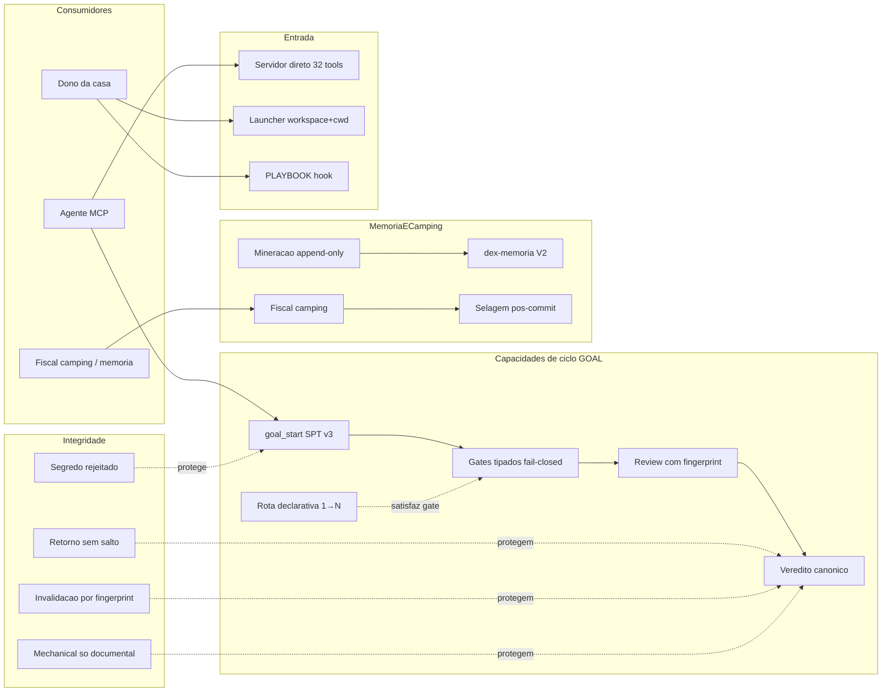

# CAPACITY — Mapa de Capacidades dex-PPIRTV

> Fotografia estática gerada pela skill `dex-mapa-capacidades` no corte
> **commit `947fdb4` (2026-10-18)**. Não é checklist vivo: nova medição exige
> novo pedido/execução da skill. Não editar à mão o veredito das linhas —
> regenerar. Espelho comentado (matriz de 10 colunas com limites por linha):
> `.agents/AUDITORIAS/2026-10-18-mapa-capacidades-947fdb4.md` (local, não
> versionado).

## Identidade da fotografia

| Dimensão | Valor |
| --- | --- |
| Objeto | dex-PPIRTV — servidor MCP executor PPIRTV (goal/flow/gate/evidence/memory) + launcher global + dex-agent local |
| Fotografia/revisão | commit `947fdb4`, suite 666 passed \| 4 skipped, build verde, tools/list 32 ao vivo |
| Ambiente | Windows Server, Node 24.16, workspace `C:\CodexProjetos\dex-PPIRTV`, MCP stdio local |
| Fontes vivas | `dist/index.js` + `dist/launcher.js`, `src/`, `tests/` (44 arquivos), ledger camping (10 records selados), receipts em `.agents/AUDITORIAS/EVIDENCIAS/` |
| Escopo | Capacidades acionáveis por consumidores (agente MCP, dono, casa) |
| Fora de escopo | Skill registry global, projetos consumidores, vNext não decidido |

**Convenção de estado (honestidade)**: `comprovada` = oráculo independente ao
vivo no corte OU suíte dedicada verde; `parcial` = implementada + suíte verde,
sem jornada de consumidor viva no corte; `não comprovada` = sem oráculo no
corte (não é ausência).

## Reavaliação 2026-10-18 — hardening-3 + gate de commit

> Reavaliação do worktree sobre a fotografia `947fdb4`. Não substitui a
> fotografia histórica; registra o delta observado e as limitações antes do
> próximo commit.

| Capacidade | Delta observado | Evidência |
|---|---|---|
| CAP-02 gates tipados | `changed_files`/`deleted_files` agora rejeitam escalar/objeto antes do merge; `[]` bloqueia | probe A/A2, teste R2, suíte 671 |
| CAP-08 invalidação same-path | gate de revisão stale exige `review_current` e review estruturada atual; claims-only não reabre | probe B, teste R3 |
| CAP-11 mechanical documental | veredito corrobora `changed_files` contra o diff Git real; sem `.git` a limitação é declarada | teste R6 Git; probe G no-Git documentado |
| CAP-16 fiscal camping | visita CONTAIN PASS; `FE-DEBT-003` aberto para extrair a cola restante | `npm run check:flow-engine` PASS |
| CAP-17 selagem pós-commit | `598ae5d` per-commit continua FAIL por selagem em `76e9c94`; exceção documentada | replay per-commit/cumulativo |
| CAP-33 gate de capacidades | novo `npm run check:capacity` + hook pre-commit bloqueiam commit com arquivos de capacidade sem reavaliação | script e hook desta visita |
| CAP-34 help/schema/usage por tool | `--describe/--schema/--usage` no harness listam a tool sem invocá-la | `tests/mcp-tool-describe.test.ts` 3/3 |

**Evidência do corte:** `npm run check` 674 passed | 4 skipped; build verde;
`check:flow-engine` PASS CONTAIN; `tests/gate-integrity-hardening-3.test.ts`
4/4; `tests/capacity-gate.test.ts` 1/1; `tests/mcp-tool-describe.test.ts`
3/3; `npm run check:capacity` PASS; probes A/A2/B/C/D/E/F/G. **Limitações:** R5 permanece decisão documentada
(evidence genérico aceita `criterion_proof`; review stale é contido por R3);
R7 per-commit é exceção documentada; sem `.git` não há corroboração de diff.
`FE-DEBT-003` aberto. A pendência P0
`PPIRTV-GATE-INTEGRITY-REVALIDATION-2026-10-18` continua **aberta**.

## Matriz de capacidades

| ID | Capacidade | Estado | Oráculo que decidiu |
|---|---|---|---|
| CAP-01 | goal_start com SPT v3 (binding, idempotência, revalidação, guard de segredo nos risks do contrato) | **comprovada** | Cerimônia viva + probe runtime rejeitou segredo em `spt.risks` |
| CAP-02 | Gates de fase tipados fail-closed (R2/R10) | **comprovada** | Bateria 13/13 — `[]`/`"false"`/`0`/`{}` rejeitados |
| CAP-03 | Diagnóstico `field/received/expected` no preflight (R8) | **comprovada** | Teste R8 + probe dist devolveu o diagnóstico real |
| CAP-04 | Retorno sem salto para frente (R1; mesma fase = regresso fiscal legal) | **comprovada** | Bateria R1 + 3 testes legados vivos verdes |
| CAP-05 | Veredito canônico com cobertura de critérios | **comprovada** | Jornada viva: 1ª tentativa reprovada (C-2/C-4/C-6); 2ª com 20 ids passou |
| CAP-06 | Rota declarativa `declarative_proof` 1→N | **comprovada** | 20 criterion_proofs criados; quickstart §Declarative route |
| CAP-07 | Review estrutural com fingerprint + cobertura integral de changed_files | **comprovada** | Review parcial 5/11 rejeitada ao vivo; integral passou |
| CAP-08 | Invalidação de gates por fingerprint same-path (R3) | **comprovada** | Bateria R3 (bloqueio) + não-regressão (reuse legítimo) |
| CAP-09 | Fluxo manual legado sem goal_binding | **comprovada** | Teste legacy verde (nível suíte) |
| CAP-10 | Segredo rejeitado antes de persistir | **comprovada** | Bateria R4 ×3 portas + flow JSON limpo conferido |
| CAP-11 | Fast-track mechanical só para diff documental (R6, allowlist invertida) | **comprovada** | Veredito mechanical com `scripts/deploy`/`Makefile` reprovado |
| CAP-12 | Mineração append-only + idempotência no ledger | **comprovada** | 3 eventos `memory_mined` no corte (pré+pós-veredito idêntico anexou) |
| CAP-13 | Resolução de candidatos de memória | **comprovada** | Recibo MGL (descarte com rationale) + suíte |
| CAP-14 | Integração dex-memoria V2 (receipts COMMITTED) | **comprovada** | 2 receipts reais; L1↔L2 confirmado |
| CAP-15 | Seletor de memória (bins + probe) | **parcial** | e2e 12 verdes + bins; sem jornada viva no corte |
| CAP-16 | Fiscal camping (SHRINK/CONTAIN/EXCEPTION + ledger + markers) | **comprovada** | Replays PASS; EXCEPTION de integridade aceita |
| CAP-17 | Selagem pós-commit de records (R7) | **comprovada** | Probe adversarial: selagem mentirosa REPROVA; record selado no commit |
| CAP-18 | Replay cumulativo em cadeia (`5e7d5df..HEAD`) | **comprovada** | PASS com cadeia de 4 records |
| CAP-19 | Servidor direto stdio (`dist/index.js`) | **comprovada** | `tools/list` real: 32 tools com schemas |
| CAP-20 | Launcher global com contrato workspace+cwd | **comprovada** | Sem sinal → erro tipado; com sinal → `ok:true` (2 oráculos) |
| CAP-21 | runtime_probe | **comprovada** | Presente em toda chamada de harness |
| CAP-22 | ppirtv_trace / arqueologia evolutiva | **parcial** | Suíte verde; sem consumo vivo no corte |
| CAP-23 | spt_validate standalone | **parcial** | Suíte verde; no corte só via revalidação interna do goal_start |
| CAP-24 | Reuniões / required_cooperation | **parcial** | Suíte verde; sem reunião viva no corte |
| CAP-25 | hygiene_scan / lixeira com manifesto | **parcial** | Suíte verde; sem scan vivo no corte |
| CAP-26 | mm_pipeline_run (orquestração em lote) | **parcial** | Suíte verde; missão do corte foi single-flow |
| CAP-27 | ppirtv_checkout | **parcial** | Suíte verde; fechamento do corte usou goal_status |
| CAP-28 | checklist_render (fluxo visual) | **parcial** | Tool viva no tools/list; sem render no corte |
| CAP-29 | Documentação publicada achável | **parcial** | Estrutural (INDEX + rotas AGENTS); link-checker não executado |
| CAP-30 | PLAYBOOK projeção externa + hook anti-drift | **comprovada** | Hook FRESCO nos commits do corte |
| CAP-31 | Versioning/snapshot de produto | **não comprovada** | Estritamente documental; sem decisão de versão no corte |
| CAP-32 | Dex Agent Telegram (áudio/proativo) | **comprovada** | Receipts reais messageId 879/880 (print não exercitado) |
| CAP-33 | Gate de reavaliação de capacidades antes de commit | **comprovada** | `npm run check:capacity` + hook pre-commit desta visita |
| CAP-34 | Help/schema/usage read-only por tool MCP | **comprovada** | `--describe/--schema/--usage` + `tests/mcp-tool-describe.test.ts` |

## Mapa relacional estático

## Laudo

- **17 comprovadas com oráculo vivo**, **9 parciais** (implementadas + suíte
  666 verde, sem consumidor real acionando no corte), **1 não comprovada**
  (versioning — documental).
- **Endurecidas/novas no corte**: CAP-03, CAP-07, CAP-08, CAP-11, CAP-17 —
  todas com RED causal preservado antes do fix.
- **Nota estrutural honesta**: `flow-engine.ts` fechou o corte +12 linhas
  não-vazias (EXCEPTION de integridade no ledger, expira no próximo diff);
  dívidas do ledger zeradas; 4 testes skipped (condicionais de ambiente) não
  investigados.

## Limites da medição

- Fotografia estática em `947fdb4`; não acompanha mudanças posteriores.
- Oráculo "vivo" = exercício real na sessão do corte; capacidades parciais
  têm só oráculo de suíte (declarado por linha).
- `não comprovada` não é ausência de capacidade.