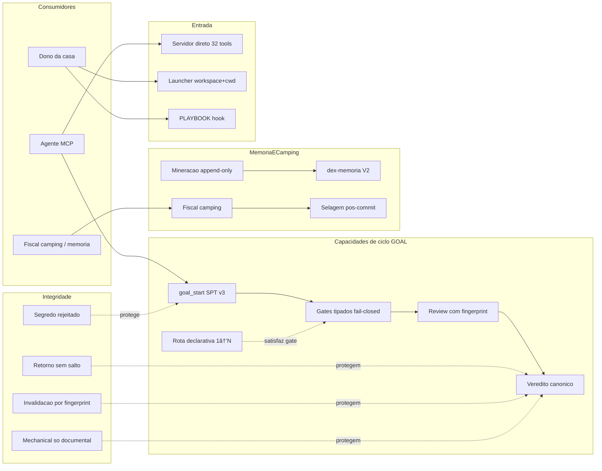

# CAPACITY — Mapa de Capacidades dex-PPIRTV

> Fotografia estática gerada pela skill `dex-mapa-capacidades` no corte
> **commit `947fdb4` (2026-10-18)**. Não é checklist vivo: nova medição exige
> novo pedido/execução da skill. Não editar à mão o veredito das linhas —
> regenerar. Espelho comentado (matriz de 10 colunas com limites por linha):
> `.agents/AUDITORIAS/2026-10-18-mapa-capacidades-947fdb4.md` (local, não
> versionado).

## Identidade da fotografia

| Dimensão | Valor |
| --- | --- |
| Objeto | dex-PPIRTV — servidor MCP executor PPIRTV (goal/flow/gate/evidence/memory) + launcher global + dex-agent local |
| Fotografia/revisão | commit `947fdb4`, suite 666 passed \| 4 skipped, build verde, tools/list 32 ao vivo |
| Ambiente | Windows Server, Node 24.16, workspace `C:\CodexProjetos\dex-PPIRTV`, MCP stdio local |
| Fontes vivas | `dist/index.js` + `dist/launcher.js`, `src/`, `tests/` (44 arquivos), ledger camping (10 records selados), receipts em `.agents/AUDITORIAS/EVIDENCIAS/` |
| Escopo | Capacidades acionáveis por consumidores (agente MCP, dono, casa) |
| Fora de escopo | Skill registry global, projetos consumidores, vNext não decidido |

**Convenção de estado (honestidade)**: `comprovada` = oráculo independente ao
vivo no corte OU suíte dedicada verde; `parcial` = implementada + suíte verde,
sem jornada de consumidor viva no corte; `não comprovada` = sem oráculo no
corte (não é ausência).

## Reavaliação 2026-10-26 — fechamento hardening-3 + rito P0 (docs-only, zero src)

> Commit de fechamento de governanca: pendencia P0 `PPIRTV-GATE-INTEGRITY-REVALIDATION-2026-10-18` consumida com prova (probe A-F v2 black-box MCP 6/6 no HEAD 113713a; camping cumulativo PASS x2 nas bases 5e7d5df/067d975; suites 17/17; `pendencias.py --valida` VALIDO); flow `flow_20261018140649700_2948_0001` COMPLETE com veredito `pronto_com_ressalvas`; CHANGELOG/laudo Addendum 22/REVIEWS INDEX/Trilho/ACTIVE/HANDOFF reconciliados. Nenhuma capacidade de produto mudou (0 capability files; gate PASS 34 capabilities); fotografia `947fdb4` segue vigente; receipt atualizado apenas em `generated_at`.
## Reavaliação 2026-10-23 — snapshot fantasma: sensível de runtime de terceiro é redigido, nunca bloqueia

> GO do dono 2026-10-23, cura da pendência PPIRTV-VEREDITO-TERMINAL-GATES-
> SNAPSHOT-FANTASMA (flows 0568/0602 do workspace jev travados em
> `REVIEW_SNAPSHOT_SENSITIVE_PATH: .codex/config.toml`). Diagnóstico com
> evidência: o guarda (sensível por nome, desde f9a63f1) estava certo, mas a
> fronteira errada — `GIT_CORROBORATION_EXCLUDED_PREFIXES` (l.101) cobria
> .git/.ppirtv/.agents e NÃO os dot-dirs de runtime de outros hosts; e o
> merge não-filtrado foi PERSISTIDO no changed_files do flow (416 paths no
> 0568, o universo untracked inteiro), de modo que remover o arquivo do
> disco não curava e reiniciar o servidor tampouco. Delta do corte
> (review-snapshot.ts + error-envelope.ts + testes; flow-engine.ts
> intocado): (1) prefixos += `.codex/`, `.zcode/` (ruído automático de
> runtime de qualquer host nunca entra pela corroboração); (2)
> `fingerprintReviewedImplementation` REDIGE path sensível sob prefixo de
> runtime como entrada `{state: "redacted_runtime"}` (conteúdo NUNCA lido
> nem hasheado) em vez de lançar — cura flows já envenenados sem restart e
> sem cirurgia; sensível FORA de runtime dir (`.env`, `.npmrc`, `config.toml`
> de produto na raiz, `vendor/*/.git/config`) continua fail-closed; (3)
> envelope REVIEW_SNAPSHOT_PATH_INVALID ensina a causa real e a rota (path
> de terceiro corroborado; tirar do workspace/changed_files). Provas: RED
> 2/3 falhas antes do fix; suite 716|4 (pós-rodada); probe da vítima real — fingerprint
> do flow 0568 com os 416 paths persistidos (incluindo .codex/config.toml)
> computa SEM throw no build novo; teste de independência prova que o
> conteúdo redigido nunca altera o hash. Contrato atualizado: `.git/config`
> na raiz passa a ser redigido (ruído de runtime), teste gate-resolution
> ajustado com comentário. Base `ba6bb85`. RODADA ADVERSARIAL (1, fixes
> aplicados antes do push): redação vale para TODO path sob prefixo de
> runtime após resolução lexical (não só sensível-por-nome) — cura também o
> modo strict do attach de review (REVIEW_SNAPSHOT_FILE_REQUIRED por path
> runtime ausente morre; vítima 0568 resolve em strict), impede
> leitura/hash de runtime não-sensível (.zcode/), fecha o traversal
> .codex/../.env (fail-closed de produto preservado) e despirra aspas
> literais de path persistido sujo (família input-unwrap). Suite 716|4;
> description de goal_verdict atualizada. Selagem: Trilho CONCLUÍDO,
commit e533f6a PUSHED; vítima 0568 provada em modo strict; ação consumidor
= fleet update do jev + reanexar review.

## Reavaliação 2026-10-21 — fiscal auto-ressalva: required_cooperation ensina a receita e review_required lidera o composto

> GO do dono 2026-10-21 ("menor corte possível com o maior ganho, sem
> reinventar a roda") para a trava recorrente de 10 meses do blocker
> `required_cooperation`. Delta deste corte (texto/schema/contrato/teste —
> zero mudança de lógica do gate; `src/flow-engine.ts` intocado):
> (1) `src/error-envelope.ts` — a sequência ensinada (`meetingSequence`)
> agora carrega `satisfies_blockers: ["required_cooperation"]` +
> `participants_present` no passo da `goal_meeting_close` e `evidence_ids`
> no verdict, o reason da branch `register_required_cooperation` ensina a
> receita literal (close com satisfies_blockers + participantes + verdict
> com meeting_id/evidence_ids; preencher apenas cooperators não satisfaz) e
> nasce a branch `attach_structural_review_before_meetings` como PRIMEIRA:
> no bloqueio composto, `review_required` lidera (goal_status full →
> evidence_add kind code_review espelhando `reviewRequiredSequence` do
> engine, com scope_classification/scope_reference e arrays de substituição
> não vazios + fingerprint vigente → goal_meeting_open → close com
> participants_present/satisfies_blockers → verdict com
> evidence_ids/meeting_id); no review puro, verdict SEM meeting_id;
> (2) `src/server.ts` — description viva de `goal_meeting_close` ensina a
> receita, `satisfies_blockers` ganha `.describe()`
> (`INPUT_FIELD_DESCRIPTIONS`) e o branch `provide_meeting_id_for_verdict`
> do `classifyToolError` respeita a liderança do review_required; (3)
> contrato `GOAL_SPT_CANONICAL_CONTRACT.md` (global+local,
> `audit:canonical` verde) ganha o bullet da forma de satisfação +
> liderança do composto + pointer para GOAL_EXECUTION_BRIDGE; (4)
> `tests/error-envelope.test.ts` com asserts literais (RED provado: 3
> novos falharam antes do fix) + rodada de correção da revisão adversarial
> em 2 voltas (F1 open ausente, F2 participants_present, F3 payload sem scope_*, F4
> evidence_ids, F5 precedência sobre attempt-branches, F6 guarda no server,
> F7 fixture alinhado ao schema vivo, F8 meeting_id no review puro, F4-residual da rodada 2: rationale
> com o literal "cooperacao material" rearma o blocker no verdict
> (positiveMeetingTrigger flow-engine l.5179) — rationales neutralizadas +
> teste de regressão travando os literais).
> Provas: suite 711 passed | 4 skipped (54 arquivos);
> `audit-error-envelope` 33 famílias / 0 sem rota / 8 sequências válidas
> contra schema vivo; probe MCP stdio `tools/list` 7/7 PASS. Base `424b1ca`.

## Reavaliação 2026-10-18 — frentes 2 e 3: unwrap profundo + leitura que responde + SHRINK FE-DEBT-001

> GO do dono após auditoria por print (pedido × entendimento × entrega).
> Causa-raiz do loop eterno do consumidor decifrada no código: o flow velho
> persistiu `gates[implementacao].provided.changed_files` com elementos
> `{"value": X}` e o `goal_status` compact/full rejoga esse provided no
> `checkGate`, onde `strictPathArray` lançava DENTRO da tool de leitura.
> Entregue: (1) `src/input-unwrap.ts` novo — desembrulho profundo (arrays e
> objetos aninhados, teto de profundidade) no ponto único da fronteira para
> TODAS as tools + `sanitizePersistedProvided` (replay de dado persistido
> sujo é saneado; drop nunca adiciona satisfação — fail-closed honesto);
> (2) as tools de diagnóstico com handler tolerante (`goal_status`,
> `flow_status`) nunca rejeitam por forma na fronteira; as demais mantêm o
> envelope ensinante com rota (identificação com referência, não loop); (3) `normalizeReviewPathForPlatform` tolera não-string e o
> helper `unique` do monolito descarta não-strings legados (fim do
> `value.trim is not a function`/`[object object]` críptico); (4) visita
> SHRINK ao monolito paga FE-DEBT-001: classificadores de `spt_path`
> migram para `src/spt-path-diagnostics.ts`. Critério de aceite = replay do
> transcript real do consumidor: `tests/consumer-replay-jumper.test.ts` 4/4
> (RED provado antes do fix) + `tests/input-unwrap.test.ts` 9/9;
> `npm run check:flow-engine` PASS modo SHRINK. Prova estendida aos três modos de `detail` (lean default, compact e full) no mesmo flow sujo. Selado no commit `9a96e92`
> (blobs conferidos: base `c01421a` → head `cb629ce`).

## Reavaliação 2026-10-18 — fronteira de input nunca bloqueante (unwrap + ressalvas)

> Diretiva do dono: problema vai ocorrer com 100% de certeza; quando ocorrer,
> é identificado e NUNCA bloqueante — ressalva com referência do local.
> Implementado no desenho mínimo (ponytail + chato + jev-gate-principios):
> (1) `unwrapClientValueWrappers` (12 linhas) no override de
> `validateToolInput` — o artefato de cliente `{"value": X}` é desembrulhado
> em UM ponto para TODAS as tools e campos de topo (laudo consumidor jumper:
> 14 retries); (2) `src/review-input.ts` (92 linhas, extraído do monolito,
> −83 em `src/server.ts`): unwrap de domínio nas 6 chaves de review +
> validador que agora gera `review_input_ressalvas` no receipt em vez de
> `PPIRTV_INPUT_INVALID` bloqueante; o gate de veredito segue fail-closed no
> substancial. Provas: `tests/review-input.test.ts` 3/3,
> `tests/evidence-add-review-wire.test.ts` 5/5 (RED provado contra dist
> antigo), `tests/mcp-tool-describe.test.ts` com frases literais do novo
> contrato; suíte 691 passed | 4 skipped.

## Reavaliação 2026-10-18 — contratos de corroboração documentados no help vivo

> `goal_start` e `goal_verdict` descriptions agora ensinam `git_head_base`
> congelado, `git diff base..HEAD`, fail-closed em base órfã e a rota de
> resolução de `review_required` (evidence_add com as 6 flat keys). Fonte
> única: `tools/list` — `--help/--schema/--usage/--describe/--list` do
> entrypoint e do harness herdam a mesma description (OCP: um ponto de
> escrita, todos os canais). Prova documental:
> `tests/mcp-tool-describe.test.ts` 4/4 (novo assert de frases);
> probes ao vivo nos 5 modos; suíte 686 passed | 4 skipped.

## Reavaliação 2026-10-18 — corroboration por commit (NOVO-1/NOVO-2) + SHRINK FE-DEBT-003

> `goal_start` congela `git_head_base`; `goal_verdict` corrobora COMMITS via
> `git diff base..HEAD` (fail-closed em base orfa exige review) e runtime
> `.git/`/`.ppirtv/`/`.agents/` sai do ruído de corroboration.
> `flowWithCurrentImplementationFingerprint` deixa o monolito (SHRINK paga
> `FE-DEBT-003`; camping PASS SHRINK). RED-first:
> `tests/git-corroboration-commits.test.ts` 4/4 (burla commit-then-verdict
> NOVO-1 reprovada; doc-only legítimo NOVO-2 aceito; base orfa fail-closed);
> probes MCP H3 3/3 (laudo adendo 3); suíte 685 passed | 4 skipped.
> Limitação declarada: flow iniciado SEM git não tem baseline — corroboração
> por commit só existe quando o repo preexiste ao primeiro binding.

## Reavaliação 2026-10-18 — hardening-3 + gate de commit

> Recibo canônico machine-readable: [CAPACITY.receipt.json](CAPACITY.receipt.json)
> (`dex.capacity.snapshot.v1`). A matriz abaixo é a vista humana; o gate lê o
> recibo e exige ambos staged antes do commit.

> Reavaliação do worktree sobre a fotografia `947fdb4`. Não substitui a
> fotografia histórica; registra o delta observado e as limitações antes do
> próximo commit.

| Capacidade | Delta observado | Evidência |
|---|---|---|
| CAP-02 gates tipados | `changed_files`/`deleted_files` agora rejeitam escalar/objeto antes do merge; `[]` bloqueia | probe A/A2, teste R2, suíte 679 |
| CAP-08 invalidação same-path | gate de revisão stale exige `review_current` e review estruturada atual; claims-only não reabre | probe B, teste R3 |
| CAP-11 mechanical documental | veredito corrobora `changed_files` contra o diff Git real E commits via `git diff base..HEAD` (base congelada no primeiro `goal_start`; base orfa fail-closed); sem `.git` no start a limitação é declarada | tests/git-corroboration-commits.test.ts 4/4; probes H3 3/3 |
| CAP-16 fiscal camping | visita CONTAIN PASS; `FE-DEBT-003` aberto para extrair a cola restante | `npm run check:flow-engine` PASS |
| CAP-17 selagem pós-commit | `598ae5d` per-commit continua FAIL por selagem em `76e9c94`; exceção documentada | replay per-commit/cumulativo |
| CAP-07 scaffold de review | server boundary remove `[object Object]`/nao-string de `reviewed_targets`/`scope_reference` e cai para placeholder | `tests/server-review-scaffold.test.ts` 2/2 |
| CAP-33 gate de capacidades | `CAPACITY.receipt.json` é a fonte canônica; hook bloqueia commit sem receipt + vista humana staged | `tests/capacity-gate.test.ts` 1/1 + `tests/capacity-receipt.test.ts` 1/1 |
| CAP-34 help/schema/usage por tool | `--describe/--schema/--usage` funcionam no `dist/index.js` e no harness; sem tool falham com help, sem hang | `tests/tool-cli-entrypoint.test.ts` 4/4 + `tests/mcp-tool-describe.test.ts` 3/3 |

**Evidência do corte:** `npm run check` 681 passed | 4 skipped; build verde;
`check:flow-engine` PASS CONTAIN; `tests/gate-integrity-hardening-3.test.ts`
4/4; `tests/capacity-gate.test.ts` 1/1; `tests/mcp-tool-describe.test.ts`
3/3; `tests/tool-cli-entrypoint.test.ts` 4/4; `tests/server-review-scaffold.test.ts`
2/2; `tests/capacity-receipt.test.ts` 1/1;
`npm run check:capacity` PASS;
probes A/A2/B/C/D/E/F/G. A matriz completa herda o espelho 947fdb4; o delta
revalidou CAP-02/08/11/16/17/33/34. **Limitações:** R5 permanece decisão documentada
(evidence genérico aceita `criterion_proof`; review stale é contido por R3);
R7 per-commit é exceção documentada; sem `.git` não há corroboração de diff.
`FE-DEBT-003` aberto. A pendência P0
`PPIRTV-GATE-INTEGRITY-REVALIDATION-2026-10-18` continua **aberta**.

## Matriz de capacidades

| ID | Capacidade | Estado | Oráculo que decidiu |
|---|---|---|---|
| CAP-01 | goal_start com SPT v3 (binding, idempotência, revalidação, guard de segredo nos risks do contrato) | **comprovada** | Cerimônia viva + probe runtime rejeitou segredo em `spt.risks` |
| CAP-02 | Gates de fase tipados fail-closed (R2/R10) | **comprovada** | Bateria 13/13 — `[]`/`"false"`/`0`/`{}` rejeitados |
| CAP-03 | Diagnóstico `field/received/expected` no preflight (R8) | **comprovada** | Teste R8 + probe dist devolveu o diagnóstico real |
| CAP-04 | Retorno sem salto para frente (R1; mesma fase = regresso fiscal legal) | **comprovada** | Bateria R1 + 3 testes legados vivos verdes |
| CAP-05 | Veredito canônico com cobertura de critérios | **comprovada** | Jornada viva: 1ª tentativa reprovada (C-2/C-4/C-6); 2ª com 20 ids passou |
| CAP-06 | Rota declarativa `declarative_proof` 1→N | **comprovada** | 20 criterion_proofs criados; quickstart §Declarative route |
| CAP-07 | Review estrutural com fingerprint + cobertura integral de changed_files | **comprovada** | Review parcial 5/11 rejeitada ao vivo; integral passou |
| CAP-08 | Invalidação de gates por fingerprint same-path (R3) | **comprovada** | Bateria R3 (bloqueio) + não-regressão (reuse legítimo) |
| CAP-09 | Fluxo manual legado sem goal_binding | **comprovada** | Teste legacy verde (nível suíte) |
| CAP-10 | Segredo rejeitado antes de persistir | **comprovada** | Bateria R4 ×3 portas + flow JSON limpo conferido |
| CAP-11 | Fast-track mechanical só para diff documental (R6, allowlist invertida) | **comprovada** | Veredito mechanical com `scripts/deploy`/`Makefile` reprovado |
| CAP-12 | Mineração append-only + idempotência no ledger | **comprovada** | 3 eventos `memory_mined` no corte (pré+pós-veredito idêntico anexou) |
| CAP-13 | Resolução de candidatos de memória | **comprovada** | Recibo MGL (descarte com rationale) + suíte |
| CAP-14 | Integração dex-memoria V2 (receipts COMMITTED) | **comprovada** | 2 receipts reais; L1↔L2 confirmado |
| CAP-15 | Seletor de memória (bins + probe) | **parcial** | e2e 12 verdes + bins; sem jornada viva no corte |
| CAP-16 | Fiscal camping (SHRINK/CONTAIN/EXCEPTION + ledger + markers) | **comprovada** | Replays PASS; EXCEPTION de integridade aceita |
| CAP-17 | Selagem pós-commit de records (R7) | **comprovada** | Probe adversarial: selagem mentirosa REPROVA; record selado no commit |
| CAP-18 | Replay cumulativo em cadeia (`5e7d5df..HEAD`) | **comprovada** | PASS com cadeia de 4 records |
| CAP-19 | Servidor direto stdio (`dist/index.js`) | **comprovada** | `tools/list` real: 32 tools com schemas |
| CAP-20 | Launcher global com contrato workspace+cwd | **comprovada** | Sem sinal → erro tipado; com sinal → `ok:true` (2 oráculos) |
| CAP-21 | runtime_probe | **comprovada** | Presente em toda chamada de harness |
| CAP-22 | ppirtv_trace / arqueologia evolutiva | **parcial** | Suíte verde; sem consumo vivo no corte |
| CAP-23 | spt_validate standalone | **parcial** | Suíte verde; no corte só via revalidação interna do goal_start |
| CAP-24 | Reuniões / required_cooperation | **parcial** | Suíte verde; sem reunião viva no corte |
| CAP-25 | hygiene_scan / lixeira com manifesto | **parcial** | Suíte verde; sem scan vivo no corte |
| CAP-26 | mm_pipeline_run (orquestração em lote) | **parcial** | Suíte verde; missão do corte foi single-flow |
| CAP-27 | ppirtv_checkout | **parcial** | Suíte verde; fechamento do corte usou goal_status |
| CAP-28 | checklist_render (fluxo visual) | **parcial** | Tool viva no tools/list; sem render no corte |
| CAP-29 | Documentação publicada achável | **parcial** | Estrutural (INDEX + rotas AGENTS); link-checker não executado |
| CAP-30 | PLAYBOOK projeção externa + hook anti-drift | **comprovada** | Hook FRESCO nos commits do corte |
| CAP-31 | Versioning/snapshot de produto | **não comprovada** | Estritamente documental; sem decisão de versão no corte |
| CAP-32 | Dex Agent Telegram (áudio/proativo) | **comprovada** | Receipts reais messageId 879/880 (print não exercitado) |
| CAP-33 | Gate de reavaliação de capacidades antes de commit | **comprovada** | `npm run check:capacity` + hook pre-commit desta visita |
| CAP-34 | Help/schema/usage read-only por tool MCP (entrypoint + harness) | **comprovada** | `dist/index.js --describe/--schema/--usage` + `tests/tool-cli-entrypoint.test.ts` 4/4 |

## Mapa relacional estático

## Laudo

- **17 comprovadas com oráculo vivo**, **9 parciais** (implementadas + suíte
  666 verde, sem consumidor real acionando no corte), **1 não comprovada**
  (versioning — documental).
- **Endurecidas/novas no corte**: CAP-03, CAP-07, CAP-08, CAP-11, CAP-17 —
  todas com RED causal preservado antes do fix.
- **Nota estrutural honesta**: `flow-engine.ts` fechou o corte +12 linhas
  não-vazias (EXCEPTION de integridade no ledger, expira no próximo diff);
  dívidas do ledger zeradas; 4 testes skipped (condicionais de ambiente) não
  investigados.

## Limites da medição

- Fotografia estática em `947fdb4`; não acompanha mudanças posteriores.
- Oráculo "vivo" = exercício real na sessão do corte; capacidades parciais
  têm só oráculo de suíte (declarado por linha).
- `não comprovada` não é ausência de capacidade.