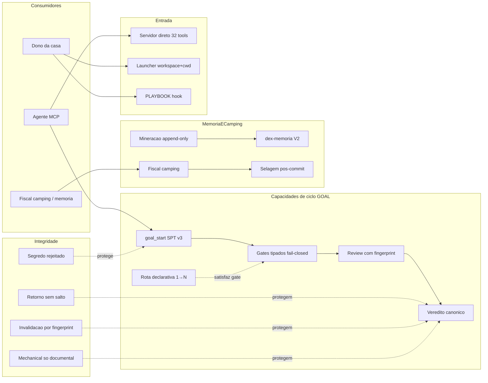

## Reavaliação — ISSUE #17 verdict anuncia mineracao pos-verdict (D-38), 2026-11-11

Capability paths tocados: src/flow-engine.ts (bloco de retorno de
goalVerdictUnlocked: predição requiresPostVerdictMining com o predicado
EXATO hasVerdictAfterLatestMemoryMining sobre flow recarregado pós-verdict +
next_required_action run_memory_mining com reason do ciclo completo —
~19 linhas; camping EXCEPTION integrity record
FE-2026-11-11-ISSUE0017-VERDICT-NEXT-ACTION-MINING-EXCEPTION selado com RED
provado no baseline 9a8d2c2) e src/server.ts (descriptions de goal_verdict e
goal_advance: predição da mineração pós-verdict + memoria_viva_reconciled
atestando o checklist do Trilho vinculado antes da imutabilidade terminal).
Testes: 2 its novos em tests/memory-gate-loop.test.ts (caso RED→GREEN +
controle fase não-terminal) + sentinelas de description em tests/mcp.test.ts.
Suíte 908→910; npm run check exit 0. Guard do advance terminal intocado
(fonte única preservada).

## Reavaliação — ISSUE #15 reconciliação de flows históricos (OPS + emenda + rodada 2), 2026-11-10

RODADA 2 (GO do owner na pergunta da #15): nenhum capability path. +20
arquivamentos administrativos via API (18 stubs externos + 2 SPT ausente)
com motivo citando a classe e a autorização; readback 24 archived pelo
corte / 9 da família 3 preservados para decisão flow-a-flow (lista no
comentário da issue). PLAYBOOK regen pós-rodada2 (ACTIVE/HANDOFF/PLAN-TASKS
atualizados 24 archived / 9 família 3).

EMENDA (commit seguinte): nenhum capability path tocado (ops; adversarial 5
revisores 0P1/4P2/5P3 sem quebra material). Deltas: `CHANGELOG.md` (ponteiros
da prova para o destino perene `.agents/AUDITORIAS/2026-11-10-issue15-verify.py`
— verificador CWD-ancorado por `__file__` + detector de 5º arquivado implícito,
P2s curados e provados verdes de CWD externo) + este par. Suíte 908 inalterada.
PLAYBOOK regen pós-fechamento (ACTIVE/HANDOFF/PLAN-TASKS INDEX da #15).

Capability paths tocados: NENHUM (corte de ops sem src — camping flow-engine
NOT_APPLICABLE por desenho; suíte 908 inalterada re-medida no ciclo). Deltas
do commit: `CHANGELOG.md` (entrada OPS da #15: 4 flows arquivados por
fechamento DOCUMENTAL via `flow_archive` com motivo citando o status do SPT +
readback, evidências/verdicts preservados 9/5/4/17 ev; 29 ambíguos/externos
intactos para decisão do owner; tabela de classificação por flow com evidência
em `.agents/AUDITORIAS/2026-11-10-issue15-reconciliacao-flows.md` — gitignored;
prova executável `.agents/TMP/verify-issue15.py` → 4/4 archived com motivo +
29 intactos, exit 0) e o par CAPACITY deste receipt. Distinção publicada:
fechamento documental ≠ conclusão oficial — mora no motivo de cada
arquivamento. Nenhuma edição manual de arquivo de flow: tudo pela API com
readback (eventos `flow_archived` nos 4; zero eventos nos 29).

## Reavaliação — ISSUE-LOCAL-0007 gerador MM × charset L1 da dex-memoria 0.1.17 (D-37), 2026-11-10

Capability paths tocados: src/memory/dex-memoria-v2-adapter.ts
(`sanitizeCandidateText` exportada — o item da mineração citando shape-MM
`^{slug}-[hash8]$` não pode mais levar `^`/`[`/`]`/CR/LF em title/trigger;
body permanece cru; caso bom sai idêntico), src/memory-promotion.ts
(`freshOperationIdForRetry` — id fresco sufixado `-retry-N` quando o id base
está PRESO: status não-COMMITTED e não-PARTIAL_PENDING; PARTIAL_PENDING
segue o RESUME canônico pelo mesmo id, contrato preservado pela suíte que
PEGOU A REGRESSÃO no primeiro desenho) e src/flow-engine.ts (1 linha de cola
na montagem do operationId; camping fiscal: consulta ao validador antes do
commit). Testes RED-first (adapter charset + engine charset-retry) + 2
achados pagos pela execução: helper partialReceipt assume rota global
(fixture) e sufixo `::` quebra paths de receipt no Windows (":" proibido em
nome de arquivo — ENOENT ao vivo; separador é hífen). PROVA REAL: mineração
com hash no item commitando COMMITTED na dex-memoria 0.1.17 REAL
(`theme=COMMITTED`, receipt mmv2_617f...520e9c8, memory_home temporário
isolado; harness .agents/TMP/prova-real-0007.mjs). Suíte 906→908 (904+4,
files 72).

SELAGEM: record 42 do camping selado com commit ab1c63ea (parent 4326322)
— sem dívida oculta de CONSECUTIVE_EXCEPTION; commit B persiste a selagem.

EMENDA adversarial D-37 (5 revisores, 1P1/2P2/5P3, 3 classes convergentes;
probes de 2 revisores contra o código real; consolidado em
`.agents/TMP/adversarial-issue0007/`): **(P1, contratos+adversário
convergentes)** `freshOperationIdForRetry` REESCRITA por família com contador
no SUFIXO numérico — o primeiro desenho regenerava id já queimado na 3ª
tentativa (loop base↔retry-1; `v2_receipts` é SUBSTITUÍDO por rodada, a
contagem por receipts nunca via o id sufixado) — RED ao vivo no teste de 3
rodadas antes do fix; **(P2)** último PARTIAL_PENDING da família devolve o
MESMO id (resume canônico preservado inclusive em id sufixado — o desenho
antigo perdia o resume na rodada seguinte); **(P2 vocabulário)** o receipt
canônico real é "COMMITTED"|"PARTIAL_PENDING"|"FAILED" — o teste fabricava
"PENDING" (impossível no caminho real; preso real = FAILED): corrigido +
assinatura da função tipada com `Pick<DexMemoriaV2CanonicalReceipt>`;
**(P3s)** guard `DEX_MEMORIA_V2_CANDIDATE_TITLE_EMPTY` no writer (item só de
metacaracteres saneia para vazio — falha perto da causa em vez de
INVALID_CANDIDATE do outro lado do CLI), assert de VALOR do title saneado no
teste adapter (trava vazio/aparado), contadores de suíte "(906+2)" nos 2
arquivos (checklist: decomposição não batia com o diff). Zero flow-engine
na emenda (camping N/A para este diff).

FECHAMENTO: CHANGELOG com emenda + D-37 nos 2 mapas + Trilho CONCLUSAO +
ACTIVE/HANDOFF + TRACKER 0007 FECHADA com receipt da prova real COMMITTED
na 0.1.17 (mmv2_617f...520e9c8) + playbook regen; commits ab1c63e (corte)
+ a804545 (selagem) + b2b58be (emenda) + fechamento. TRACKER local zerado
(0001..0008).

## Reavaliação — ISSUE #16/ISSUE-LOCAL-0008 contrato goal_advance × path inexistente (D-36), 2026-11-10

Capability paths tocados: src/server.ts (apenas a description da tool
goal_advance no tools/list — a frase "an absent changed file without
deleted_files fails closed" mentia sobre o desenho D-31 deliberado de
gate-provided-paths.ts) e tests/mcp.test.ts (NOVO it
contrato-goal-advance-path-inexistente: RED-provado na sentinela ANTES do
fix — caracterização antes da mudança; caso + controle no MESMO advance;
sentinela de classe). Zero motor (gate-provided-paths/flow-engine
intocados; camping N/A). Suíte 905→906 (re-medida: 902 passed + 4 skipped,
files 72).

EMENDA adversarial D-36 (5 revisores, 0P1/4P2/7P3, 2 classes convergentes;
consolidado em .agents/TMP/adversarial-issue16/CONSOLIDADO.md): (P2
adversário, probe MCP real) frase emendada com ESCOPO DE FASE — "when the
implementation gate advances ... (changed_files paths are only inspected
during the implementation gate)": fora de implementacao o receipt não nomeia
(5/6 fases), e a frase herdara a mesma classe de mentira que o corte veio
matar; mesma emenda cobriu o caso diretório ("or not a regular file" —
statSync isFile), a âncora legível (gate.provided_missing_paths) e os
markers negativos do next_step ("such as false/no/null/0/off"). (P2 testes)
caso SOLO por MCP no mesmo it — 2º flow com changed_files único inexistente:
ressalva nomeada, snapshot vazio, fase persistida (a claim "even when it is
the only declared path" agora tem it onde a claim mora). (P2 checklist)
suite.total re-medido no receipt (905→906; classe congelamento paga 2x na
casa). (P3, 3 revisores convergentes) sentinela BIDIRECIONAL —
not.toContain("fails closed") — provada por MUTAÇÃO CASO E (campo citado +
mentira ao lado → RED exato na sentinela; restore → GREEN). (P3 testes)
fail-near: advance de setup asserta phase implementacao antes do advance
alvo. Não-curados deliberados: dedup case-variant da ressalva e resultOf
opaco (motor/harness pré-existentes fora do escopo do corte); vacina de
atualidade do suite.total (corte próprio).

FECHAMENTO: CHANGELOG D-36 + mapas (2) + Trilho CONCLUSAO + TRACKER 0008
com remote_url + #16 fechada online + playbook regen; commits bee93ea
(corte) + 79549cc (emenda) + docs de fechamento.

## Reavaliação — ISSUE-0006 E2E golden-path SPT v3 (D-35), 2026-11-10

Capability paths tocados: tests/goal-lifecycle.e2e.test.ts (NOVO it golden-path
SPT v3 canônico: fixture v3 molde memory-gate-loop com 2 critérios;
addDeclarativeEvidence expande 1 evidência por critério — Evidence.criterion_proof
é SINGULAR; gate revisão bloqueado→review estrutural fp pós-âncora→verde;
verdict pronto citando provas+review; fonte persistida + artefatos no disco). O
it v2 legacy PERMANECE verde (contrato legado aceito). Zero src (camping N/A).
Suíte 904→905 (901+4, files 72).

EMENDA adversarial D-35 (5 revisores, 0P1/3P2/6P3): (P2 mapa = timing — mapa
gravado na mesma entrega, persiste no fechamento); (P2 testes) fail-near —
cada goalAdvance assertado na fase; (P2 receipt, vacina de CLASSE)
`CAPACITY_RECEIPT_GENERATED_AT_STALE_CITED_HEAD` no fiscal (generated_at não
pode preceder a criação do commit head — RED ao vivo pegando o congelamento
de >=2 reavaliações; generated_at agora real); (P3s) `as never` ×2 e cast
flowsDir MORTOS (acesso direto compila — engine satisfaz estruturalmente as
interfaces), asserts fortes (flowId `^flow_`; .sort() na ordem de critérios),
timeout 30s no it. Não-curados deliberados: vocabulário `status` do SPT
(texto livre por desenho — enum é corte de schema próprio), tree_hash
write-tree intermediário (protocolo do gate: confere o STAGED).

FECHAMENTO: superfícies vivas + Trilho CONCLUSAO + TRACKER 0006 (revisão D-30 6/6, TRACKER zerado); generated_at atualizado junto do head ao re-ancorar (vacina em ação).

## Reavaliação — ISSUE-0001+0003 diagnóstico-que-ensina (D-34), 2026-11-09

Capability paths tocados: src/gate-resolution.ts (função pura providedIgnoredKeys
+ PROVIDED_PATH_KEYS — reuso do mapa PROVIDED_REQUIREMENT_KINDS; julga chaves de
provided que nenhum requisito da fase conhece), src/flow-engine.ts (COLA pura:
import + cálculo + spread condicional de provided_ignored no GateRecord —
camping EXCEPTION FE-2026-11-09-ISSUE0001-PROVIDED-IGNORED-EXCEPTION, RED real
baseline 4c693c6), src/domain.ts (GateRecord.provided_ignored? aditivo),
src/review-scope-attribution.ts (filter no lugar do some() nos 2 erros de
escopo + helper de truncagem offending_paths até 10 com contador — molde da
irmã STALE), tests/gate-provided-ignored.test.ts NOVO (2: typo plural nomeado
no receipt sem reprovar; chaves válidas nunca avisadas), tests/
review-scope-offending-paths.test.ts NOVO (3: UNATTRIBUTED nomeia 2 paths,
UNDISCOVERED nomeia, truncagem 12→10 +2 more). Suíte 896→901 (892+5 passed,
4 skipped, files 72). RED-first 1+3 provados no baseline antes das curas.
FECHAMENTO: selagem do record 41 commitada (9ea8ef6); superfícies vivas + TRACKER + mapa D-34; playbook regen (ACTIVE.md é fonte). Suíte medida 904 (900+4, files 72) no check exit 0.

EMENDA adversarial D-34 (5 revisores, 0P1/3P2/7P3, 3 classes convergentes;
probe do adversário no motor real): (P2) PROVIDED_REVIEW_INPUT_KEYS mata o
falso positivo (review_findings/review_artifact_path lidas por
needsReviewCoherence fora do mapa); (P2, 3 revisores) SIMETRIA do preflight —
goal_gate_preflight também emite provided_ignored (cola adicional no motor,
record 41 EXCEPTION integrity); (P3s) paths entre aspas no offending_paths,
amarração PROVIDED_PATH_KEYS×sanitizePersistedProvided por teste, timeout no
git do teste, satisfies Pick real. Suíte 901→904 (897→900 passed, +3 its de
emenda; files 72).

## Reavaliação — ISSUE-0004 tool fantasma no guidance (D-33), 2026-11-09

Capability paths tocados: src/fiscal-blockers.ts (1 linha: blockerOwner
librarian_status memory_recall→ppirtv_checkout, tool REAL do registro —
veredito documental oraculo-clean-code cap2 l.906-920), tests/
fiscal-blockers.integration.test.ts (SENTINELA CONSUMIDA: RED provado ao vivo
quando a cura chegou; teste novo julga a TABELA INTEIRA contra o registro VIVO
de tools do server.ts — nenhuma tool fantasma passa). flow-engine.ts
intocado (camping N/A). Suíte INALTERADA em 896 (892+4, files 70 — a
sentinela foi reescrita 1:1, não somada). EMENDA adversarial (0P1/1P2/6P3):
vacina por CONSTRUÇÃO no teste (pares if/return extraídos por regex + TODO
guidance tool: do módulo varrido contra o registro vivo — mutation probe
do adversário pagou a classe da lista hardcoded).

## Reavaliação — ISSUE-0005 typecheck de tests/ no pipeline (D-32), 2026-11-09

Capability paths tocados: tsconfig.tests.json (NOVO: extends base, noEmit,
lib ES2023, include src+tests), package.json (script check:types entrando no
check ANTES do vitest), scripts/validate-flow-engine-boundary.d.mts (NOVO:
declarações do validador .mjs para o typecheck consumir), tests/ (curadoria
de ~130 erros herdados em 18 arquivos: fixtures completas — Meeting 8 campos,
GoalVerdictInput.next_step, GateRequirement.kind; imports de tipos; as const
dos profiles; casts de envelope dinâmico; ! só em asserts). Baseline RED
congelado (251 linhas tsc, src/ puro 0 — BASELINE-RED.txt reabrível na pasta
de evidências). tsc 0 erros; suíte 896 (892 passed + 4 skipped, files 70)
VERDE sem mudança de comportamento; zero src/*.ts de runtime no corte.
EMENDA adversarial (5 revisores, 0 P1/4 P2/10 P3): receipt suite corrigido
(892+0+4=896, files 70, comando atual — o total 852 e o rótulo "Onda 5"
estavam congelados há 4 cortes; 2aad953 gravou total-como-passed) +
VACINA no fiscal check-capacity.mjs (cruzamento passed+failed+skipped===total,
CAPACITY_RECEIPT_SUITE_TOTAL_MISMATCH); d.mts com vocabulários FECHADOS
espelhados do .mjs (probe provou tsc aceitando mode SHRINKGG) e sem label
fantasma; README com o pipeline real do check; spawn git sem timeout =
duplicata de classe já estacionada (EST ADV-ONDA5).

## Reavaliação — D-31 emenda adversarial: aviso unconfirmed + fronteira envelope + preflight simétrico, 2026-11-09

Capability paths tocados: src/flow-engine.ts (cola pura — julgamento extraído;
nonblank +10, decisões −1), src/gate-provided-paths.ts (NOVO: julgamento de
provided paths — ressalva na nascente, aviso provided_unconfirmed_deletions do
par canônico changed+deleted, fronteira = workspace do envelope, isExistingFile),
src/domain.ts (GateRecord.provided_unconfirmed_deletions?), tests/
(gate-provided-paths.test.ts 4→9: bypass P1 RED no baseline 0c6dda9 + sem-binding
+ diretório + preflight + V5 documental; asserts reforçados: status passed,
envelope.workspace, ressalva sem deleted legítimo). Camping EXCEPTION integrity
(record 39; 38 selado com commit 0c6dda9 + parent 7c76632). Suíte 891→896.
Limits vigentes: existsSync→statSync isFile NO workspace do envelope; SEM
envelope a ressalva fica ausente (nunca CWD do servidor); par changed+deleted
simultâneo entra por atestação com aviso quando não confirmável (indistinguível
de deleção real no disco — decisão documental cap7/cap8).

## Reavaliação — D-31 ISSUE-0002: ressalva provided_missing_paths + expurgo da union, 2026-11-09

Capability paths tocados: src/flow-engine.ts (gate implementacao: union só com
paths existentes + ressalva provided_missing_paths no GateRecord + expurgo por
deleted_files com assert pré-expurgo), src/domain.ts (GateRecord.provided_missing_paths?),
tests/ (+1 arquivo gate-provided-paths.test.ts, 4 testes RED-first; expurgo literal
testado e rejeitado com regresso medido — #6 preservado). Camping EXCEPTION
urgent_hotfix (record 38, RED real baseline 7c76632). Suíte 887→891.

## Reavaliação — D-30 emenda 3: receipt re-ancorado + missing_context, 2026-11-09

Consolidado automático da adversarial completou (22 agrupados): P2 do receipt
(head/tree_hash congelados — mesma classe da Onda 5) curado com âncoras reais
write-tree; P3 missing_context exercitado (ramo 3 faltantes); E2E v3
estacionado; acentuação/freeze declarados não-curados deliberados. Suíte 887.

## Reavaliação — Testes de integração dos 4 módulos de política + E2E golden-path, 2026-11-09

Capability paths tocados: tests/ (+6 arquivos: helper fixture + 4 suítes
integration + 1 e2e; 35 testes novos após emendas adversariais). Cobertura
direta onde era indireta: meeting-policy/fiscal-blockers/ppirtv-checkin/
memory-promotion agora com consumidor de teste próprio; E2E do ciclo completo
(start→advances reais→gate/review→status→verdict) com artefatos persistidos
conferidos no disco + idempotência. Vigília provada por mutação 5/5 (RED +
revert imediato, src/ byte-igual). Emendas adversariais (5 revisores, veredito
$oraculo-clean-code): fixture completa SEM casts + tsc strict pontual LIMPO,
E2E pela máquina de estados (3 goalAdvance), formas fechadas, sentinelas de
bugs conhecidos (tool fantasma librarian_status, falso-positivo rodoviaria).
Zero src/ no corte final. Suíte 852→887 (medido: 883 passed + 4 skipped).

## Reavaliação — Mapa de decisões público FLOW_ENGINE_DECISIONS_MAP, 2026-11-09

Documental: docs/architecture/FLOW_ENGINE_DECISIONS_MAP.md (projeção pública
versionada do mapa D-01..D-29; tabela dúvida-comum→decisão + L1/L2 `rg "D-xx"`
para consumo por LLM). Publicação completa: README + docs/INDEX (2 seções) +
docs/architecture/INDEX + AGENTS (rota) + INDEX raiz; PLAYBOOK regen (AGENTS é
fonte). Zero src; fotografia interna .agents/MAPAS/261109b não versiona por design.

## Reavaliação — Rodada documental pós-maratona, 2026-11-09

Documental: src/INDEX.md + netos memory/security (mapa de código local por
design do gitignore), INDEX raiz em árvore, README roteia o mapa, fix links
MAPAS. Validado check-markdown-links (doc viva limpa). Zero src.

## Reavaliação — Onda 7 emenda: adversarial 0 P1/3 P2/7 P3 — contagens 5341/−408, 2026-11-09

Owner $oraculo-refatoracao (mesma sessão, flow 3952): baseline real 601c8ac =
5341L (linha fantasma do split pela 3ª vez — o número da prosa veio do script
de corte, não do wc -l), delta −408L; range l.4837-5268; claim errorMessage
qualificado (2 cópias privadas pré-existentes em memory/ ficam). Zero mudança
de código (emenda documental). Estacionados: testes diretos dos 33 símbolos +
seletor mcp.test no record (tio-testador); robustez pré-existente fiel.

## Reavaliação — selagem pós-commit da Onda 7 (última), 2026-11-09

Documental: record FE-2026-11-09-ONDA7-MEMORY-PROMOTION-SHRINK selado no
ledger (commit=c99ef481, parent=601c8aca) após push do corte; janela
acumulada defacc1→c99ef48 (emenda 3ff6d7e + playbook + corte). Suíte e
receipts unchanged (852). Zero src no commit (ledger + par CAPACITY).

## Reavaliação — Onda 7 (ÚLTIMA): eixo memory-v2/promotion fora do monólito, 2026-11-09

Owner $oraculo-refatoracao (Trilho onda7-memory-promotion, flow 3952; GO único
do dono — última família da maratona): 33 símbolos (32 funcs + 1 type) →
src/memory-promotion.ts (458L); errorMessage → lang-utils (fonte única);
motor 5342→4933 (−409L) com zero símbolo novo; suíte 848+4=852 SEM editar
teste; tsc 0; vacina TOTAL pegou 9 mortos antes do commit (6 do corte + 3 de
linhas únicas). Camping SHRINK com janela acumulada defacc1→corte. Maratona
de famílias ENCERRA aqui; resta núcleo de orquestração por desenho.

## Reavaliação — Onda 6 emenda: adversarial 0 P1/3 P2/10 P3 — 42 imports mortos, 2026-11-09

Emenda documental adicional: projeção PLAYBOOK regen commitada (fontes
napkin/ACTIVE da Onda 6; worktree limpo para a corroboração do verdict).
Suíte/receipts unchanged (852).

Owner $oraculo-refatoracao (mesma sessão, flow 3917; mesa QUESTIONADORES-ATIVADO):
vacina anti-import-morto revelou que só varria o bloco NOVO — 8 mortificados
pelo corte + 34 acumulados das Ondas 1-5 = **42 cortados**; monólito
5503→5341; tsc 0; suíte 848+4=852 sem editar teste. Contagens reconciliadas
(baseline 6155 real; import 12 símbolos; msg b5d5f95: 23 imports, não 25).
`__stash__` do record selado documentado no EVOLUTION.md (imutável pós-selo).
Estacionados: testes diretos (tio-testador), invariante parent→base_blob
(Trilho futuro), README stale.

## Reavaliação — selagem pós-commit da Onda 6, 2026-11-09

Documental: record FE-2026-11-09-ONDA6-PPIRTV-CHECKIN-SHRINK selado no ledger
(commit=defacc1f1, parent=b5d5f9514) após push do corte; janela acumulada
e0ec9d1..cobre emenda b5d5f95 (imports) + corte defacc1. Suíte/receipts
unchanged (852). Zero src no commit (ledger + par CAPACITY).

## Reavaliação — Onda 6: check-in/check-out PPIRTV fora do monólito, 2026-11-09

Owner $oraculo-refatoracao (Trilho onda6-ppirtv-checkin, flow 3917; GO único
do dono, mesa QUESTIONADORES-ATIVADO, RESPIRA-ANTES-DE-CODAR): 23 funções + 2
consts (check-in/out + accountability + evidence-quality + work-progress +
memoryMiningStatus) → src/ppirtv-checkin.ts (696L); bloco autônomo (zero
função não-migrante consumida, probe pré-corte); motor 6156→5503 (−652L
líquido) com zero símbolo novo; suíte 848+4=852 SEM editar teste; tsc 0.
Vacina Onda 5 paga no primeiro uso: varredura anti-import-morto pegou 2
mortos ANTES do commit. Camping SHRINK. Ficam: memory-v2/promotion (onda
futura) e utils do motor.

## Reavaliação — Onda 5 emenda: adversarial 0 P1/2 P2/8 P3 curada no corte, 2026-11-09

Owner $oraculo-refatoracao (mesma sessão, flow 3874): **P2 receipt re-ancorado**
(head=87981d9 + tree_hash=6cba77f5 write-tree da árvore staged medida pela
suíte 848+4=852; antes congelado em db823f1 há 4 receipts); **25 imports
mortos cortados** (15 monólito + 10 módulo — tsc não flagrava sem noUnusedLocals);
**contagens reconciliadas por medição**: baseline real 7071L → **−901L**;
50 símbolos movidos (44 selo AST + 2 consts + 4 tipos). Estacionados: teste
direto do módulo (tio-testador), tautologia expect(true) na fixture RED,
spawn git sem timeout, asserts fracos.

## Reavaliação — selagem pós-commit da Onda 5, 2026-11-09

Documental: record FE-2026-11-09-ONDA5-FISCAL-BLOCKERS-SHRINK selado no
ledger de camping (commit=e0ec9d17, parent=db823f1d) após push do corte;
suíte e receipts unchanged (852). Zero src no commit (docs + par CAPACITY).

## Reavaliação — Onda 5: diagnóstico de bloqueio fiscal fora do monólito, 2026-11-09

Owner $oraculo-refatoracao (Trilho onda5-fiscal-blockers, flow 3874; GO único
do dono, régua ESCOTEIRO-ONDA): ~48 símbolos (librarian/blocker-diagnostics/
memory-mining-blocked/ações diretas/loop) → src/fiscal-blockers.ts (995L);
requireText/nowIso → lang-utils (fonte única). Motor 7072→6170 (−902L) com
zero símbolo novo; suíte 848+4=852 SEM editar teste; tsc 0 erros. Camping
SHRINK. Ficam: avaliação (evaluateFiscalPolicy), check-in/graphify,
promotion-scope (eixos futuros).

## Reavaliação — Cura-6 emenda: P1 da adversarial curado (grandfathering) + P3s, 2026-11-09

Owner $oraculo-refatoracao (mesma sessão, mesa QUESTIONADORES-ATIVADO): P1
convergente de 3 revisores (birthRecords re-julgava selos legados sem
parent_commit — probes reais 4bf8aab..HEAD com 5-15 COMMIT_SEAL_PARENT_MISSING
falsos) CURADO com RED F + grandfathering por selo já commitado no manifest do
HEAD (committedSealKeys id+commit; nascimento = selo ainda não commitado);
probe real pós-fix: 0 falsos. P3 pago no mesmo corte: cat-file do chain com
blob loose (LEDGER_CHAIN_BLOB_UNREADABLE estruturado), record.id ??
"unknown" no birth loop, typo receipt. Contador da suíte corrigido por
medição viva: 848+4=852 (o +4 anterior estava congelado pré-vacina E).
P2/P3 estacionados: teste legado cwd, cobertura merge (resistiu por probe),
timeout spawns, /dev/null, vacina da 3ª comparação, trio de reasons do
encolhido, assimetria pós-TARGET_MISSING.

## Reavaliação — Cura-6: rede do fiscal + janelas + vocabulário, 2026-11-09

Owner $oraculo-refatoracao (Trilho cura6-seal-remaining, flow 3834; GO único
do dono no veredito do oráculo-clean-code): P2-A RECORD_REMOVED com reason
próprio (fim do BASE_LEDGER_UNREADABLE falso); P2-B birthRecords=chainRecords
(todos os records da chain nascem conferidos); P2-C vacinas de invariância do
canonicalJson (E discriminante RED-por-mutação + D integração); P3s
TARGET_MISSING distinto de NOT_FOUND + enums unificados + typo + receipt
dict. 3 REDs baseline 1ed5dcb -> GREEN; suíte 846+4=850; camping
NOT_APPLICABLE (fiscal puro). Suíte medida antes do incidente do stash
conflitado (resolvido restaurando HEAD; stash antigo preservado).

## Reavaliação — Cura-5: error-path do selo estruturado + janelas de selo, 2026-11-09

Owner $oraculo-refatoracao (Trilho cura5-seal-diff-crash, flow 3805; P1 da
adversarial cura-4): rev-list de linhagem no MESMO try do rev-parse do blob
(commit inexistente devolve COMMIT_SEAL_COMMIT_NOT_FOUND — crash sem receipt
era regressão do 8ad367a; lição REGRESSAO-ERROR-PATH-TRY-CATCH); blob do
nascimento no path de declaração (COMMIT_SEAL_BLOB_MISMATCH); deselagem
fechada no LEDGER_PREFIX (guard do par + COMMIT_SEAL_COMMIT_MISSING);
canonicalJson nas 3 comparações de record. 3 REDs no baseline c7b2ed6 ->
GREEN; suíte 842+4=846; camping NOT_APPLICABLE (motor intocado — primeira
cura 100% fiscal, sem record por desenho). Aprendizado de fixture: --head
WORKTREE faz o seal-diff ler o worktree sujo; declaration só é selecionado
quando base_blob/head_blob casam o par do diff.

## Reavaliação — Cura-4: linhagem incondicional + rede antes da pá, 2026-11-08

Owner $oraculo-refatoracao (Trilho cura4-seal-lineage-unico, flow 3778; GO do
dono aceitando recomendação $oraculo-clean-code): sealLineageReasons helper
único nos 3 gates (motor-laundering B1 + fabricado B2 fechados);
selectorIsReplayable com self-match + grandfathering LEGACY_SELECTOR_EXEMPT
(C); providedSatisfied enterrado (F4); backfillReattachLedger único com ordem
unificada (G5); dialetos pinados; guard importSpecifier(consumer, undefined).
4 REDs no baseline 7d5b67b -> GREEN; suíte 839+4=843 sem editar teste. Camping
EXCEPTION PASS reasons []; selagem 8ad367a COM parent_commit 7d5b67b; exempt
completo com 12 ids medidos (probe da mesa QUESTIONADORES-ATIVADO).

## Reavaliação — Emenda adversarial Onda 4 (0 P1 consolidada), 2026-11-08

Owner $projeto-manter-changelog: conferência na sessão dona — 62/62 eram as 3
suítes do eixo (receipt completado); 7 consumers de officialGoalNeedsCanonicalVerdict
(não 9; MD+CHANGELOG emendados); prosa das variantes precisa (canonicalizadores
equivalentes por probe; divergência real = coerção+comparação);
providedSatisfied CONFIRMADO morto (remoção na cura-4); header meeting-policy
stale REFUTADO. Suíte permanece 835+4=839 @4aed637.

## Reavaliação — Onda 4: eixo gate-resolution migra + higiene Onda 3 paga, 2026-11-08

Owner $oraculo-refatoracao (Trilho onda4-gate-resolution, flow 3751; GO do
dono, ESCOTEIRO-ONDA): 11 símbolos do eixo (wrappers de requisito, atestação
de review, família verdict-coherence com renomes anti-colisão) →
src/gate-resolution.ts (646→784L); variantes de EVIDENCE coabitam SEM
unificação (laudo 2026-10-17); higiene EST-ADV-ONDA3 itens 1-4 no mesmo corte
(header, des-exports, par morto com rg, imports, providedSatisfied). Motor
7223→7097 (−126L); suíte 835+4=839 sem editar teste. Camping SHRINK PASS reasons [] (−11 símbolos, −116 linhas
não-vazias, 0 exports); selagem pós-commit 8505275 COM parent_commit 6e0ce92.

## Reavaliação — Emenda documental contagens Onda 3 (adversarial consolidada), 2026-11-08

Owner $projeto-manter-changelog (consolidação da adversarial Onda 3 na sessão
dona, 0 P1): FLOW_ENGINE_EVOLUTION.md + CHANGELOG recebem as contagens
reconciliadas por medição (47 removed_symbols / 48 decls meeting-policy / 54
removidas no diff / 8179→7210 = −969L) + nota de convenção consumers
(importador direto). Sem mudança de código; suíte permanece 835+4=839 @ad82485.

## Reavaliação — Cura-3: seletor-regex + parent obrigatório + backfill terminal, 2026-11-08

Owner $oraculo-refatoracao (Trilho cura3-selo-parent-obrigatorio, flow 3719; GO
do dono): gate de seletores valida REGEX de fato (selectorRunsAsRegex; parens
literais rodavam 0 testes com exit 0 — falso verde de replay); selagem exige
parent_commit (MISSING/REMOVED) e o path de declaração confere linhagem
same-commit (LEDGER_PREFIX + sealedParentReasons); early-return terminal ganha
o backfill do re-attach. Suíte 835+4=839 (3 REDs provados no baseline d46a415).
Camping EXCEPTION integrity PASS reasons []; selagem pós-commit em cb0b4aa COM
parent_commit d46a415 (full) — exigido pelo próprio gate novo; decision_sites +1
(reattachHistory no early-return terminal).

## Reavaliação — Onda 3: política de meetings fora do monólito (SHRINK paga FE-DEBT-006), 2026-11-08

Owner $oraculo-refatoracao (Trilho onda3-meetings-policy, flow 3693; GO do
dono): 48 símbolos top-level do eixo meeting/required_cooperation →
src/meeting-policy.ts (941L, família sequencer completa — dependência cruzada
refutou exclusão por eixo); lang-utils (fonte única) + fiscal-policy ganham
latestFiscalBlockEvent/MEMORY_MINING. Motor 8180→7210 (−970L, −12%) com ZERO
símbolos adicionados (AST); suíte 832+4=836 sem editar teste; camping SHRINK
reasons [] com pays_debt_id=FE-DEBT-006 — a dívida sai do ledger.
Record selado pós-commit em 9ad23ee **com parent_commit** (mitigação P2 adversarial).
Emenda: one-liner gravou path por bug; o **selo vivo pegou o falso**
(COMMIT_SEAL_PARENT_MISMATCH) e o pai real e809b054 foi gravado e validado
na mesma sessão.

## Reavaliação — Cura-2: selo vivo confere linhagem + backfill do re-attach, 2026-11-08

Owner $oraculo-refatoracao (Trilho cura2-validador-selo-vivo, flow 3667; GO do
dono): selo VIVO reprova COMMIT_SEAL_PARENT_MISMATCH (P1 da adversarial da
cura — helper vivia só no bootstrap morto); fonte única parentMatchesCommit;
selectedParent sempre full sha; bootstrap isento como o path de declaração;
backfill do re-attach via ensureLedgerTransitionRecorded; higiene (regex, MD,
CAPACITY espaçamento, commits full). 2 REDs → GREEN 35/35; suíte 832+4=836.
Record selado pós-commit em 49524c3.

## Reavaliação — Corte de cura adversarial 2/2b: ordem do evento + linhagem do ledger, 2026-11-08

Owner $oraculo-refatoracao (Trilho cura-adversarial-linhagem-ledger, flow 3637;
GO PADRAO do dono): P1 2b — ledger de spt_traceability_reattached só após
saveFlow (flag reattachLedgerData, actor dex-code; history atômico com o save);
P1 Onda 2 — sealedParentReasons no validador confere pai armazenado inclusive
em pai único (COMMIT_PARENT_MISMATCH, prefixo ≥7); linhagem do ledger corrigida
(0bdd375 full / full shas). Higiene: CAPACITY dedup, 3 gaps de teste, hoist,
un-export. 2 REDs → GREEN 33/33; suíte 830+4=834.
Record selado pós-commit em 9facae1.

## Reavaliação — Onda 2b: evento de re-attach + pré-indexação SptTraceIndex, 2026-11-08

Owner $oraculo-refatoracao (Trilho onda2b-fecha-fe-debt-006, flow 3601; GO
PADRAO do dono): evento spt_traceability_reattached (history+ledger) no
re-bind de flow órfão via helper puro; índice SptTraceIndex (WeakMap, O(C+E))
consumido por qualify/cobertura/declarative — zero .find linear no caminho de
qualificação; shape persistido inalterado (índice lazy para flows antigos).
RED→GREEN 11/11 (+1 teste); suíte 828+4=832; camping EXCEPTION integrity
 reasons []; record selado pós-commit em 145ac4e; pagamento do record FE-DEBT-006
agendado no SHRINK verificado da Onda 3.

## Reavaliação — Onda 2: sentinela de admissão v3 no SSOT, 2026-11-08

Owner $oraculo-refatoracao (Trilho onda2-sentinela-admissao-v3, flow 3570;
GO PADRAO do dono): assertCriterionProofAdmission no SSOT spt-traceability
(3 casos, mensagens preservadas byte a byte); monólito com zero checagem
SPT_V3 inline (rg prova). RED→GREEN 10/10; suíte 827+4=831 (+1); build
verde; camping reasons [] (selagem pós-commit da noite classificou os
records como retroativos — a cura do validador provada em corte real).

## Reavaliação — Convergência PR12 (rota canônica única) + cura do validador de camping, 2026-11-08

Owner $oraculo-refatoracao (Trilho convergencia-pr12, flow 3501; GO do dono no
veredito do $oraculo-pragmatico): review_scope_attribution é a ÚNICA rota
canônica — merge do PR12 (binding v1 revisor+base+fp, tipo extraído, motor
-26) + revert do path_attribution (supersede record; preservados T24b/Onda 1,
records, schema-status). RED real: 6 cenários MCP stdio falhavam por forma de
path 8.3×longo — assert curada por identidade fs (dev+ino). Validador de
camping curado em 2 classes com RED (20/20): sealed_retroactive (marcado em
cópia pelo CLI via merge-base) + supersedes_record — regra-mãe preservada.
Camping da convergência VERDE (reasons: []). Suíte 826+4=830 (65 files; +5).

## Reavaliação — Regressão C-01 issue #11: path_attribution no goal_verdict, 2026-11-07

Owner $oraculo-refatoracao (relato do dono, RED confirmado em 05e8563): rota
pública `path_attribution` {path, sha256, justification} no verdict para aceitar
inclusão legítima de pending_review_additions — política pura
`applyPathAttribution` + `applyPathAttributionUnblock` + `readWorkspaceFileAt`
em src/review-snapshot.ts (triagem sha divergente/indeterminado/sensível SEM
aplicar; unblock lança PATH_ATTRIBUTION_TRIAGE); cola mínima no motor
(helper deps); schema MCP com campo opcional documentado. RED→GREEN fiel ao
roteiro do dono + teste de triagem: 8/8 no arquivo; suíte 821+4=825 (+2);
build verde. Camping EXCEPTION public_compatibility: line/decision limits OK —
resta apenas CONSECUTIVE_EXCEPTION_FORBIDDEN (lacuna de classe já estacionada:
validador não modela selagem retroativa). Drift [status] do
SCHEMA/dex.spt.v3.schm.md ('vivo'→'ativo') curado no mesmo commit
(check-schemas 0 findings).

## Reavaliação — selagem pós-commit da Onda 1, 2026-11-07

Selagem do record FE-2026-11-07-ONDA1-GOAL-START-SSOT no ledger (commit
115d7e5, parent 05e8563) — sem mudança de código; suíte 819+4=823/64 do
corte segue valendo. Ritual do ledger: o sha só existe depois do commit
(stripSeal do validador permite append de commit/parent_commit).

## Reavaliação — Onda 1 desmontagem: teto terminal consome SSOT de goal_start, 2026-11-07

Owner $oraculo-refatoracao (Trilho desmontagem-flow-engine-ondas, flow 3464):
RED→GREEN T24b `tests/engine.test.ts` — motor REAL na rota `close_flow_with_reservation`,
sequência validada pelo oráculo `validateSequenceSteps` + schema-index espelhado
(RED: `evidence_required` undefined na cópia; GREEN: `true`+`source`+sequência
aprovada). Diff líquido no monólito: 1 import + 1 linha; suíte 819+4=823/64
(+1 teste). Camping EXCEPTION `public_compatibility` no ledger (record
FE-2026-11-07-ONDA1-GOAL-START-SSOT) + selagem retroativa: FE-DEBT-006 item
3ª cópia PAGO. Finding de classe registrado: CONSECUTIVE_EXCEPTION_FORBIDDEN
não modela selagem retroativa (record ISSUE11 entrando depois do commit 5b66f56
— cadeia quebrou no 5b66f56 sem record; validador precisa distinguir corte
novo × selagem de histórico; estacionado com owner $oraculo-refatoracao).

## Reavaliação — issue 11, atribuição fiscal, 2026-11-07

O runtime recebe a atribuição explícita por `evidence_add`, vincula a evidência
à base Git e aos arquivos observados, e revalida essa identidade no veredito.
O teste público usa MCP stdio com código legítimo, exclusão externa, alterações
posteriores, caminho novo, alias de caminho protegido e fingerprint divergente.
O veredito registra os IDs usados e o conjunto efetivamente avaliado.
Proveniência semântica continua sendo atestação do revisor. O flow real do
consumidor foi preservado durante a prova em fixtures sintéticas.
Build e `npm run check` passaram após integração a `main` em `0bdd375`:
**825 passed + 4 skipped = 829, 64 files, exit 0**. Gate do motor: SHRINK,
26 linhas não vazias removidas, zero novas decisões. Seis cenários MCP stdio
passaram. Os scripts do gate histórico permanecem iguais aos de `main`.

## Reavaliação — pacote workflow desmontagem-monolito-ondas, 2026-11-07

Owner $oraculo-refatoracao/executor: nascimento do pacote local (dex.workflow.v1
rev 1.7 — WORKFLOW/RULES/SCHEMA/USAGE/CHANGELOG/CAPACITY; validador
check-workflow.py OK exit 0). Sem mudança de código: suíte 818+4=822/64 segue
valendo. Fotografia ANTES da desmontagem registrada no corte 4d75dd2 (CRG
2618n/39471a/58com, receipt captured built_at==HEAD) + MAPAS/INDEX.md +
HISTORICO-DESMONTAGEM.md retroativo (12 ondas com símbolos→destino→commit→prova).
Onda 1 (3ª cópia goal_start → SSOT error-envelope) fica na fila do flow 3464.

## Reavaliação — diretriz ESCOTEIRO-ONDA (docs/régua), 2026-11-07

Owner AGENTS local: emenda à cláusula de maratona — ondas densas executam A
CADA AJUSTE (fix que toca cluster mapeado extrai a onda inteira; maratona
contínua, não bloco). Sem mudança de código: suíte 818+4=822/64 continua
valendo; superfícies: AGENTS.md local (gitignored, fonte do PLAYBOOK),
CHANGELOG, PLAYBOOK regen.

## Reavaliação — issue #11: verdict bloqueado não persiste ampliação, 2026-11-07

Owner review-snapshot/flow-engine: fix com RED real (molde commit-then-verdict
do relato da issue, 2 casos — RED 2/2 provado antes da cura, GREEN depois).
Cura: `restoreBlockedVerdictSnapshot` + `pendingReviewAdditionsFor` (funções
puras NOVAS em review-snapshot.ts, FORA do monólito) — o verdict REJEITADO
restaura changed_files/deleted_files do último gate aprovado com snapshot e
registra os acréscimos como `pending_review_additions` auditáveis no evento
fiscal_policy_blocked (history+ledger, payload único fatorado); a avaliação
continua honesta com o conjunto corrente. Recuperação pública: goal_status
expõe pending (lean=count+receita <5KB; full=array). Vizinho atualizado com
intenção preservada: git-porcelain-quoting C-2 agora observa o espaçado
desquotado no PENDING (contrato sem-aspas vale em conjunto fiscal nenhum).
Camping EXCEPTION (fix com RED real; flow-engine só cola ~26 linhas; marker
FE-2026-11-07-ISSUE11-BLOCKED-VERDICT-SNAPSHOT no MD). Suíte medida:
**818 passed + 4 skipped = 822, 64 files, exit 0**. Escopo:
src/review-snapshot.ts, src/flow-engine.ts, tests/git-corroboration-commits.test.ts,
tests/git-porcelain-quoting.test.ts, CHANGELOG, FLOW_ENGINE_EVOLUTION.md, Trilho.

## Reavaliação — envelope família todas as rotas (smoke de régua), 2026-11-07

Owner error-envelope/tests: **P1** — 4ª cópia da sequência no próprio SSOT
curada: `terminalReservationTail` agora ensina `goal_start` com
`evidence_required: true` + `source` (rota composta do teto terminal;
vacina da rota `attempt_regress_limit_reached` com GREEN da sequência
inteira + RED documentado da forma antiga). **P2#1** — builders com `true`
literal (placeholder string em `z.boolean()` falhava verbatim por tipo);
replay verbatim-por-tipo nas 3 rotas. **P2#2** — schema-index movido para
`tests/helpers/sequence-schema-index.ts` e espelhado contra o tools/list
REAL no `mcp.test.ts` (required+type+enum por campo; index completado com
enums de goal_start, `flow_role`, `goal_verdict` integral, `flow_archive`;
espelho caçou 2 drifts do index velho: `flow_id` das meetings é optional).
Suíte medida: **816 passed + 4 skipped = 820, 64 files** (antes 813/817 —
o contador `files: 59` do receipt anterior estava congelado; achado P2#4
do smoke corrigido de passagem). +3 testes (error-envelope 22→25).
flow-engine.ts INTOCADO (3ª cópia l.6087 segue na FE-DEBT-006;
camping NOT_APPLICABLE). Escopo: src/error-envelope.ts,
tests/error-envelope.test.ts, tests/helpers/sequence-schema-index.ts (novo),
tests/mcp.test.ts, CHANGELOG, FLOW_ENGINE_EVOLUTION.md, Trilho novo.

## Reavaliação — P1 workflow revisao-adversarial evidence_required, 2026-11-07

Owner error-envelope/server: builders `recoverTraceabilityRequiredAction` +
`goalStartRequiredAction` movidos para `src/error-envelope.ts` (SSOT curado:
`evidence_required` nos args ensinados, origem de leitura no passo 1); server
consome sem duplicata inline (bloco TRACEABILITY_MISSING e GOAL_NAO_ATIVO).
Vacina: schema-index do `validateSequenceSteps` cobre `goal_start` (required
vivo: workspace/spt_path/objective/idempotency_key/evidence_required/source) e
`spt_validate`; RED documentado (forma do P1 REPROVADA em teste) + GREEN dos
builders — 22/22 no arquivo. flow-engine.ts INTOCADO (3a copia l.6087 →
FE-DEBT-006; camping NOT_APPLICABLE). Escopo: src/error-envelope.ts,
src/server.ts, tests/error-envelope.test.ts, CHANGELOG, CAPACITY (2),
FLOW_ENGINE_EVOLUTION.md, Trilho novo. Docs de fidelidade do corte anterior
corrigidas (narrativa cappedCoverageDetails/missingCriterionCoverage; 810/814;
2710-2730; 11d5eb0 no corpo; headings ###).

## Reavaliação — issue #10 review-fixes (+2ª revisão 9 lentes), 2026-11-07

Owner engine/server: correções da revisão adversarial (6 lentes) — envelope
`SPT_V3_TRACEABILITY_MISSING` aponta `goal_start` (única rota que reata;
`goal_resume` não curava — mantinha o loop original da issue); `goal_status`
lean (default) expõe binding via `sptBindingStatus` único (spread nos 3
details, SRP); reason fecha em 1 rodada (ER/task dona, ids citados, aprovada
não citada, pipe entre provas, cap 4000); 1 passada de diagnostics (wrapper
morto removido); estreitamento de `goal_binding` no call-site. 9/9 testes (4+5
novos: órfão, misto, âncora, lean, verde-multi). Camping CONTAIN PASS
(FE-DEBT-006 aberta — sentinelas/evento de auditoria/O(C+E)/saneamento —
pagável pela onda densa). P1 da revisão refutado na fonte (fingerprint cobre
contrato inteiro). Escopo: src (3) + teste + arquitetura (2) + contrato (1).

2ª revisão adversarial (9 lentes, 8 relatórios; mimo cancelada pelo dono)
aplicada no mesmo corte: envelope agora com `required_tool_sequence`
executável (goal_status lê `goal_envelope.idempotency_key` → spt_validate →
goal_start completo — `args:{flow_id}` sozinho falhava no schema e key nova
criaria flow duplicado); teste lean exercita o branch lean real
(`detail:"lean"` explícito); reason ação-primeiro (cite a aprovada antes de
anexe); `citedIds` hoisted; export de `cappedCoverageDetails` removido;
regex do misto ancorada no id real; jornada da cura (re-bind → prova →
verdict) provada no teste do órfão. Delta medido: receipt goal_start
5173→5229 chars (56 bytes dos 2 escalares de binding) — teto do teste de
orçamento lean 5200→5300 com bump DECLARADO e comentário dono-do-gasto;
suíte 810/814 (4 skip preexistentes; 809 era snapshot pre-6o-it — corrigido pela revisao do workflow). Docs: contrato separou `SPT_INVALIDO`
(rota spt_validate); header corte anterior SHRINK→EXCEPTION (drift
MD×ledger); FLOW_ENGINE_EVOLUTION com emenda da 2ª revisão. Refutado:
`debt.responsibility === declaration.responsibility` é exigência do
validador (l.323).

## Reavaliação — issue #10 verdict que ensina, 2026-11-07

Owner spt-traceability/flow-engine: rotas A+B da issue #10 — erro de cobertura
detalha por critério (`proof_not_passed` com evaluation literal /
`no_criterion_proof` com rota de correção); `goal_status` expõe
`spt_contract_version`/`spt_traceability_present`; re-bind do mesmo SPT v3
reata traceability de flows órfãos. Camping `check:flow-engine` PASS
(EXCEPTION urgent_hotfix com extração embutida: gate SPT v3 do verdict saiu
inteiro para `assertSptV3PositiveVerdictCoverage`; engine −6 linhas, −2
decisões; RED 4/4 → GREEN 4/4, receipt baseline). Pacote
`manutencao-iterativa-com-evidencia` 1.0.3: régua anti-escoteiro-minúsculo
(passo 6) + Meta-análise (cura finding do fiscal). Escopo: src (2) + teste +
arquitetura (2) + workflow (2).

# CAPACITY — Mapa de Capacidades dex-PPIRTV

> Fotografia estática gerada pela skill `dex-mapa-capacidades` no corte
> **commit `947fdb4` (2026-10-18)**. Não é checklist vivo: nova medição exige
> novo pedido/execução da skill. Não editar à mão o veredito das linhas —
> regenerar. Espelho comentado (matriz de 10 colunas com limites por linha):
> `.agents/AUDITORIAS/2026-10-18-mapa-capacidades-947fdb4.md` (local, não
> versionado).

## Identidade da fotografia

## Reavaliação — vacina banner + revisão PR #9, 2026-11-07

Owner tests/spt-kit: vacina da classe Obsolete Comment (issue #8) — teste
`tests/spt-kit-banner.test.ts` casa o range anunciado no `--schema` do
preflight com os checks emitidos no código (`add("Snn"`) e o cabeçalho com o
shape máximo. RED provado por mutação (banner S00..S10→S00..S09: 2 failed)
antes do GREEN 2/2 (receipt `.agents/receipts/2026-11-07-banner-vacina.log`).
Pull do PR #9 revisado pós-merge (banner confere; hook post-merge
`INALTERADO` — 1ª medição real em pull; PLAYBOOK regen FRESCO — a projeção do
PR #9 embutia fontes `.agents` locais da máquina de origem, drift entre
máquinas declarado). Issues #5/#6/#8 fechadas com comentário de prova. Escopo:
tests/spt-kit-banner.test.ts + PLAYBOOK regen.

## Reavaliação — localizadores publicados no PLAYBOOK, 2026-11-07

Owner playbook: fonte versionada para os dois localizadores do PR #9.
Escopo: lista de fontes, projeção gerada e índice documental. A prova usa
`--check` local, `--check-sent` em cópia entregue e busca em Markdown e JSON.
O painel aponta para `docs/INDEX.md`, que acompanha a entrega.

## Reavaliação — anuncio S10 do preflight, 2026-11-06

Owner spt-kit: `--schema` anuncia S00..S10, alinhado ao shape S10 ja
implementado. Somente texto e comentario; nenhum algoritmo alterado.
Fixture `plan-objeto.md`: achados=1/S10. Check anterior:799passed/4skipped;
revalidacao focal na base bc3f9b6 antes do envio. Escopo: preflight e CHANGELOG.

## Reavaliação — faxina dívidas estacionadas, 2026-11-06

Owner workflow/executor: workflow novo 1.0.0
`workflow/fechamento-goal-worktree-compartilhado/` (pacote 6 irmãos
dex.workflow.v1) capturando a receita do flow 3086 — review estrutural cobre
o COLETADO do worktree vivo, commit seletivo por proveniência, fechamento de
coerência com a janela irmã via receipt real. Fiscal `check-workflow.py` OK;
`check-schemas.py workflow/` 2 schemas, 0 findings. Dívidas locais
(`.agents/` gitignored) pagas no mesmo corte: 37/37 espelhos dex-memoria,
resíduo `.code-review-graph/` na LIXEIRA com MANIFEST, `PENDENTES.md` VALIDO
(3 abertas = decisão humana, roteadas), 11 seções 5-campos no
GATILHOS-VIVOS (15 E SE??), rota absoluta do fulltext clean-code no oráculo
global + fonte AC (commit `499ed2bb`). Escopo: workflow/ + INDEX + CHANGELOG.

## Reavaliação — hook post-merge paridade contratos, 2026-11-06

Owner playbook/hooks: hook post-merge auto-curativo sincroniza os 4 pares
globais (repo -> ~/.agents) apos pull; RECUSA sobrescrever global divergente
de ORIG_HEAD e de HEAD (edicao local viva). Lista de pares extraida para
scripts/canonical-pairs.mjs (fonte unica com o audit). Self-test 4/4
(COPIADO/JA-OK/RECUSADO/INALTERADO) RED->GREEN (receipt
.agents/receipts/2026-11-06-postmerge-selftest.log); audit:canonical e npm run
check verdes. Escopo: tools/playbook/hooks/post-merge(.impl.mjs) +
scripts/canonical-pairs.mjs + audit-canonical-sync.mjs (import).

## Reavaliação — spt-kit cobertura total, 2026-11-06

Owner spt-kit: preflight S00 agora diagnostica causa (bytes de abertura + causas
provaveis) e tolera BOM UTF-8 (alinhado ao parser oficial); novo S10 antecipa
presenca/shape dos 21 campos do dex.spt.v3 (campo ausente, plan array de
strings, tasks objetos, uncertainties>=1, chave desconhecida citando validas;
lista espelhada do SCHEMA). Instrucao de copia curada (GUIA/MOLDE/contratos:
copiar o BLOCO YAML, nunca o arquivo integral). 5 fixtures adversariais
RED->GREEN (falso verde x3 provado); suite 799|0|4 com npm run check exit 0;
sha256 do MOLDE bumpado (.schm.md rev 3) no mesmo commit. Escopo: spt-kit/ +
SCHEMA + docs/contracts; nenhum arquivo de src/ ou tests/ tocado por este corte.

## Reavaliação — arquivos unborn legados, 2026-11-05

Owner review-snapshot: recuperacao publica de arquivos regulares automaticos
nao declarados em repo ainda unborn e flow sem base; declaracoes historicas,
delecoes, HEAD/base e paths invalidos preservados. RED causal1/14GREEN antes
do reparo, focal20/20 depois; provas em .agents/receipts/snapshot-publica-20261105/.
Consumidor real workflows em validacao nesta sessao; nao antecipar verdict.
Fechamento 2026-11-06 (janela ZCode, commit de coerencia): o codigo dos 3
arquivos foi commitado apos suite focal 17/17 e suite completa 799|0|4 verdes;
receipts reais em
C:\Users\Administrator\.agents\skills\.agents\SYNC-LAB\Sincronizacao_2026.11.05\evidencias\ppirtv\
(o path .agents/receipts/snapshot-publica-20261105 citado acima estava desatualizado).

## Reavaliação 2026-11-05 — recuperação pública do snapshot (#6)

Base `ada0c0d`, Trilho `2026-11-05-recuperacao-snapshot-publica`.
Delta focal em `src/review-snapshot.ts` e no tipo Flow: status projeta o escopo
recuperado sem escrita; evidencia aceita persiste a mesma lista e o registro
de exclusoes legadas. Declaracoes, delecoes e fronteiras continuam estritas.
RED preservado em `.agents/receipts/snapshot-publica-20261105/red.log`;
GREEN e replay em `tests/review-snapshot-recovery.test.ts`.
Validacao final: 17 focais; `npm run check` com 794 passed/4 skipped/62 arquivos;
MCP novo com 32 tools. Uma rodada anterior falhou por EPERM no lock de reuniao;
log preservado e bateria isolada 24/24, sem alterar o lock neste corte.
Limite: recuperacao sintetica nao certifica fechamento do consumidor externo;
runtime persistente exige carregar o build final. Neste host, reinicio nativo
foi confirmado depois do build. Publicacao para revisao no PR #7; atualizacao
documental de fechamento sem novo comportamento. Matriz historica abaixo preservada.

## Reavaliação 2026-11-05 — verdict-learning SHRINK (issue #5.2)

Trilho `2026-11-05-verdict-learning-filtro-findings` (flow
`flow_20261105192958447_2993_0001`): SHRINK do camping flow-engine —
`deriveVerdictLearning`+`isStrongLearningText` extraídas para
`src/verdict-learning.ts` (módulo puro, tipos por import de
mining-policy/domain, sem ciclo; fachada ganha só o import/l.2767).
Comportamento (issue #5.2): review_findings só viram gold_mining com texto
forte (mesma regra do rationale) — a promoção cega criava candidatos de
confiança baixa (2 gerados ao vivo pelo flow 2950). RED 1/1 no baseline;
guard mining-policy verde SEM edição; porta explícita verdict_gold_mining
inalterada; registro FE-2026-11-05-VERDICT-LEARNING-FILTRO-FINDINGS
(SHRINK PASS). Suíte 782|0|4 (61 files); `npm run check` exit 0. Push fora
do corte.

Fechamento (mesma sessão): flow 2993 **complete** (veredito
`vrd_20261105194113176_3002_0001` pronto_com_ressalvas, camping SHRINK PASS,
mining 2 nuggets); ressava do dono: onda DENSA do cluster learning estacionada
(EST-20261105-ONDA-DENSA-VERDICT-LEARNING).

## Reavaliação 2026-11-05 — merge PR #7 (review-scope-recovery da irmã)

Trilho `.agents/PLAN-TASKS/2026-11-05-merge-pr7-review-scope-recovery.md`
(flow 3051 complete, veredito `vrd_20261105204506565_3058_0001`
pronto_com_ressalvas): merge consciente do PR #7 — recuperação de flows
LEGADOS pela rota pública (`recoverLegacyReviewScope` com **proveniência**:
diretório declarado permanece; dedupe volta a *Do One Thing*); suíte no main
62 files / **794|0|4**; conflitos só em PLAYBOOK (regen); PR #7 **MERGED**
(20:47) com comentário de prova; CRG-FRESH-GATE rodou sozinho no pre-commit
do merge. 3 lapidações menores registradas.

## Reavaliação 2026-11-05 — CRG-FRESH-GATE no pre-commit (diretriz do dono)

Trilho `2026-11-05-crg-gate-precommit` (flow 3022): hook pre-commit ganha
bloco CRG-FRESH-GATE — todo commit tocando src/tests/scripts atualiza o banco
CRG automaticamente (auto-curativo; CLI ausente = aviso não-bloqueante,
frota/P10). BARATA MORTA ao vivo: `update --base HEAD` é NO-OP (diff
HEAD..HEAD vazio) — banco estava preso em `339e3ca`/agosto com receipts de
falso verde; base DEFAULT (last_built) é a rota; pós-cura: built_at
`ada0c0d`, 2536 nós, 130 arquivos. INDEX do CRG e napkin atualizados
(superfícies locais). Gate que dependia de memória agora é engenharia
(impossibilitar o erro). Fechamento: flow 3022 **complete** (veredito
`vrd_20261105195738696_3030_0001` **pronto**, sem ressalvas).

Causa incendiária eliminada (mesma sessão, barata-scan do dono): o
`capture-cut.py` do método gerava os falsos verdes (`--base HEAD` NO-OP) —
curado com base DEFAULT + **pós-condição no receipt** (`built_at_commit` ==
`rev-parse HEAD`; divergindo nasce `failed`). Baseline honesta:
`regularizacao-261105` (2536 nós/130 arquivos). CRG-FRESH-GATE e lista do
capacity gate alinhados: `src/tests/scripts/workflow/tools` (barata irmã
do scan). Teste capacity-gate 1/1 sem edição.

## Reavaliação 2026-11-05 — snapshot unborn/aninhado/casing (issues #6 + #5.1)

Fechamento (mesma sessão): flow 2950 **complete** (veredito
`vrd_20261105191612400_2965_0001` pronto_com_ressalvas, gates de fase
passed, mining 2 nuggets ledger_only, memória-viva reconciliada);
documentação de selagem (CHANGELOG + playbook regen) no commit de docs da
mesma data.

Coletor e merge de corroboração saneados em `src/review-snapshot.ts` (Trilho
`2026-11-05-snapshot-unborn-aninhado`, flow `flow_20261105185901479_2950_0001`):
(1) repo **unborn** (sem HEAD) não tem mais corroboração por status
(`gitChangedFiles` = null — sem base não há diff atribuível; issue #6: 8.075
paths vs 105 declarados); (2) entrada com barra final do porcelain -z
(repo aninhado `book-to-skill/`) é descartada — diretório nunca foi revisável e
congelava o verdict com `REVIEW_SNAPSHOT_FILE_REQUIRED`; (3) merge deduplica
por identidade fs (`dedupeChangedFilesByFsIdentity`: win32 case-insensitive
preservando casing da declaração, Linux exato — issue #5.1) e descarta
trailing-slash de todas as fontes, saneando flows feridos na próxima visita;
(4) early-return do merge compara CONTEÚDO (contagem igual escondia troca
dir↔untracked 2===2). Strict do snapshot intocado: arquivo real ausente segue
fail-closed. RED 4/4 provado no baseline; caracterização nova
`tests/git-corroboration-unborn.test.ts` 5/5; 2 guards com fixture unborn por
conveniência adaptados com commit-base (provas ipsis literis:
`review-snapshot-redaction`, `git-porcelain-quoting`). Zero mudança em
flow-engine/server. Push fora do corte (GO separado).

## Reavaliação 2026-11-02 — corte de manutenção 01 (assertToolEffectDeclaration)

Retrofit do template (mesma sessao): global 1.2.0->1.2.1 (3 gotchas +
nota PPIRTV) e instancia 1.0.1->1.0.2 (passo 9 do config; medidor 0.4.3
minimo). Documental; checkers OK nos dois lados; nenhum schema. Selagem:
commit `2e24584` fixa os blobs; HANDOFF reconciliado com o push efetivo
(ate `e0395c5`) e regra anti-drift: estado de push NAO se registra no
HANDOFF — a verdade mora no git log/origin/main.

Primeiro corte real do método (Trilho `manutencao-corte-01-tool-effects`):
`assertToolEffectCatalog` 16→**4** (mismatch + loop) com helper privado
`assertToolEffectDeclaration` 13 (6 regras verbatim, sem export novo).
Comportamento preservado: `tests/tool-effects.test.ts` 9/9 sem edição.
Trade-off: soma src/mcp 22→23, max 16→13 (observação, não veto — PERFIL
observacional). Evidência comparável: baseline `pos-fix-01` vs
`corte-manutencao-01` no mesmo motor 0.4.3.

## Reavaliação 2026-11-02 — medidor 0.4.3 (P1 do oráculo, corte medidor-ts-range-corpo)

Selagem do corte: commits `8f51e98` (USAGE+CAPACITY) e o HANDOFF fixam
os blobs desta medição; nenhuma lógica de produto alterada.

Corte **documental** (zero `src/` do produto): fix na fonte do medidor
`dex-complexidade-ciclomatica` 0.4.2→0.4.3 (range do corpo TS com return
type anotado; sintoma CC=1 da irmã era bug de range), suíte da skill 38/38,
re-medição src/mcp 22/16 com ranges disjuntos, captura `pos-fix-01`
(provenance engine 0.4.3, revision f6daafa=HEAD), USAGE do pacote com seção
Remediação, backup 0.4.2 em CHECKPOINT. Nenhuma capacidade MCP alterada;
`recurring_risk`/teto terminal intactos. Raws 0.4.2 = fotografia histórica
do motor (R13 — não comparáveis). Verdict
`vrd_20261102165109623_3210_0001` pronto_com_ressalvas.

## Reavaliação 2026-11-02 — portabilidade do workflow

Delta documental: instancia local1.0.1 adota seletivamente global1.2.0, com dependencias/preflight e regua PPIRTV v1 preservada. Cinco templates globais relocalizados com perfis reais CC-only e fixtures CC2; cinco negativos de dependencia ausente; contato owner15/15 e consumidores29/29. Nenhuma nova capacidade MCP ou alteracao fiscal. Schemas11/0, acervo49/49; prova .agents/receipts/workflow-retrofit-20261102/FINAL-REPORT.md. Nao certifica instalacao na maquina irma, cobertura, ciclos ou ganho longitudinal.

## Reavaliação 2026-11-02 — integracao e prova real da rota terminal

Integracao fbf7d9d preserva workflow0e566b1 e correcao423e89a. Check completo776pass/4skip; contratos global/local sincronizados. Consumidor Hub real arquivado com nao_pronto, contador4/3 preservado e sucessor de reconciliacao aberto. Prova de runtime via MCP stdio real; transporte nativo desta janela ficou fechado apos encerrar launcher antigo e depende de reconexao cliente. Delta desta selagem limitado a capacidade, changelog e PLAYBOOK regenerado; nao altera codigo fiscal nem aceita produto Hub. Receipt .agents/receipts/runtime-fiscal-closeout.md.

## Reavaliação 2026-11-02 — metodo de manutencao continua

Base77c019d, escopo workflow/, .code-review-graphignore, README, changelog e projecao PLAYBOOK. Instancia1.0.0/global1.1.0; consumo real de CRG2.3.7/exporter1.2.0/medidor0.4.2 com perfil PPIRTV v1. Nenhuma capacidade MCP ou politica fiscal alterada. Suite do checkout769passed4skipped/59arquivos; consumidor local5/5, contato15/15, checker37/37, exporter24/24 e medidor37/37+fixtures. Cobertura/ciclos e ganho longitudinal nao medidos; extracao TS suspeita reproduzida e encaminhada ao owner. Fotografia historica das capacidades de produto abaixo preservada; isto reavalia somente o delta de metodo/ferramentas.

## Reavaliação 2026-11-02 — ensaio de PR de rascunho

Base `2e63c8c0411ae96686f62cd5ea65d6b221117b32`. Delta limitado ao README,
changelog e registro dos gates de publicação; nenhum código, tool ou contrato
MCP alterado. A fotografia e os oráculos históricos abaixo ficam preservados.
Este corte não certifica capacidade adicional do servidor: o ensaio mede a
skill externa dex-gerar-pull-request e seu transporte Git/GitHub. Resultados
locais executados constam no corpo do PR; o estado remoto é conferido depois
do envio e não é antecipado por este registro pré-commit.

## Reavaliação 2026-11-02 — contrato canônico ensina a rota terminal do teto

Cura da deriva que ensinava o loop: GOAL_SPT_CANONICAL_CONTRACT (global +
cópia local, linha ~952) ainda EXIGIA `open_decision_meeting` no teto de
regressões — o mapa da "reunião sem saída" que janelas consumidoras
reportaram. Contrato agora ensina o terminal por desenho (opção b):
`close_flow_with_reservation` (nao_pronto → flow_archive → flow novo);
reunião NÃO é rota de saída do teto. `audit:canonical` PASS. Zero mudança de
código — somente a fonte que os consumidores seguem.

## Reavaliação 2026-11-02 — verdict não-positivo + teto terminal

Corte `2e63c8c+working-tree` (Trilho
`2026-11-02-fiscal-verdict-nao-positivo`, revisão em dupla do merge 2e63c8c),
owner PPIRTV. CAP-35 reavaliada no delta: fechamento do relato de recorrência
somente por verdict positivo gravado (`pronto`/`pronto_com_ressalvas`);
`false` só persiste com veredito consumado; retry não duplica evento; teto de
regressões terminal por desenho (opção b do dono) com saída provada
`close_flow_with_reservation` → `flow_archive` + flow novo — envelope não
prescreve mais repetir veredito. Provas: `tests/fiscal-recurrence.test.ts`
29/29 (RED 4|24 no baseline), suíte integral 774 testes, 4 skipped, 59
arquivos; fronteira MCP intacta. `src/verdict-fiscal-policy.ts`,
`src/flow-engine.ts` (glue), `src/error-envelope.ts` e os 3 arquivos de teste
foram reavaliados neste delta. Camping: EXCEPTION integrity PASS (+21
nonblank, +2 decisões, RED causal ligado ao blob base 52d5e72); nenhuma
dívida paga ou aberta por este corte; janela lexical de materialidade tabuada
em PENDENTES. Outras linhas abaixo preservam fotografias históricas.

Selagem documental do corte: commit `6629f0f` fixa os blobs desta medição;
nenhuma lógica ou capacidade adicional foi alterada na selagem.

Fix-up da revisão adversarial do commit (code-reviewer, APPROVED_WITH_NITS →
consumido): descrição do `recurring_risk` na fronteira MCP atualizada para a
semântica positivo-only (superfície de ensino era o próprio bug corrigido) e
composto review+teto do envelope termina na rota terminal (nunca
`goal_verdict pronto` impossível); 2 testes de composto novos. Suíte integral
776 | 4 skipped | 59 arquivos; camping NOT_APPLICABLE (flow-engine intacto
após a selagem).

## Reavaliação 2026-11-02 — recorrencia fiscal tipificada

Corte `f4443d3+working-tree`, owner PPIRTV. CAP-35 observada em fixtures:
24 testes de recorrencia e 26 da fronteira fiscal passaram. MCP real anuncia
boolean opcional; check consolidado passou: 769 testes, 4 skipped, 59 arquivos.
`src/flow-engine.ts`, modulo fiscal, tipo compartilhado, schema e testes
foram reavaliados neste delta. SHRINK PASS: -17 linhas nao vazias, -1 decisao
na fachada, FE-DEBT-005 paga. Outras linhas abaixo preservam fotografias
historicas e nao recebem nova certificacao por este corte.

Selagem documental do PR: commit `27f500c` fixa os blobs desta medição;
nenhuma lógica ou capacidade adicional foi alterada na selagem.

| Capacidade | Delta observado | Evidencia |
| --- | --- | --- |
| CAP-35 recorrencia | Declaracao booleana, omissao/reload, false, encerramento, tipos e teto real inclusive mechanical | `tests/fiscal-recurrence.test.ts`, MCP schema real |
| CAP-16 camping | Contadores e relato saem da fachada | receipt SHRINK do corte |

| Dimensão | Valor |
| --- | --- |
| Objeto | dex-PPIRTV — servidor MCP executor PPIRTV (goal/flow/gate/evidence/memory) + launcher global + dex-agent local |
| Fotografia/revisão | commit `947fdb4`, suite 666 passed \| 4 skipped, build verde, tools/list 32 ao vivo |
| Ambiente | Windows Server, Node 24.16, workspace `C:\CodexProjetos\dex-PPIRTV`, MCP stdio local |
| Fontes vivas | `dist/index.js` + `dist/launcher.js`, `src/`, `tests/` (44 arquivos), ledger camping (10 records selados), receipts em `.agents/AUDITORIAS/EVIDENCIAS/` |
| Escopo | Capacidades acionáveis por consumidores (agente MCP, dono, casa) |
| Fora de escopo | Skill registry global, projetos consumidores, vNext não decidido |

**Convenção de estado (honestidade)**: `comprovada` = oráculo independente ao
vivo no corte OU suíte dedicada verde; `parcial` = implementada + suíte verde,
sem jornada de consumidor viva no corte; `não comprovada` = sem oráculo no
corte (não é ausência).

## Reavaliação 2026-11-01 — GUIA do kit cita a tríade (fonte viva de uso; doc pura)

> Revisão de print de sessão irmã (outra máquina, Trilho demo-e2e): `--help`
> deu ENOENT na versão pré-`1239263` e a dica gravada apontava para
> `spt-kit/GUIA.md` — que não citava a tríade (regra 3 do padrão documental
> da casa: tríade citada como fonte viva). Cura doc: seção "Ajuda viva" no
> GUIA com os 3 comandos. Zero `src/`/`tests/`/`scripts/`; nenhum estado de
> capacidade muda — comportamento já entregue em `1239263`.

| Capacidade | Delta observado | Evidência |
|---|---|---|
| CAP-23 autoria de SPT (preflight) | fonte viva de uso completa: `GUIA.md` cita `--help`/`--schema`/`--usage` (comportamento unchanged, entregue em `1239263`) | probes ao vivo nesta janela: 3 flags exit 0 (`--schema` devolve JSON `dex.spt.preflight.doc.v1`) |
| CAP-16 fiscal camping | `src/flow-engine.ts` FORA do diff; consulta read-only | `npm run check:flow-engine` `NOT_APPLICABLE` |

## Reavaliação 2026-11-01 — preflight do kit ganha tríade documental (docs+kit, zero src)

> Lapidação em voo do kit, fechada por `dex-git-fechamento` sob ordem do dono:
> `spt-kit/preflight.mjs` responde `--help`/`--schema`/`--usage` com exit 0
> ANTES de qualquer leitura de arquivo (padrão help vivo da casa — tríade
> documental; contrato `dex.spt.preflight.doc.v1`). Resíduo do corte anterior
> garimpado: backup `MOLDE.md.bak-20261031-uncertainties` idêntico ao
> `8e72830:spt-kit/MOLDE.md` (sha256 conferido — valor já preservado no
> histórico) → `.agents/LIXEIRA/` com MANIFEST.

| Capacidade | Delta observado | Evidência |
|---|---|---|
| CAP-23 autoria de SPT (preflight) | tríade documental viva: `--help`/`--usage` devolvem texto e `--schema` devolve JSON (`dex.spt.preflight.doc.v1`) com exit 0 sem tocar arquivo (nunca ENOENT por flag); caminhos normais intactos (flags desconhecidas seguem tratadas como path) | probes ao vivo: 3 flags exit 0; `--checksum MOLDE.md` `achados=0` (S09 anti-drift); fixtures `criterio-inchido` (S03) e `molde-drift` (S00) com exit 1 |
| CAP-16 fiscal camping | `src/flow-engine.ts` FORA do diff; gatilho read-only | `npm run check:flow-engine` exit 0, `NOT_APPLICABLE` |

**Evidência do corte:** suíte integral re-medida VIVA — 737 passed | 4 skipped
(741), 58 arquivos, 61.8s, zero edição de teste; `npm run check:capacity
-- --staged` PASS com este recibo. **Limitações:** a tríade do preflight é
local ao script (o preflight não é tool MCP — não herda do `tools/list`);
o texto da tríade não é congelado por teste (contrato declarado no
`--schema`).

## Reavaliação 2026-10-31 — cura do MOLDE uncertainties rev 2 (docs-only, zero src)

> Corte do Trilho skills `2026-10-31-fechar-ciclo-teto-1024` (task A-04). Dor:
> o MOLDE ensinava ERRADO — "senao remover esta linha" em `uncertainties`,
> mas o schema `dex.spt.v3` exige min 1 item (erro pago 2x no mesmo dia,
> plaquinha `SPT-TRILHO-NASCE-DO-MOLDE-261031`). Cura: frase substituída por
> `TODO-PREENCHER` com a regra explícita (NUNCA remova a chave; declare a
> ressalva residual); registro do schema bumped para rev 2 com
> `MOLDE.md sha256:8b8d5761`; `preflight.mjs --checksum` verde (S09 anti-drift).

| Capacidade | Delta observado | Evidência |
|---|---|---|
| CAP-23 autoria de SPT | molde curado (a causa incendiária do erro de uncertainties morre na fonte que ensina); dogfood do molde curado ao vivo: Trilho do corte nasceu do MOLDE rev 2 — preflight `achados=0` e `spt_validate valid=true` | receipt `spt_validate` do Trilho skills (fingerprint `ef75d7d8`); S09 `achados=0` |
| Matriz CAP-23 (dívida do `8e72830`) | linha da matriz principal ainda `**parcial**` enquanto receipt dizia `comprovada` — `tests/capacity-receipt.test.ts` vermelho na suíte integral; alinhada para `**comprovada**` (transição já declarada na Reavaliação 2026-10-30 do kit) | suíte integral re-medida viva no fechamento deste corte |

**Evidência do corte:** suíte integral re-medida (números no
`CAPACITY.receipt.json` desta revisão); zero `src/` no diff — docs+kit apenas.

## Reavaliação 2026-10-30 — kit SPT válido-por-construção (autoria fill-first, zero src)

> Corte do Trilho `2026-10-30-kit-spt-valido-por-construcao.md` (PRD aprovado
> por arena cega). Dor: SPTs nasciam prose-first e reprovavam ~100% de primeira
> no validador machine-first; o kit inverte a autoria para fill-first (molde de
> slots + preflight local SEM MCP). Docs+kit apenas — zero `src/`/`tests/` no
> diff; suíte re-medida viva no fechamento.

| Capacidade | Delta observado | Evidência |
|---|---|---|
| CAP-23 autoria de SPT (upstream do spt_validate) | kit `spt-kit/` no repo: `MOLDE.md` com 21 slots `TODO-PREENCHER` (preencher, nunca interpretar), `RULES.md` R1-R08 com rótulos de cobertura declarada, `GUIA.md` 1 página (instalação, ordem de preenchimento, gate único), `preflight.mjs` S01-S09 sem MCP (graph check requisito/critério/task, cobertura, LF, anti-drift S09 por sha256), fixtures adversariais (`criterio-inchido`, `molde-drift`); schema `SCHEMA/dex.spt.v3.schm.md` (padrão `.schm.md` da casa) com checksum anti-drift; `.gitattributes` `eol=lf` para `spt-kit/**` e `SCHEMA/**`. **Transição de estado: `parcial` → `comprovada`** — o limit da fotografia ("chamada standalone não ocorreu") caiu ao vivo: o dogfood chamou `spt_validate` standalone via MCP stdio no `dist/index.js` real | bateria ER 10/10 verde (`.agents/receipts/2026-10-30-kit-spt-er-battery.log`: preflight `achados=0`, `valid:true`, `execution_eligible:true`, ER-10 pipeline exit=0); dogfood `valid=true` de PRIMEIRA (`.agents/receipts/2026-10-30-kit-spt-validate-1a-execucao.log`) |
| CAP-01 goal_start (consumidor final) | upstream da revalidação resolvido na autoria: SPT nascido do molde com preflight verde chega ao `goal_start` sem reprovação de primeira por forma (a dor prose-first × machine-first) | dogfood do corte (validação de primeira acima); suíte integral 737 \| 4 intocada |
| CAP-16 fiscal camping | `src/flow-engine.ts` FORA do diff (corte docs+kit); gatilho read-only | `npm run check:flow-engine` exit 0, `NOT_APPLICABLE` (sem declaration nova) |

**Evidência do corte:** suíte integral re-medida VIVA — 737 passed | 4 skipped
(741), 58 arquivos, 66.5s, zero edição de teste; PLAYBOOK fresco
(`generate-playbook.py --check` exit 0); `npm run check:capacity -- --staged`
PASS com este recibo. **Limitações:** preflight cobre a forma estrutural
(R1-R08 → S01-S09), não a semântica de fondo (segue com dono/`spt-revisor`);
`preflight.mjs` depende do pacote `yaml` (já presente no repo); S09 vale
enquanto molde e schema mudarem no mesmo commit (GUIA §Anti-drift).

## Reavaliação 2026-10-30 — git-porcelain-nul-quoting (parsers -z + ponte legacy)

> Corte do Trilho `2026-10-30-git-porcelain-nul-quoting.md` (consumo da
> pendência PPIRTV-GIT-QUOTING-UNWRAP-001). Deltas sobre a fotografia 947fdb4;
> recibo atualizado (`dex.capacity.snapshot.v1`).

| Capacidade | Delta observado | Evidência |
|---|---|---|
| CAP-11 corroboração git | `gitChangedFiles` e `gitCommittedFilesSince` consomem saída `-z` NUL-delimited (git NUNCA quoteia com -z) — imunidade estrutural ao C-quoting de espaços (status) e non-ASCII/escapes octais (diff, divergência D1 da recepção); rename/copy do -z consumido mantendo o ALVO novo; ordem slice(3)-antes-do-trim preservada (trim na entry inteira comia o XY " M" e manava ".ppirtv/..." em "pirtv/..." — barata pega ao vivo pela suíte irmã) | `tests/git-porcelain-quoting.test.ts` 6/6 (parser cru ×3, e2e strict sem FILE_REQUIRED e zero entry quotada congelada, ponte legacy fp(quoted)==fp(real), guard fail-closed) |
| CAP-07 review estrutural | ponte legacy no loop de entries: entry congelada com aspas (parser pré--z) resolve o arquivo REAL via prefer-exact-then-unquoted (exact primeiro — nome real quotado no Linux nunca mis-hash; entry registrada com path despido + sha real); ambas ausentes seguem fail-closed | idem (C-3) + `tests/consumer-replay-jumper.test.ts` + `tests/git-corroboration-commits.test.ts` verdes sem edição |
| CAP-16 fiscal camping | flow-engine.ts FORA do diff (toda a mudança no SSOT review-snapshot.ts); gate verde sem visita nova | `npm run check:flow-engine` PASS (sem declaration nova) |

**Evidência do corte:** `npm run check` verde (audit + camping + capacity +
build + suíte 737 passed | 4 skipped, 58 arquivos, zero edição de teste
existente); RED preservado em
`.agents/AUDITORIAS/EVIDENCIAS/2026-10-30-git-quoting-red.log` (5 causais |
1 guard). **Limitações:** comportamento `-z` em git antigo/Linux/macOS não
testado localmente (contrato documentado; X-01 do Trilho); workspace
consumidor ConfigurarWindows intocado (restrição da recepção).

## Reavaliação 2026-10-29 (b) — selagem do record env-snapshot no ledger de camping

> Apenas governança: record FE-2026-10-29-ENV-SNAPSHOT-REDACTION-CONTAIN ganha
> commit 4bf8aab + parent e46bf09 (selagem pós-commit; `ledger_commit_seal:
> PASS`); nenhum arquivo de capacidade mudou neste commit. Fotografia vigente
> segue 947fdb4; receipt atualizado em generated_at.

## Reavaliação 2026-10-29 — env-snapshot-sensitive-redaction (CONTAIN + redação de sensível não-declarado)

> Corte do Trilho `2026-10-29-env-snapshot-sensitive-redaction.md` (consumo da
> pendência PPIRTV-ENV-SNAPSHOT-001 do ledger `.agents/PENDENTES.md`). Deltas
> sobre a fotografia 947fdb4; recibo atualizado (`dex.capacity.snapshot.v1`).

| Capacidade | Delta observado | Evidência |
|---|---|---|
| CAP-07 review estrutural | corroboração git NUNCA incorpora path sensível (filtro `isSensitiveWorkspacePath` no merge); snapshot redige sensível NÃO-declarado (entry `redacted_sensitive`, conteúdo nunca lido nem hasheado) por proveniência de declaração (provided.changed_files de todos os gates + revision_set de criterion_proof); sensível DECLARADO segue fail-closed (`revision_path_sensitive` intacto); rotas corrente e ESTRITA de atestação compartilham o wrapper SSOT `strictReviewSnapshotFingerprint` (emenda barata 2) | `tests/env-snapshot-sensitive.test.ts` 6/6 — vítima e2e destrava (gate revisão passed + verdict sem REVIEW_SNAPSHOT_SENSITIVE_PATH); `tests/gate-resolution.test.ts` + `tests/review-snapshot-redaction.test.ts` verdes sem edição |
| CAP-11 leitura tolerante | `redactableSensitivePaths` normaliza item sujo/embrulhado pela MESMA rota do pipeline antes do casamento de sensibilidade — suíte adversarial existente pegou o colateral ao vivo (crédito: replay sujo do consumidor) | `tests/consumer-replay-jumper.test.ts` verde; suíte integral 731 \| 4 sem edição de teste |
| CAP-16 fiscal camping | visita CONTAIN PASS (`FE-2026-10-29-ENV-SNAPSHOT-REDACTION-CONTAIN`, `glue_only`, destination `src/review-snapshot.ts`); debt `FE-DEBT-005` aberta e pagável (`any_verified_shrink`) | `npm run check:flow-engine` PASS |

**Evidência do corte:** `npm run check` verde (audit + camping CONTAIN +
capacity + build + suíte 731 passed | 4 skipped, 57 arquivos); RED preservado
em `.agents/AUDITORIAS/EVIDENCIAS/2026-10-29-env-snapshot-red.log`. **Limitações:**
lacunas 12.1 (risk_level mechanical) e 12.3 (população exposta) do laudo seguem
incertas (corte próprio); FE-DEBT-005 aberta.

## Reavaliação 2026-10-28 — selagem do record mining-egress-shrink no ledger de camping

> Apenas governança: record FE-2026-10-28-MINING-EGRESS-SHRINK ganha commit
> 6e2b4b9 + parent a678a1a (selagem pós-commit; `ledger_commit_seal: PASS`);
> nenhum arquivo de capacidade mudou neste commit. Fotografia vigente segue
> 947fdb4; receipt atualizado em generated_at.

## Reavaliação 2026-10-28 — mining-egress-shrink (SHRINK paga FE-DEBT-004)

> GO do dono 2026-10-28 (Trilho `mining-egress-shrink`, veredito do
> $oraculo-refatoracao): a política de unblock de memória
> (`memoryMiningRequiredSequence`) e o par de egress de visibilidade
> (`nuggets_collected`/`deposit_guidance`, helper `miningVisibilityEgress`)
> migram da fachada para o SSOT `src/memory/mining-policy.ts` (Mover Função —
> SHRINK `FE-2026-10-28-MINING-EGRESS-SHRINK` PASS com
> `pays_debt_id=FE-DEBT-004`; a debt deixa de estar aberta e cortes irmãos
> como o sub-eixo meetings destravam). Prova: BASELINE 725|4 no HEAD
> `a678a1a`; suites de rede 222/222 sem edição de teste; camping PASS mode
> SHRINK reasons []. Nenhuma capacidade nova/removida (fotografia `947fdb4`
> vigente; receipt atualizado em `generated_at`).

## Reavaliação 2026-10-28 — selagem do record mining-deposit-visibility no ledger de camping

> Apenas governança: record FE-2026-10-27-MINING-DEPOSIT-VISIBILITY-CONTAIN
> ganha commit 734322a + parent 7fec5bb (selagem pós-commit; validador
> `ledger_commit_seal: PASS`); nenhum arquivo de capacidade mudou neste
> commit. Fotografia vigente segue 947fdb4; receipt atualizado em
> generated_at.

## Reavaliação 2026-10-27 — mining-deposit-visibility (CONTAIN + vocabulário delphi)

> GO do dono 2026-10-27 (Trilho `2026-10-27-mining-deposit-visibility`): fim do
> 0-anestesiante do `mm_memory_mining`. Delta de capacidade: o summary/retorno do
> mining expõe `nuggets_collected` e, com a coleta vazia, `deposit_guidance`
> ensinando a depositar (política no SSOT `src/memory/mining-policy.ts`,
> consumida pelos dois caminhos de writer — visita CONTAIN
> `FE-2026-10-27-MINING-DEPOSIT-VISIBILITY-CONTAIN`, debt `FE-DEBT-004` aberta);
> as DUAS rotas de unblock (`memoryRequiredErrorAction` em `src/server.ts`,
> agora exportada, e `memoryMiningRequiredSequence` no flow-engine) devolvem
> passo 1 `evidence_attach` com `gold_mining` modelo antes de minerar, via
> builder SSOT `miningDepositStep`; `THEME_RULES` delphi reconhece `dcc32|dpr|dproj` (ouro de
> build pontuava 4 e caía em `ledger_only` silencioso); description do
> `mm_memory_mining` declara que o classificador lê somente texto depositado em
> `gold_mining`/`parking_lot`. Prova: suite nova RED-first
> `tests/mining-deposit-visibility.test.ts` (9 casos; RED 9/9 preservado em
> `.agents/AUDITORIAS/EVIDENCIAS/2026-10-27-mining-deposit-red.log`) + suite
> integral 725|4 (56 arquivos) + camping CONTAIN PASS + tools/list 32 vivo com
> description nova. Nenhuma capacidade nova/removida (fotografia `947fdb4`
> vigente; receipt atualizado em `generated_at`/`suite`).

## Reavaliação 2026-10-26 — selagem do record P1 no ledger de camping

> Apenas governança: record FE-2026-10-26-VERDICT-FISCAL-POLICY-SHRINK ganha commit 9797016 + parent 883561b (selagem pós-commit); nenhum arquivo de capacidade mudou. Fotografia vigente segue 947fdb4; receipt atualizado em generated_at.

## Reavaliação 2026-10-26 — verdict-fiscal-policy-tree (SHRINK CCP P1)

> Árvore CCP P1 (GO do dono): o eixo fiscal do verdict (`evaluateFiscalPolicy`
> + núcleo + triggers de meeting + `codeReviewRequired`/`hasReviewEvidence` +
> `recurringRisk`/`hasEnoughAttempts`/`regressLimitReached`, 13 símbolos) sai da
> fachada para `src/verdict-fiscal-policy.ts` com `FiscalPolicyDeps` explícitas;
> fachada mantém wrappers finos. Camping worktree SHRINK PASS (8088→7886
> não-vazias). Prova: suite integral 716|4 sem edição de teste + probe A–F v2
> 6/6 no dist rebuildado. Nenhuma capacidade nova/removida (fotografia
> `947fdb4` vigente; receipt atualizado em `generated_at`). Reparo de mojibake
> incluído (CP1252→UTF-8 reversível via round-trip latin-1 por segmentos).

## Reavaliação 2026-10-26 — fechamento hardening-3 + rito P0 (docs-only, zero src)

> Commit de fechamento de governanca: pendencia P0 `PPIRTV-GATE-INTEGRITY-REVALIDATION-2026-10-18` consumida com prova (probe A-F v2 black-box MCP 6/6 no HEAD 113713a; camping cumulativo PASS x2 nas bases 5e7d5df/067d975; suites 17/17; `pendencias.py --valida` VALIDO); flow `flow_20261018140649700_2948_0001` COMPLETE com veredito `pronto_com_ressalvas`; CHANGELOG/laudo Addendum 22/REVIEWS INDEX/Trilho/ACTIVE/HANDOFF reconciliados. Nenhuma capacidade de produto mudou (0 capability files; gate PASS 34 capabilities); fotografia `947fdb4` segue vigente; receipt atualizado apenas em `generated_at`.

## Reavaliação 2026-10-23 — snapshot fantasma: sensível de runtime de terceiro é redigido, nunca bloqueia

> GO do dono 2026-10-23, cura da pendência PPIRTV-VEREDITO-TERMINAL-GATES-
> SNAPSHOT-FANTASMA (flows 0568/0602 do workspace jev travados em
> `REVIEW_SNAPSHOT_SENSITIVE_PATH: .codex/config.toml`). Diagnóstico com
> evidência: o guarda (sensível por nome, desde f9a63f1) estava certo, mas a
> fronteira errada — `GIT_CORROBORATION_EXCLUDED_PREFIXES` (l.101) cobria
> .git/.ppirtv/.agents e NÃO os dot-dirs de runtime de outros hosts; e o
> merge não-filtrado foi PERSISTIDO no changed_files do flow (416 paths no
> 0568, o universo untracked inteiro), de modo que remover o arquivo do
> disco não curava e reiniciar o servidor tampouco. Delta do corte
> (review-snapshot.ts + error-envelope.ts + testes; flow-engine.ts
> intocado): (1) prefixos += `.codex/`, `.zcode/` (ruído automático de
> runtime de qualquer host nunca entra pela corroboração); (2)
> `fingerprintReviewedImplementation` REDIGE path sensível sob prefixo de
> runtime como entrada `{state: "redacted_runtime"}` (conteúdo NUNCA lido
> nem hasheado) em vez de lançar — cura flows já envenenados sem restart e
> sem cirurgia; sensível FORA de runtime dir (`.env`, `.npmrc`, `config.toml`
> de produto na raiz, `vendor/*/.git/config`) continua fail-closed; (3)
> envelope REVIEW_SNAPSHOT_PATH_INVALID ensina a causa real e a rota (path
> de terceiro corroborado; tirar do workspace/changed_files). Provas: RED
> 2/3 falhas antes do fix; suite 716|4 (pós-rodada); probe da vítima real — fingerprint
> do flow 0568 com os 416 paths persistidos (incluindo .codex/config.toml)
> computa SEM throw no build novo; teste de independência prova que o
> conteúdo redigido nunca altera o hash. Contrato atualizado: `.git/config`
> na raiz passa a ser redigido (ruído de runtime), teste gate-resolution
> ajustado com comentário. Base `ba6bb85`. RODADA ADVERSARIAL (1, fixes
> aplicados antes do push): redação vale para TODO path sob prefixo de
> runtime após resolução lexical (não só sensível-por-nome) — cura também o
> modo strict do attach de review (REVIEW_SNAPSHOT_FILE_REQUIRED por path
> runtime ausente morre; vítima 0568 resolve em strict), impede
> leitura/hash de runtime não-sensível (.zcode/), fecha o traversal
> .codex/../.env (fail-closed de produto preservado) e despirra aspas
> literais de path persistido sujo (família input-unwrap). Suite 716|4;
> description de goal_verdict atualizada. Selagem: Trilho CONCLUÍDO,
commit e533f6a PUSHED; vítima 0568 provada em modo strict; ação consumidor
= fleet update do jev + reanexar review.

## Reavaliação 2026-10-21 — fiscal auto-ressalva: required_cooperation ensina a receita e review_required lidera o composto

> GO do dono 2026-10-21 ("menor corte possível com o maior ganho, sem
> reinventar a roda") para a trava recorrente de 10 meses do blocker
> `required_cooperation`. Delta deste corte (texto/schema/contrato/teste —
> zero mudança de lógica do gate; `src/flow-engine.ts` intocado):
> (1) `src/error-envelope.ts` — a sequência ensinada (`meetingSequence`)
> agora carrega `satisfies_blockers: ["required_cooperation"]` +
> `participants_present` no passo da `goal_meeting_close` e `evidence_ids`
> no verdict, o reason da branch `register_required_cooperation` ensina a
> receita literal (close com satisfies_blockers + participantes + verdict
> com meeting_id/evidence_ids; preencher apenas cooperators não satisfaz) e
> nasce a branch `attach_structural_review_before_meetings` como PRIMEIRA:
> no bloqueio composto, `review_required` lidera (goal_status full →
> evidence_add kind code_review espelhando `reviewRequiredSequence` do
> engine, com scope_classification/scope_reference e arrays de substituição
> não vazios + fingerprint vigente → goal_meeting_open → close com
> participants_present/satisfies_blockers → verdict com
> evidence_ids/meeting_id); no review puro, verdict SEM meeting_id;
> (2) `src/server.ts` — description viva de `goal_meeting_close` ensina a
> receita, `satisfies_blockers` ganha `.describe()`
> (`INPUT_FIELD_DESCRIPTIONS`) e o branch `provide_meeting_id_for_verdict`
> do `classifyToolError` respeita a liderança do review_required; (3)
> contrato `GOAL_SPT_CANONICAL_CONTRACT.md` (global+local,
> `audit:canonical` verde) ganha o bullet da forma de satisfação +
> liderança do composto + pointer para GOAL_EXECUTION_BRIDGE; (4)
> `tests/error-envelope.test.ts` com asserts literais (RED provado: 3
> novos falharam antes do fix) + rodada de correção da revisão adversarial
> em 2 voltas (F1 open ausente, F2 participants_present, F3 payload sem scope_*, F4
> evidence_ids, F5 precedência sobre attempt-branches, F6 guarda no server,
> F7 fixture alinhado ao schema vivo, F8 meeting_id no review puro, F4-residual da rodada 2: rationale
> com o literal "cooperacao material" rearma o blocker no verdict
> (positiveMeetingTrigger flow-engine l.5179) — rationales neutralizadas +
> teste de regressão travando os literais).
> Provas: suite 711 passed | 4 skipped (54 arquivos);
> `audit-error-envelope` 33 famílias / 0 sem rota / 8 sequências válidas
> contra schema vivo; probe MCP stdio `tools/list` 7/7 PASS. Base `424b1ca`.

## Reavaliação 2026-10-18 — frentes 2 e 3: unwrap profundo + leitura que responde + SHRINK FE-DEBT-001

> GO do dono após auditoria por print (pedido × entendimento × entrega).
> Causa-raiz do loop eterno do consumidor decifrada no código: o flow velho
> persistiu `gates[implementacao].provided.changed_files` com elementos
> `{"value": X}` e o `goal_status` compact/full rejoga esse provided no
> `checkGate`, onde `strictPathArray` lançava DENTRO da tool de leitura.
> Entregue: (1) `src/input-unwrap.ts` novo — desembrulho profundo (arrays e
> objetos aninhados, teto de profundidade) no ponto único da fronteira para
> TODAS as tools + `sanitizePersistedProvided` (replay de dado persistido
> sujo é saneado; drop nunca adiciona satisfação — fail-closed honesto);
> (2) as tools de diagnóstico com handler tolerante (`goal_status`,
> `flow_status`) nunca rejeitam por forma na fronteira; as demais mantêm o
> envelope ensinante com rota (identificação com referência, não loop); (3) `normalizeReviewPathForPlatform` tolera não-string e o
> helper `unique` do monolito descarta não-strings legados (fim do
> `value.trim is not a function`/`[object object]` críptico); (4) visita
> SHRINK ao monolito paga FE-DEBT-001: classificadores de `spt_path`
> migram para `src/spt-path-diagnostics.ts`. Critério de aceite = replay do
> transcript real do consumidor: `tests/consumer-replay-jumper.test.ts` 4/4
> (RED provado antes do fix) + `tests/input-unwrap.test.ts` 9/9;
> `npm run check:flow-engine` PASS modo SHRINK. Prova estendida aos três modos de `detail` (lean default, compact e full) no mesmo flow sujo. Selado no commit `9a96e92`
> (blobs conferidos: base `c01421a` → head `cb629ce`).

## Reavaliação 2026-10-18 — fronteira de input nunca bloqueante (unwrap + ressalvas)

> Diretiva do dono: problema vai ocorrer com 100% de certeza; quando ocorrer,
> é identificado e NUNCA bloqueante — ressalva com referência do local.
> Implementado no desenho mínimo (ponytail + chato + jev-gate-principios):
> (1) `unwrapClientValueWrappers` (12 linhas) no override de
> `validateToolInput` — o artefato de cliente `{"value": X}` é desembrulhado
> em UM ponto para TODAS as tools e campos de topo (laudo consumidor jumper:
> 14 retries); (2) `src/review-input.ts` (92 linhas, extraído do monolito,
> −83 em `src/server.ts`): unwrap de domínio nas 6 chaves de review +
> validador que agora gera `review_input_ressalvas` no receipt em vez de
> `PPIRTV_INPUT_INVALID` bloqueante; o gate de veredito segue fail-closed no
> substancial. Provas: `tests/review-input.test.ts` 3/3,
> `tests/evidence-add-review-wire.test.ts` 5/5 (RED provado contra dist
> antigo), `tests/mcp-tool-describe.test.ts` com frases literais do novo
> contrato; suíte 691 passed | 4 skipped.

## Reavaliação 2026-10-18 — contratos de corroboração documentados no help vivo

> `goal_start` e `goal_verdict` descriptions agora ensinam `git_head_base`
> congelado, `git diff base..HEAD`, fail-closed em base órfã e a rota de
> resolução de `review_required` (evidence_add com as 6 flat keys). Fonte
> única: `tools/list` — `--help/--schema/--usage/--describe/--list` do
> entrypoint e do harness herdam a mesma description (OCP: um ponto de
> escrita, todos os canais). Prova documental:
> `tests/mcp-tool-describe.test.ts` 4/4 (novo assert de frases);
> probes ao vivo nos 5 modos; suíte 686 passed | 4 skipped.

## Reavaliação 2026-10-18 — corroboration por commit (NOVO-1/NOVO-2) + SHRINK FE-DEBT-003

> `goal_start` congela `git_head_base`; `goal_verdict` corrobora COMMITS via
> `git diff base..HEAD` (fail-closed em base orfa exige review) e runtime
> `.git/`/`.ppirtv/`/`.agents/` sai do ruído de corroboration.
> `flowWithCurrentImplementationFingerprint` deixa o monolito (SHRINK paga
> `FE-DEBT-003`; camping PASS SHRINK). RED-first:
> `tests/git-corroboration-commits.test.ts` 4/4 (burla commit-then-verdict
> NOVO-1 reprovada; doc-only legítimo NOVO-2 aceito; base orfa fail-closed);
> probes MCP H3 3/3 (laudo adendo 3); suíte 685 passed | 4 skipped.
> Limitação declarada: flow iniciado SEM git não tem baseline — corroboração
> por commit só existe quando o repo preexiste ao primeiro binding.

## Reavaliação 2026-10-18 — hardening-3 + gate de commit

> Recibo canônico machine-readable: [CAPACITY.receipt.json](CAPACITY.receipt.json)
> (`dex.capacity.snapshot.v1`). A matriz abaixo é a vista humana; o gate lê o
> recibo e exige ambos staged antes do commit.

> Reavaliação do worktree sobre a fotografia `947fdb4`. Não substitui a
> fotografia histórica; registra o delta observado e as limitações antes do
> próximo commit.

| Capacidade | Delta observado | Evidência |
|---|---|---|
| CAP-02 gates tipados | `changed_files`/`deleted_files` agora rejeitam escalar/objeto antes do merge; `[]` bloqueia | probe A/A2, teste R2, suíte 679 |
| CAP-08 invalidação same-path | gate de revisão stale exige `review_current` e review estruturada atual; claims-only não reabre | probe B, teste R3 |
| CAP-11 mechanical documental | veredito corrobora `changed_files` contra o diff Git real E commits via `git diff base..HEAD` (base congelada no primeiro `goal_start`; base orfa fail-closed); sem `.git` no start a limitação é declarada | tests/git-corroboration-commits.test.ts 4/4; probes H3 3/3 |
| CAP-16 fiscal camping | visita CONTAIN PASS; `FE-DEBT-003` aberto para extrair a cola restante | `npm run check:flow-engine` PASS |
| CAP-17 selagem pós-commit | `598ae5d` per-commit continua FAIL por selagem em `76e9c94`; exceção documentada | replay per-commit/cumulativo |
| CAP-07 scaffold de review | server boundary remove `[object Object]`/nao-string de `reviewed_targets`/`scope_reference` e cai para placeholder | `tests/server-review-scaffold.test.ts` 2/2 |
| CAP-33 gate de capacidades | `CAPACITY.receipt.json` é a fonte canônica; hook bloqueia commit sem receipt + vista humana staged | `tests/capacity-gate.test.ts` 1/1 + `tests/capacity-receipt.test.ts` 1/1 |
| CAP-34 help/schema/usage por tool | `--describe/--schema/--usage` funcionam no `dist/index.js` e no harness; sem tool falham com help, sem hang | `tests/tool-cli-entrypoint.test.ts` 4/4 + `tests/mcp-tool-describe.test.ts` 3/3 |

**Evidência do corte:** `npm run check` 681 passed | 4 skipped; build verde;
`check:flow-engine` PASS CONTAIN; `tests/gate-integrity-hardening-3.test.ts`
4/4; `tests/capacity-gate.test.ts` 1/1; `tests/mcp-tool-describe.test.ts`
3/3; `tests/tool-cli-entrypoint.test.ts` 4/4; `tests/server-review-scaffold.test.ts`
2/2; `tests/capacity-receipt.test.ts` 1/1;
`npm run check:capacity` PASS;
probes A/A2/B/C/D/E/F/G. A matriz completa herda o espelho 947fdb4; o delta
revalidou CAP-02/08/11/16/17/33/34. **Limitações:** R5 permanece decisão documentada
(evidence genérico aceita `criterion_proof`; review stale é contido por R3);
R7 per-commit é exceção documentada; sem `.git` não há corroboração de diff.
`FE-DEBT-003` aberto. A pendência P0
`PPIRTV-GATE-INTEGRITY-REVALIDATION-2026-10-18` continua **aberta**.

## Matriz de capacidades

| ID | Capacidade | Estado | Oráculo que decidiu |
|---|---|---|---|
| CAP-01 | goal_start com SPT v3 (binding, idempotência, revalidação, guard de segredo nos risks do contrato) | **comprovada** | Cerimônia viva + probe runtime rejeitou segredo em `spt.risks` |
| CAP-02 | Gates de fase tipados fail-closed (R2/R10) | **comprovada** | Bateria 13/13 — `[]`/`"false"`/`0`/`{}` rejeitados |
| CAP-03 | Diagnóstico `field/received/expected` no preflight (R8) | **comprovada** | Teste R8 + probe dist devolveu o diagnóstico real |
| CAP-04 | Retorno sem salto para frente (R1; mesma fase = regresso fiscal legal) | **comprovada** | Bateria R1 + 3 testes legados vivos verdes |
| CAP-05 | Veredito canônico com cobertura de critérios | **comprovada** | Jornada viva: 1ª tentativa reprovada (C-2/C-4/C-6); 2ª com 20 ids passou |
| CAP-06 | Rota declarativa `declarative_proof` 1→N | **comprovada** | 20 criterion_proofs criados; quickstart §Declarative route |
| CAP-07 | Review estrutural com fingerprint + cobertura integral de changed_files | **comprovada** | Review parcial 5/11 rejeitada ao vivo; integral passou |
| CAP-08 | Invalidação de gates por fingerprint same-path (R3) | **comprovada** | Bateria R3 (bloqueio) + não-regressão (reuse legítimo) |
| CAP-09 | Fluxo manual legado sem goal_binding | **comprovada** | Teste legacy verde (nível suíte) |
| CAP-10 | Segredo rejeitado antes de persistir | **comprovada** | Bateria R4 ×3 portas + flow JSON limpo conferido |
| CAP-11 | Fast-track mechanical só para diff documental (R6, allowlist invertida) | **comprovada** | Veredito mechanical com `scripts/deploy`/`Makefile` reprovado |
| CAP-12 | Mineração append-only + idempotência no ledger | **comprovada** | 3 eventos `memory_mined` no corte (pré+pós-veredito idêntico anexou) |
| CAP-13 | Resolução de candidatos de memória | **comprovada** | Recibo MGL (descarte com rationale) + suíte |
| CAP-14 | Integração dex-memoria V2 (receipts COMMITTED) | **comprovada** | 2 receipts reais; L1↔L2 confirmado |
| CAP-15 | Seletor de memória (bins + probe) | **parcial** | e2e 12 verdes + bins; sem jornada viva no corte |
| CAP-16 | Fiscal camping (SHRINK/CONTAIN/EXCEPTION + ledger + markers) | **comprovada** | Replays PASS; EXCEPTION de integridade aceita |
| CAP-17 | Selagem pós-commit de records (R7) | **comprovada** | Probe adversarial: selagem mentirosa REPROVA; record selado no commit |
| CAP-18 | Replay cumulativo em cadeia (`5e7d5df..HEAD`) | **comprovada** | PASS com cadeia de 4 records |
| CAP-19 | Servidor direto stdio (`dist/index.js`) | **comprovada** | `tools/list` real: 32 tools com schemas |
| CAP-20 | Launcher global com contrato workspace+cwd | **comprovada** | Sem sinal → erro tipado; com sinal → `ok:true` (2 oráculos) |
| CAP-21 | runtime_probe | **comprovada** | Presente em toda chamada de harness |
| CAP-22 | ppirtv_trace / arqueologia evolutiva | **parcial** | Suíte verde; sem consumo vivo no corte |
| CAP-23 | spt_validate standalone | **comprovada** | Suíte verde; dogfood standalone via MCP stdio no `dist/index.js` real (corte kit 2026-10-30: `valid=true` de primeira, `.agents/receipts/2026-10-30-kit-spt-validate-1a-execucao.log`) |
| CAP-24 | Reuniões / required_cooperation | **parcial** | Suíte verde; sem reunião viva no corte |
| CAP-25 | hygiene_scan / lixeira com manifesto | **parcial** | Suíte verde; sem scan vivo no corte |
| CAP-26 | mm_pipeline_run (orquestração em lote) | **parcial** | Suíte verde; missão do corte foi single-flow |
| CAP-27 | ppirtv_checkout | **parcial** | Suíte verde; fechamento do corte usou goal_status |
| CAP-28 | checklist_render (fluxo visual) | **parcial** | Tool viva no tools/list; sem render no corte |
| CAP-29 | Documentação publicada achável | **parcial** | Estrutural (INDEX + rotas AGENTS); link-checker não executado |
| CAP-30 | PLAYBOOK projeção externa + hook anti-drift | **comprovada** | Hook FRESCO nos commits do corte |
| CAP-31 | Versioning/snapshot de produto | **não comprovada** | Estritamente documental; sem decisão de versão no corte |
| CAP-32 | Dex Agent Telegram (áudio/proativo) | **comprovada** | Receipts reais messageId 879/880 (print não exercitado) |
| CAP-33 | Gate de reavaliação de capacidades antes de commit | **comprovada** | `npm run check:capacity` + hook pre-commit desta visita |
| CAP-34 | Help/schema/usage read-only por tool MCP (entrypoint + harness) | **comprovada** | `dist/index.js --describe/--schema/--usage` + `tests/tool-cli-entrypoint.test.ts` 4/4 |
| CAP-35 | Recorrencia fiscal por fatos tipados | **comprovada** | 24 casos engine e schema MCP real; outros eixos fora do corte |
| CAP-36 | Atribuicao fiscal auditavel em checkout compartilhado | **comprovada** | Seis cenarios MCP stdio em git-corroboration-commits.test.ts; origem semantica atestada pelo revisor |

## Mapa relacional estático

## Laudo

- **17 comprovadas com oráculo vivo**, **9 parciais** (implementadas + suíte
  666 verde, sem consumidor real acionando no corte), **1 não comprovada**
  (versioning — documental).
- **Endurecidas/novas no corte**: CAP-03, CAP-07, CAP-08, CAP-11, CAP-17 —
  todas com RED causal preservado antes do fix.
- **Nota estrutural honesta**: `flow-engine.ts` fechou o corte +12 linhas
  não-vazias (EXCEPTION de integridade no ledger, expira no próximo diff);
  dívidas do ledger zeradas; 4 testes skipped (condicionais de ambiente) não
  investigados.

## Limites da medição

- Fotografia estática em `947fdb4`; não acompanha mudanças posteriores.
- Oráculo "vivo" = exercício real na sessão do corte; capacidades parciais
  têm só oráculo de suíte (declarado por linha).
- `não comprovada` não é ausência de capacidade.
