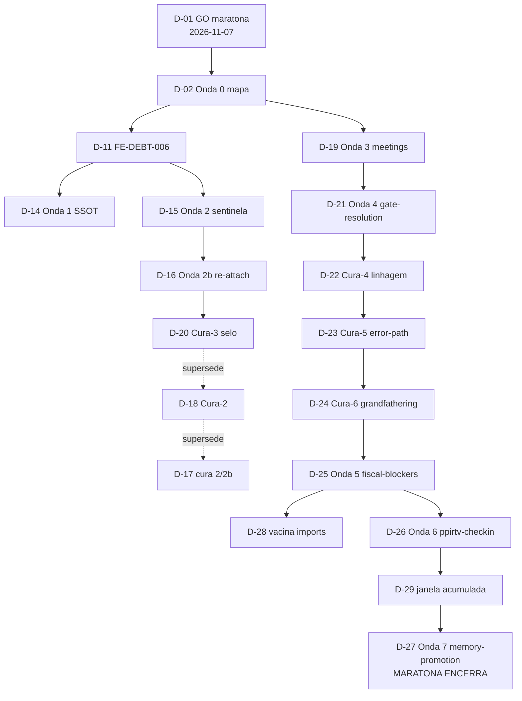

# FlowEngine Decisions Map — por que o código é assim

`LOCALIZER: PPIRTV-FLOW-ENGINE-DECISIONS-MAP`

Mapa público das decisões que moldaram `src/flow-engine.ts` e os módulos em
volta (maratona de desmontagem 2026-11-07→2026-11-09, régua "escoteiro-onda").
Propósito: **esclarecer dúvidas de uso e proveniência** — quando você se
perguntar "onde mora X?", "por que isso é um módulo separado?", "quem decide
Y?", a resposta está numa decisão D-xx abaixo, com fonte reabrível.

Como consumir: a tabela L1 responde a maioria das consultas (busque por
`D-xx`); os blocos L2 (`## D-xx`) trazem origem, escolha e prova. Este
arquivo é a projeção pública versionada; as fotografias internas completas
(capacidades, CRG, receipts) moram no workspace de manutenção sob
`.agents/MAPAS/` (fora do versionamento por design).

## Dúvida comum → decisão

| Dúvida de uso | Resposta curta | Decisão |
| --- | --- | --- |
| Onde mora a política de meetings/required_cooperation? | `src/meeting-policy.ts`, não no motor | D-19 |
| Onde é decidido se um gate está satisfeito? | `src/gate-resolution.ts` (coerência review×changed_files) | D-21 |
| Por que meu fluxo está bloqueado por fiscal? Diagnóstico? | `src/fiscal-blockers.ts` expõe o diagnóstico e ações diretas | D-25 |
| O que o `ppirtv_checkin` calcula? | `src/ppirtv-checkin.ts` (envelope de status/accountability) | D-26 |
| Quem decide escrita/promoção de memória v2? | `src/memory-promotion.ts` | D-27 |
| Erros MCP: por que o envelope "ensina o desbloqueio"? | SSOT de error-envelope + teto terminal | D-14 |
| Posso confiar que behavior foi preservado nas extrações? | Ledger selado por blob + fiscal `check:flow-engine` | D-13, D-24 |
| Por que existe um índice SptTraceIndex? | Evento re-attach de criterion_proofs (rastreabilidade) | D-16 |
| Como adicionar um módulo novo sem crescer o monólito? | Leia `FLOW_ENGINE_EVOLUTION.md` + `src/INDEX.md` primeiro | D-12, D-01 |

## L1 — Índice executivo (27 decisões)

| ID | Título | Estado | Etapa | K/N | Fonte viva (Git) |
| --- | --- | --- | --- | --- | --- |
| D-01 | GO maratona + fotografia ANTES | aceita | V✅ | 3/3 | `FLOW_ENGINE_EVOLUTION.md` |
| D-02 | Mapa Onda 0 (símbolo→cluster→suite→destino) | aceita | V✅ | 1/1 | `FLOW_ENGINE_EVOLUTION.md` |
| D-03 | Ordem fiscal-policy antes de meetings | aceita | V✅ | 1/1 | CHANGELOG 2026-10 |
| D-04 | Onda 2 fiscal-policy (árvore verdict) | supersedida→evento | V✅ | 1/1 | `src/verdict-learning.ts` |
| D-06..10 | Extrações contínuas (traceability/learning/mining/envelope/snapshot) | aceitas | V✅ | 5/5 | CHANGELOG; módulos em `src/` |
| D-11 | FE-DEBT-006 (3 cópias goal_start/sentinela/evaluate) | aceita→paga | V✅ | 3/3 | Ondas 1/2/2b |
| D-12 | Régua ESCOTEIRO-ONDA contínua | aceita | V✅ | 1/1 | `FLOW_ENGINE_EVOLUTION.md` |
| D-13 | Desmontagem com fotografia antes/depois | aceita | V✅ | 1/1 | ledger `flow-engine-evolution.json` |
| D-14 | **Onda 1**: teto terminal → SSOT error-envelope | aceita→evento | V✅ | 1/1 | 115d7e5+0bdd375 |
| D-15 | **Onda 2**: sentinela admissão v3 → SSOT | aceita→evento | V✅ | 1/1 | 217c389; `src/spt-traceability.ts` |
| D-16 | **Onda 2b**: evento re-attach + SptTraceIndex | aceita→evento | V✅ | 1/1 | 145ac4e+9df1304 |
| D-17 | Cura adversarial 2/2b (ledger pós-save + linhagem) | aceita→evento | V✅ | 2/2 | 9facae1+665bb5f |
| D-18 | **Cura-2**: selo vivo confere linhagem | aceita→evento | V✅ | 2/2 | 49524c3+e809b05 |
| D-19 | **Onda 3**: meetings-policy (49 símbolos) | aceita→evento | V✅ | 1/1 | 9ad23ee..d46a415; `src/meeting-policy.ts` |
| D-20 | **Cura-3**: seletor-regex + parent obrigatório | aceita→evento | V✅ | 1/1 | cb0b4aa..6e0ce92 |
| D-21 | **Onda 4**: gate-resolution (11 símbolos) | aceita→evento | V✅ | 1/1 | 8505275..7d5b67b; `src/gate-resolution.ts` |
| D-22 | **Cura-4**: linhagem incondicional 3 gates | aceita→evento | V✅ | 1/1 | 8ad367a+c7b2ed6 |
| D-23 | **Cura-5**: error-path do selo estruturado | aceita→evento | V✅ | 3/3 | 1ed5dcb |
| D-24 | **Cura-6**: RECORD_REMOVED + birthRecords + vacinas | aceita→evento | V✅ | 3/3 | beef440+db823f1 |
| D-25 | **Onda 5**: fiscal-blockers (50 símbolos) | aceita→evento | V✅ | 3/3 | e0ec9d1..b5d5f95; `src/fiscal-blockers.ts` |
| D-26 | **Onda 6**: ppirtv-checkin (23 funcs) | aceita→evento | V✅ | 3/3 | defacc1..601c8ac; `src/ppirtv-checkin.ts` |
| D-27 | **Onda 7**: memory-promotion (33 símbolos; ÚLTIMA) | aceita→evento | V✅ | 3/3 | c99ef48..8c4cf46; `src/memory-promotion.ts` |
| D-28 | Vacina anti-import-morto total | aceita | V✅ | 3/3 | nasceu Onda 5, pagou 6/7 |
| D-29 | Janela acumulada no selo SHRINK | aceita | V✅ | 2/2 | Ondas 6/7 |

*(D-05 nunca foi atribuído — lacuna declarada, não fabricada.)*

Resultado líquido: monólito **8.181 → 4.933 linhas (−40%)** com 7 ondas + 6
curas; suíte de testes **823 → 852** sem editar teste de comportamento; 5
módulos de política + SSOTs; 38 records selados no ledger.

## Árvore causal (Mermaid)

## L2 — Detalhe por decisão

### D-01..D-13 (fundação)
GO único do dono após veredito documental; fotografia ANTES = capacidades +
decisões + grafo estrutural (CRG) com `built_at == HEAD`. D-12 é a diretriz
"escoteiro-onda": correção que toca cluster mapeado extrai a onda INTEIRA daquele
cluster no mesmo corte — extração densa, não pedra minúscula; big-bang e
reescrita ampla continuam proibidos.

### D-11 (FE-DEBT-006) e Ondas 1/2/2b (D-14..D-16)
A 3ª cópia da sequência goal_start/sentinela/avaliação foi paga em 3 ondas
SSOT-first: envelope de erro com teto terminal (error-envelope.ts), sentinela de
admissão v3 + rastreabilidade (spt-traceability.ts) e evento re-attach com
índice SptTraceIndex. A dívida estrutural só foi declarada paga no record da
Onda 3, por exigência do fiscal.

### Curas 2/2b→6 (D-17..D-24): o validador fiscal amadurece
Cada cura fecha achado P1/P2 da revisão adversarial da onda anterior COM teste
RED provado: linhagem do selo → selo vivo + parent obrigatório → linhagem
incondicional + self-match → error-path estruturado → `RECORD_REMOVED` +
`birthRecords` + vacinas provadas **por mutação** (a vacina que não vigia nada
não é vacina). Consumidor: `npm run check:flow-engine` (gate de edição).

### D-25..D-27 (Ondas 5/6/7): as famílias saem, 2026-11-09
Diagnóstico de bloqueio fiscal (50 símbolos → fiscal-blockers.ts), envelope de
status check-in/checkout (→ ppirtv-checkin.ts) e candidatos/promoção de memória
v2 (→ memory-promotion.ts, última onda). Cada corte foi selado no ledger COM
parent; emendas intermediárias (imports mortos, contagens) entraram como
janela acumulada (D-29) — record único cobrindo a janela, em vez de fabricar
dívida para caber em CONTAIN.

### D-28/D-29 (transversais)
Vacina anti-import-morto: parser por bloco completo `import {...} from "...";`
varrendo o corpo sem imports; pegou 42 mortos acumulados (Onda 6) e 9 em
linha-única gigante (Onda 7). Janela acumulada: ver D-25..D-27 acima.

## Estado e débitos declarados (pós-maratona)

- Núcleo restante (~4.9k linhas) permanece monolito **por desenho**: cola de
  orquestração cujo seam ainda não é seguro; o mapa vivo de próximos seams está
  em `FLOW_ENGINE_EVOLUTION.md`.
- Dívidas abertas declaradas: testes diretos dos 5 módulos (hoje cobertos pela
  suíte do motor), invariante parent→base_blob no validador (não modela janela
  acumulada), revisão de README antigos.
- Cada visita que tocar `src/flow-engine.ts` executa `npm run check:flow-engine`
  (gatilho `PPIRTV-FLOW-ENGINE-CAMPING-RULE`).

## Manutenção

- Owner: `documentacao-tecnica / Dora Docs` + `$oraculo-refatoracao` (conteúdo).
- Quando: nova onda/cura tocando o flow-engine ⇒ linha L1 nova + bloco L2 + link
  de fonte; a fotografia interna correspondente nasce em `.agents/MAPAS/`.
- Formato: L1 tabela (1 linha por decisão) + L2 âncoras `## D-xx` no mesmo
  arquivo — consumido por LLM via `rg "D-xx"` e leitura dirigida.
