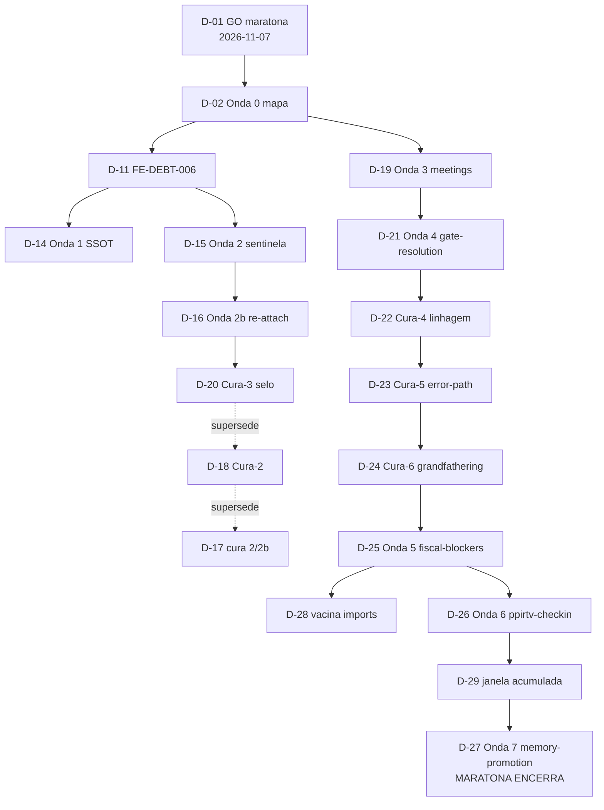

# FlowEngine Decisions Map — por que o código é assim

`LOCALIZER: PPIRTV-FLOW-ENGINE-DECISIONS-MAP`

Mapa público das decisões que moldaram `src/flow-engine.ts` e os módulos em
volta (maratona de desmontagem 2026-11-07→2026-11-09, régua "escoteiro-onda").
Propósito: **esclarecer dúvidas de uso e proveniência** — quando você se
perguntar "onde mora X?", "por que isso é um módulo separado?", "quem decide
Y?", a resposta está numa decisão D-xx abaixo, com fonte reabrível.

Como consumir: a tabela L1 responde a maioria das consultas (busque por
`D-xx`); os blocos L2 (`## D-xx`) trazem origem, escolha e prova. Este
arquivo é a projeção pública versionada; as fotografias internas completas
(capacidades, CRG, receipts) moram no workspace de manutenção sob
`.agents/MAPAS/` (fora do versionamento por design).

## Dúvida comum → decisão

| Dúvida de uso | Resposta curta | Decisão |
| --- | --- | --- |
| Onde mora a política de meetings/required_cooperation? | `src/meeting-policy.ts`, não no motor | D-19 |
| Onde é decidido se um gate está satisfeito? | `src/gate-resolution.ts` (coerência review×changed_files) | D-21 |
| Por que meu fluxo está bloqueado por fiscal? Diagnóstico? | `src/fiscal-blockers.ts` expõe o diagnóstico e ações diretas | D-25 |
| O que o `ppirtv_checkin` calcula? | `src/ppirtv-checkin.ts` (envelope de status/accountability) | D-26 |
| Quem decide escrita/promoção de memória v2? | `src/memory-promotion.ts` | D-27 |
| Erros MCP: por que o envelope "ensina o desbloqueio"? | SSOT de error-envelope + teto terminal | D-14 |
| Posso confiar que behavior foi preservado nas extrações? | Ledger selado por blob + fiscal `check:flow-engine` | D-13, D-24 |
| Por que existe um índice SptTraceIndex? | Evento re-attach de criterion_proofs (rastreabilidade) | D-16 |
| Como adicionar um módulo novo sem crescer o monólito? | Leia `FLOW_ENGINE_EVOLUTION.md` + `src/INDEX.md` primeiro | D-12, D-01 |

## L1 — Índice executivo (27 decisões)

| ID | Título | Estado | Etapa | K/N | Fonte viva (Git) |
| --- | --- | --- | --- | --- | --- |
| D-01 | GO maratona + fotografia ANTES | aceita | V✅ | 3/3 | `FLOW_ENGINE_EVOLUTION.md` |
| D-02 | Mapa Onda 0 (símbolo→cluster→suite→destino) | aceita | V✅ | 1/1 | `FLOW_ENGINE_EVOLUTION.md` |
| D-03 | Ordem fiscal-policy antes de meetings | aceita | V✅ | 1/1 | CHANGELOG 2026-10 |
| D-04 | Onda 2 fiscal-policy (árvore verdict) | supersedida→evento | V✅ | 1/1 | `src/verdict-learning.ts` |
| D-06..10 | Extrações contínuas (traceability/learning/mining/envelope/snapshot) | aceitas | V✅ | 5/5 | CHANGELOG; módulos em `src/` |
| D-11 | FE-DEBT-006 (3 cópias goal_start/sentinela/evaluate) | aceita→paga | V✅ | 3/3 | Ondas 1/2/2b |
| D-12 | Régua ESCOTEIRO-ONDA contínua | aceita | V✅ | 1/1 | `FLOW_ENGINE_EVOLUTION.md` |
| D-13 | Desmontagem com fotografia antes/depois | aceita | V✅ | 1/1 | ledger `flow-engine-evolution.json` |
| D-14 | **Onda 1**: teto terminal → SSOT error-envelope | aceita→evento | V✅ | 1/1 | 115d7e5+0bdd375 |
| D-15 | **Onda 2**: sentinela admissão v3 → SSOT | aceita→evento | V✅ | 1/1 | 217c389; `src/spt-traceability.ts` |
| D-16 | **Onda 2b**: evento re-attach + SptTraceIndex | aceita→evento | V✅ | 1/1 | 145ac4e+9df1304 |
| D-17 | Cura adversarial 2/2b (ledger pós-save + linhagem) | aceita→evento | V✅ | 2/2 | 9facae1+665bb5f |
| D-18 | **Cura-2**: selo vivo confere linhagem | aceita→evento | V✅ | 2/2 | 49524c3+e809b05 |
| D-19 | **Onda 3**: meetings-policy (49 símbolos) | aceita→evento | V✅ | 1/1 | 9ad23ee..d46a415; `src/meeting-policy.ts` |
| D-20 | **Cura-3**: seletor-regex + parent obrigatório | aceita→evento | V✅ | 1/1 | cb0b4aa..6e0ce92 |
| D-21 | **Onda 4**: gate-resolution (11 símbolos) | aceita→evento | V✅ | 1/1 | 8505275..7d5b67b; `src/gate-resolution.ts` |
| D-22 | **Cura-4**: linhagem incondicional 3 gates | aceita→evento | V✅ | 1/1 | 8ad367a+c7b2ed6 |
| D-23 | **Cura-5**: error-path do selo estruturado | aceita→evento | V✅ | 3/3 | 1ed5dcb |
| D-24 | **Cura-6**: RECORD_REMOVED + birthRecords + vacinas | aceita→evento | V✅ | 3/3 | beef440+db823f1 |
| D-25 | **Onda 5**: fiscal-blockers (50 símbolos) | aceita→evento | V✅ | 3/3 | e0ec9d1..b5d5f95; `src/fiscal-blockers.ts` |
| D-26 | **Onda 6**: ppirtv-checkin (23 funcs) | aceita→evento | V✅ | 3/3 | defacc1..601c8ac; `src/ppirtv-checkin.ts` |
| D-27 | **Onda 7**: memory-promotion (33 símbolos; ÚLTIMA) | aceita→evento | V✅ | 3/3 | c99ef48..8c4cf46; `src/memory-promotion.ts` |
| D-28 | Vacina anti-import-morto total | aceita | V✅ | 3/3 | nasceu Onda 5, pagou 6/7 |
| D-29 | Janela acumulada no selo SHRINK | aceita | V✅ | 2/2 | Ondas 6/7 |
| D-30 | Suíte de integração dos 4 módulos + E2E golden-path (pós-maratona) | aceita | V✅ | 6/6 | `tests/*.integration.test.ts` + `tests/goal-lifecycle.e2e.test.ts` |
| D-31 | ISSUE-0002: ressalva `provided_missing_paths` + não-entrada na union (expurgo rejeitado com regresso medido); emenda adversarial: aviso `provided_unconfirmed_deletions` + fronteira envelope + preflight simétrico | aceita | V✅ | 6/6 | `tests/gate-provided-paths.test.ts` + `src/gate-provided-paths.ts`; commits `0c6dda9`+emenda |
| D-32 | ISSUE-0005: typecheck de `tests/` no pipeline (`check:types` no `check` antes do vitest; curadoria de ~130 erros herdados) | aceita | V✅ | 6/6 | `tsconfig.tests.json`; commit `3d41f26` |
| D-33 | ISSUE-0004: fim da tool fantasma no guidance — `librarian_status` → `ppirtv_checkout`; sentinela consumida julgando contra o registro vivo | aceita | V✅ | 4/4 | `src/fiscal-blockers.ts`; commit `e5992f4` |
| D-34 | Aviso `provided_ignored` no receipt do gate (typo nunca mais silencioso; cola pura, julgamento em gate-resolution) + erros de escopo nomeiam `offending_paths` | `rg "provided_ignored" src/gate-resolution.ts`; record 40 do ledger | 2026-11-09 · ISSUE-LOCAL-0001+0003 · 8367969 |
| D-35 | E2E golden-path sobre SPT v3 canônico: `addDeclarativeEvidence` expande 1 evidência por critério (`criterion_proof` SINGULAR) | `rg "golden-path SPT v3" tests/goal-lifecycle.e2e.test.ts` | 2026-11-10 · ISSUE-LOCAL-0006 · c7c3779 |
| D-36 | Contrato público de `goal_advance` alinhado ao desenho D-31: description declara a ressalva `provided_missing_paths` com escopo de fase; sentinela bidirecional no teste MCP (description × comportamento) | `rg "contrato-goal-advance-path-inexistente" tests/mcp.test.ts` | 2026-11-10 · GitHub #16 / ISSUE-LOCAL-0008 · bee93ea+79549cc |
| D-37 | Gerador MM no charset L1 da dex-memoria 0.1.17 + retry com operation_id fresco por FAMÍLIA (sufixo numérico monotônico; PARTIAL_PENDING retoma pelo resume canônico) | `rg "freshOperationIdForRetry" src/memory-promotion.ts` | 2026-11-10 · ISSUE-LOCAL-0007 · ab1c63e+b2b58be |
| D-38 | goal_verdict anuncia a mineração pós-verdict que o gate terminal exigirá (predição com o predicado EXATO da fonte única; sequência ensinada completa: mine → provided → terminal) | `rg "requiresPostVerdictMining" src/flow-engine.ts` | 2026-11-11 · GITHUB #17 · flow 4417 |
| D-39 | Contratos de erro diferenciam reanexação de rastreabilidade (TRACEABILITY_MISSING: MESMA key reata o mapa) de fingerprint divergente (GOAL_BINDING_MISMATCH: binding imutável; restaurar bytes + MESMA key OU flow sucessor com key NOVA — decisão de owner) | `rg "idempotency_key NOVA" docs/contracts/MCP_TOOL_ERROR_ENVELOPE_CONTRACT.md` | 2026-11-11 · GITHUB #18 · flow 4460 |
| D-40 | Sentinela de headroom dos budgets 5120: payload medido, ecos do flow_id contados, headroom >= 2 chars/eco provado (PID de 6 dígitos cabe; teto mantido — aumento só com reprodução, rito do precedente 5500) | `rg -c "headroom" tests/mcp.test.ts` | 2026-11-12 · GITHUB #14 · flow 4548 |
| D-41 | Régua perene da rede símbolo×suíte: referência NOMINAL medida por `tools/test-symbol-coverage.py` em DUAS contagens (code_refs × mention_refs; denominador com exports de tipo) — "sem ref nominal" ≠ "sem cobertura" (calibração comportamento-via-motor); estacionamentos tio-testador fechados CONSUMIDO-com-régua/NÃO-REPRODUZIDO | `python -B tools/test-symbol-coverage.py` | 2026-11-12 · estacionamentos Ondas 3/5/6/7 · flow 4581 |
| D-42 | Corte de rede por módulo (fila da régua D-41): des-export de helper sem consumidor externo (função permanece; typecheck é o RED) + sondar a suíte por CAMPO antes de declarar lacuna (T25c já vigiava os 6 ramos; 0 lacunas comportamentais) — 26a/0b/9c + 1 ref nominal | `rg -c "^export" src/fiscal-blockers.ts` → 39 | 2026-11-12 · rede fiscal-blockers · flow 4621 |
| D-43 | Segundo corte de rede (gate-resolution): sonda por CAMPO validada ao vivo (mergePathFacts: 0 por nome interno → evidência dupla pelo campo certo) — 17a/0b/10c, 0 testes novos (CRP no núcleo de todo advance); des-export 10/10 | `rg -c "^export" src/gate-resolution.ts` → 25 | 2026-11-12 · rede gate-resolution · flow 4651 |
| D-44 | Terceiro corte de rede (meeting-policy): MUTAÇÃO SOBREVIVENTE virou teste (requiredMeetingKind "sempre transversal" passou 232/232 — escada podia regressar; it paga e re-mutação falha); 5 amostras congeladas (classe BASELINE-RED); des-export 14/14 (40→26) | `rg -c "^export" src/meeting-policy.ts` → 26 | 2026-11-12 · rede meeting-policy · flow 4679 |
| D-45 | Quarto corte de rede (memory-promotion): mutações LITERAIS 10/11 PEGAS (a 1ª rodada regex-era 10 falsos sobreviventes — replace silencioso); 5 its pagam 7 lacunas (M2 pré-coberto l.1439); M8 (b) declarada (embed inline no engine) | `rg -c "^export" src/memory-promotion.ts` → 30 | 2026-11-13 · rede memory-promotion · flow 4707 |

*(D-05 nunca foi atribuído — lacuna declarada, não fabricada.)*

Resultado líquido: monólito **8.181 → 4.933 linhas (−40%)** com 7 ondas + 6
curas; suíte de testes **823 → 852** sem editar teste de comportamento; 5
módulos de política + SSOTs; 38 records selados no ledger.

## Árvore causal (Mermaid)

## L2 — Detalhe por decisão

### D-01..D-13 (fundação)
GO único do dono após veredito documental; fotografia ANTES = capacidades +
decisões + grafo estrutural (CRG) com `built_at == HEAD`. D-12 é a diretriz
"escoteiro-onda": correção que toca cluster mapeado extrai a onda INTEIRA daquele
cluster no mesmo corte — extração densa, não pedra minúscula; big-bang e
reescrita ampla continuam proibidos.

### D-11 (FE-DEBT-006) e Ondas 1/2/2b (D-14..D-16)
A 3ª cópia da sequência goal_start/sentinela/avaliação foi paga em 3 ondas
SSOT-first: envelope de erro com teto terminal (error-envelope.ts), sentinela de
admissão v3 + rastreabilidade (spt-traceability.ts) e evento re-attach com
índice SptTraceIndex. A dívida estrutural só foi declarada paga no record da
Onda 3, por exigência do fiscal.

### Curas 2/2b→6 (D-17..D-24): o validador fiscal amadurece
Cada cura fecha achado P1/P2 da revisão adversarial da onda anterior COM teste
RED provado: linhagem do selo → selo vivo + parent obrigatório → linhagem
incondicional + self-match → error-path estruturado → `RECORD_REMOVED` +
`birthRecords` + vacinas provadas **por mutação** (a vacina que não vigia nada
não é vacina). Consumidor: `npm run check:flow-engine` (gate de edição).

### D-25..D-27 (Ondas 5/6/7): as famílias saem, 2026-11-09
Diagnóstico de bloqueio fiscal (50 símbolos → fiscal-blockers.ts), envelope de
status check-in/checkout (→ ppirtv-checkin.ts) e candidatos/promoção de memória
v2 (→ memory-promotion.ts, última onda). Cada corte foi selado no ledger COM
parent; emendas intermediárias (imports mortos, contagens) entraram como
janela acumulada (D-29) — record único cobrindo a janela, em vez de fabricar
dívida para caber em CONTAIN.

### D-28/D-29 (transversais)
Vacina anti-import-morto: parser por bloco completo `import {...} from "...";`
varrendo o corpo sem imports; pegou 42 mortos acumulados (Onda 6) e 9 em
linha-única gigante (Onda 7). Janela acumulada: ver D-25..D-27 acima.

### D-31 (pós-maratona, 2026-11-09): ISSUE-0002 — fim do fantasma na union
Primeira issue do TRACKER local curada por GO (P1, custo real: flow 136 com
3 verdicts bloqueados + 6 emissões de review por 1 typo). O gate de
implementação com path inexistente em `provided.changed_files` devolve
**ressalva `provided_missing_paths`** no receipt (nunca bloqueia) e **não
persiste o path na union** `flow.changed_files` — o typo morre na nascente.
Decisão com regresso medido: o expurgo literal da union por `deleted_files`
foi implementado, testado e **rejeitado** (quebrava a atestação de deleção
real do desenho #6 — path deletado legitimamente permanece na union como
memória do escopo; suíte do engine provou ao vivo); critério fechado pelo
aceite alternativo da própria issue. Camping EXCEPTION `urgent_hotfix`
(record 38, RED real). Dúvida de uso: declarou um arquivo que ainda não
existe? O receipt avisa na hora — redeclare quando o arquivo existir.

**Emenda adversarial (record 39, EXCEPTION integrity)**: o par
`changed_files`+`deleted_files` **simultâneo** é o formato canônico de
deleção (1ª declaração) e **entra por atestação do cliente** — quando o
disco não confirma e a union histórica não conhece, o receipt emite o aviso
**`provided_unconfirmed_deletions`** (nunca bloqueia; o typo em duas listas
deixa de ser mudo — fechado com veredito documental do $oraculo-clean-code).
No mesmo corte: fim do fallback `process.cwd()` (sem `goal_binding` não há
fronteira legítima — rota legada fica sem ressalva em vez de julgar contra a
raiz do servidor), `isExistingFile` substitui `existsSync` (diretório não é
arquivo do escopo) e `goal_gate_preflight` emite as chaves simetricamente.
Julgamento mora em `src/gate-provided-paths.ts`; suíte 891→896.

### D-30 (pós-maratona, 2026-11-09): testes de integração + E2E
A maior dívida declarada da maratona foi paga: os 4 módulos de política que
só eram exercitados via suíte do motor ganharam suítes de integração com
import direto (`tests/meeting-policy|fiscal-blockers|ppirtv-checkin|
memory-promotion.integration.test.ts`, fixtures reais em
`tests/helpers/policy-modules-fixture.ts`) cobrindo ramos adversariais
(gatilho negativo de reunião, verdict consumindo sinal, blockers
reconciliados, falso-positivo conhecido "validade"/"testemunha" documentado
fiel, progresso inválido, resolução park sem quando, destino único de
promoção). O E2E (`tests/goal-lifecycle.e2e.test.ts`) percorre o ciclo
completo — goal_start → gate de revisão bloqueado → review estrutural →
gate verde → status → verdict — e confere os artefatos PERSISTIDOS em disco
(flow `.json` com `goal_started`/evidence/`verdict_recorded` + ledger
`.ndjson`), além da idempotência do `goal_start`. Vigília provada por
mutação (5 mutações, cada uma flagrada em RED com revert imediato). Suíte
852→886, zero mudança de produto.

### D-32 (pós-maratona, 2026-11-09): ISSUE-0005 — typecheck de tests/ no pipeline
O gate `npm run check` não validava tipos dos arquivos de teste (tsconfig só
`src/**`; vitest não typechecka) — a fixture incompleta do D-30 e 3 props
fantasmas `phase` passavam em silêncio. Cura: `tsconfig.tests.json` (extends
base, noEmit, lib ES2023 p/ `findLast`) + script `check:types` no `check`
ANTES do vitest, com curadoria completa dos ~130 erros herdados em 18
arquivos (baseline RED congelado: 251 linhas). Classes: fixtures completas
(Meeting +8 campos — a própria barata do D-30 agora impossível de repetir;
`GoalVerdictInput.next_step`; `GateRequirement.kind` real do mapa),
`d.mts` de declaração para o validador de camping `.mjs`, `as const` dos
profiles de cutover, casts de envelope dinâmico e non-null **só em asserts**
(veredito documental $oraculo-clean-code cap 7/cap 9). tsc 0 erros; suíte 896
verde; zero `src/` de runtime. Dúvida de uso: fixture incompleta ou prop
fantasma em teste agora quebra o `npm run check` na hora.

### D-33 (pós-maratona, 2026-11-09): ISSUE-0004 — fim da tool fantasma no guidance
`blockerOwner("librarian_status")` apontava `memory_recall` — tool que NUNCA
existiu no registro (32 tools reais; só eventos `memory_recalled`). Veredito
documental $oraculo-clean-code (cap 2 *Meaningful Names*, l.906-920): guidance
é um nome de rota — deve revelar intenção executável. Escolha pela própria
tabela: irmãos apontam tools de AÇÃO especializada → **`ppirtv_checkout`**
(checagem de accountability do librarian, dona do diagnóstico
graphify/bibliotecário). Sentinela consumida conforme desenhada: RED provado
ao vivo na cura; o teste novo julga a tabela INTEIRA contra o registro VIVO
de tools — nenhuma tool fantasma passa. Dúvida de uso: guidance de blocker
nunca mais aponta tool inexistente (o teste vigia).

## Estado e débitos declarados (pós-maratona)

- Núcleo restante (~4.9k linhas) permanece monolito **por desenho**: cola de
  orquestração cujo seam ainda não é seguro; o mapa vivo de próximos seams está
  em `FLOW_ENGINE_EVOLUTION.md`.
- Dívidas abertas declaradas: testes diretos dos 5 módulos (hoje cobertos pela
  suíte do motor), invariante parent→base_blob no validador (não modela janela
  acumulada), revisão de README antigos.
- Cada visita que tocar `src/flow-engine.ts` executa `npm run check:flow-engine`
  (gatilho `PPIRTV-FLOW-ENGINE-CAMPING-RULE`).

## Manutenção

- Owner: `documentacao-tecnica / Dora Docs` + `$oraculo-refatoracao` (conteúdo).
- Quando: nova onda/cura tocando o flow-engine ⇒ linha L1 nova + bloco L2 + link
  de fonte; a fotografia interna correspondente nasce em `.agents/MAPAS/`.
- Formato: L1 tabela (1 linha por decisão) + L2 âncoras `## D-xx` no mesmo
  arquivo — consumido por LLM via `rg "D-xx"` e leitura dirigida.

## D-34 — diagnóstico que ensina o culpado (ISSUE-0001+0003)

**Dúvida comum**: "por que o gate ignorou minha chave?" / "qual path disparou
o UNATTRIBUTED?" — agora ambos nomeiam o culpado no ponto de erro.

- **O quê**: (a) `providedIgnoredKeys` (src/gate-resolution.ts, função pura)
  devolve `provided_ignored: ["tests_executed"]` no `GateRecord` — chaves de
  `provided` que nenhum requisito da fase conhece (typo vira ressalva visível,
  nunca bloqueio; `changed_files`/`deleted_files` aceitas em toda fase porque o
  motor as lê fora do mapa de requisitos); a fachada ganhou só o cálculo+spread
  (cola pura, camping EXCEPTION record 40, RED real). (b) `filter` no lugar do
  `some()` nos 2 erros de escopo de `review-scope-attribution.ts`:
  `offending_paths: a, b (+N more)` — truncagem 10 com contador, molde da irmã
  STALE que já nomeava o evidence_id. (c) flow zumbi 2948 (stub de goal_start
  do hardening-2, 0 evidências) arquivado pela rota canônica (vrd_4173 +
  flow_archive) — saiu do hook de SessionStart.
- **Por que assim e não outro**: reuso do mapa `PROVIDED_REQUIREMENT_KINDS`
  (FE-DEBT-002) em vez de inventário novo; mensagem (como STALE) em vez de
  campo estrutural no envelope (schema intocado); aviso nunca bloqueante —
  mesmo desenho dos avisos D-31.
- **Fontes**: commit 8367969; record 40 do ledger
  `docs/architecture/flow-engine-evolution.json`; RED baseline 4c693c6
  (`tests/gate-provided-ignored.test.ts`, `tests/review-scope-offending-paths.test.ts`).

## D-35 — E2E golden-path SPT v3 (ISSUE-0006)

**Dúvida comum**: "como é o ciclo canônico completo com provas por critério?"
→ o it golden-path v3 é o exemplar executável.

- **O quê**: `tests/goal-lifecycle.e2e.test.ts` ganhou o it v3 — fixture v3
  (molde `memory-gate-loop.test.ts`, 2 critérios), `addDeclarativeEvidence`
  expande **1 evidência por critério** (`Evidence.criterion_proof` é
  SINGULAR — 1 chamada → provas C-01/C-02), gate de revisão
  `review_evidence_coherent` → review estrutural `code_review` fp pós-âncora
  → verde, verdict `pronto` citando provas + review, fonte persistida e
  artefatos no disco. O it v2 legacy permanece (contrato legado provado).
- **Por que assim**: reuso dos moldes v3 existentes em vez de fixture nova;
  2 critérios provam a expansão múltipla; zero src (amplificação de teste).
- **Fontes**: commit c7c3779; suíte 905; fila da revisão D-30 fechada 6/6.

## D-36 — Contrato público de goal_advance × path inexistente (GitHub #16 / ISSUE-LOCAL-0008)

**Dúvida comum**: "a description do tools/list pode prometer o que o motor
não faz?" → não; e a vacina da classe mora no teste que vigia a description.

- **O quê**: a description de `goal_advance` prometia "an absent changed
  file without deleted_files fails closed" — mentira sobre o desenho D-31
  (ressalva deliberada). Frase nova declara as 3 verdades COM escopo de fase
  ("when the implementation gate advances ... changed_files paths are only
  inspected during the implementation gate" — emenda: fora de implementacao
  o receipt NÃO nomeia, 5/6 fases), o caso diretório ("or not a regular
  file"), a âncora legível (`gate.provided_missing_paths`) e os markers
  negativos do `next_step`. It MCP com caso+controle no mesmo advance +
  caso SOLO (path único inexistente) + sentinela **bidirecional**
  (`toContain("provided_missing_paths")` + `not.toContain("fails closed")` —
  provada por mutação CASO E: mentira que cite o campo ao lado é pega).
- **Por que assim**: o motor D-31 é deliberado e testado — o defeito era a
  divergência do contrato público; cortar a frase (não o motor) é o menor
  diff que resolve inteiro, e a sentinela vacina a classe descrição×comportamento.
- **Fontes**: commits bee93ea+79549cc; adversarial 0P1/4P2/7P3 (probe MCP
  real no CASO C pagou o escopo de fase); suíte 906 (902+4).

## D-38 — goal_verdict anuncia a mineração pós-verdict (GITHUB #17)

**Dúvida comum**: "por que o verdict responde run_memory_mining em vez de
advance_terminal?" → porque o gate terminal exige uma mineração POSTERIOR ao
veredito positivo e a resposta não pode anunciar só o advance.

- **O quê**: `requiresPostVerdictMining` no bloco de retorno de
  `goalVerdictUnlocked` — veredito positivo E fase terminal no perfil E
  `hasVerdictAfterLatestMemoryMining(flow recarregado pós-verdict)`, o
  predicado EXATO da fonte única (`src/memory/mining-policy.ts`); o
  `next_required_action` responde `{type run_memory_mining, tool
  mm_memory_mining}` com reason ensinando o ciclo completo (minerar →
  fornecer residual_risks/next_step/memoria_viva_reconciled no terminal).
- **Por que assim**: o requisito continua sendo avaliado no CAMINHO VIVO do
  gate (`goal_advance` terminal, l.2990) — fonte única preservada; o verdict
  apenas prediz com o mesmo predicado (1 reload em vez de equivalência
  manual). Todo GOAL oficial exige mineração antes do verdict, então o aviso
  cobre 100% dos verdicts positivos de fase terminal.
- **Contrato público**: description de `goal_verdict` declara a predição;
  description de `goal_advance` declara que `memoria_viva_reconciled`
  atesta a reconciliação das superfícies vivas (incluindo o checklist do
  Trilho vinculado) ANTES da imutabilidade terminal.
- **Fontes**: ISSUE #17 (crsantosxx, observação stdio real); camping record
  `FE-2026-11-11-ISSUE0017-VERDICT-NEXT-ACTION-MINING-EXCEPTION` (EXCEPTION
  integrity, RED provado no baseline 9a8d2c2); suíte 910.

## D-39 — diferenciar rebind de rastreabilidade e fingerprint SPT divergente (GITHUB #18)

**Dúvida comum**: "GOAL_BINDING_MISMATCH é consertado chamando goal_start de
novo?" → não: retry cego falha de novo (binding imutável); só o caso
SPT_V3_TRACEABILITY_MISSING (mapa ausente, binding compatível) se reata com
a MESMA idempotency_key.

- **O quê**: corte documental puro (zero src). `GOAL_BINDING_MISMATCH` ganhou
  linha própria no `MCP_TOOL_ERROR_ENVELOPE_CONTRACT.md` com as duas
  sub-rotas — (1) SPT editado sem intenção de trocar de plano: restaurar os
  bytes do fingerprint registrado (diagnóstico por `ppirtv_trace`,
  reason_code `spt_contract_fingerprint_drift`, registered vs current) e
  reatar com a MESMA key; (2) contrato realmente alterado: flow sucessor com
  idempotency_key NOVA, predecessor preservado, decisão de owner. O
  `GOAL_SPT_CANONICAL_CONTRACT.md` ganhou a seção que conecta os dois mundos
  ortogonais (mesma verdade com anexo perdido vs verdades divergentes) e a
  nota de o consumidor conferir `ppirtv_trace` além de `goal_status` antes
  de atribuir provas.
- **Por quê**: o guard (`flow-engine.ts:4759`) lança ANTES de qualquer
  mutação — `goal_start` NUNCA reescreve silenciosamente um binding
  diferente — mas o contrato de erro não diferenciava o reparo mecânico do
  caso que exige decisão; consumidor travava sem saber a rota.
- **Prova viva**: comportamento caracterizado por teste existente
  (`tests/mcp.test.ts`, it que edita o SPT entre dois `goal_start` e o
  retry falha MISMATCH) — a doc aponta para o teste como âncora, nunca o
  contrário.
- **Onde**: `docs/contracts/MCP_TOOL_ERROR_ENVELOPE_CONTRACT.md` (linha
  própria), `docs/contracts/GOAL_SPT_CANONICAL_CONTRACT.md` (seção
  "Reanexacao de rastreabilidade x divergencia de fingerprint").

## D-40 — sentinela de headroom dos budgets 5120 (GITHUB #14)

**Duvida comum**: "por que nao aumentar os budgets 5120 para 5500 de uma
vez?" → porque a issue #14 VETA aumento sem reproducao; a sentinela prova o
teto valido e entrega a reproducao na mao se algum dia acender.

- **O que**: caracterizacao de margem nos mesmos its (contagem de suíte
  inalterada) — cada budget mede o payload real, conta os ecos do flow_id e
  deriva `headroom = floor((5120-len)/max(ecos,1))`; asserts mantem
  `len < 5120` e exigem `headroom >= 2` (PID de 6 digitos, +2 chars por eco,
  cabe — o cenario do estacionamento EST-20261013-BUDGETS-5120-PID).
- **Por que**: o teto e contrato de TESTE de payload compact (src nao tem
  5120); o flake esperado era invisivel ate o PID do servidor crescer em
  producao — a sentinela acende ANTES, com a reproducao na mao.
- **Onde**: tests/mcp.test.ts (its "serves compact execution..." e "returns
  only the current phase..."); precedente canonico l.1934-1939 (5122 provado
  por stash-probe -> 5500 documentado) e o rito de aumento.
- **Selo**: conselheiro $oraculo-clean-code — T5 "Test Boundary Conditions"
  (l.418) + G3 "Incorrect Behavior at the Boundaries" (l.363), heuristicas
  EN 2008.

## D-41 — régua perene da rede símbolo×suíte (estacionamentos tio-testador)

**Duvida comum**: "os módulos da maratona estão sem teste?" → a rede de
INTEGRAÇÃO foi paga (D-30, suítes `*.integration.test.ts`); o que falta em
parte dos símbolos é referência NOMINAL (o nome endereçável na suíte) — e
isso agora é número, não impressão.

- **O que**: `tools/test-symbol-coverage.py` mede, por módulo da maratona
  (fiscal-blockers, gate-resolution, meeting-policy, memory-promotion,
  review-snapshot, spt-traceability, verdict-fiscal-policy, verdict-learning),
  quantos exports têm o nome referenciado em `tests/*.test.ts` em DUAS
  contagens (emenda adversarial): `code_refs` (linha não-comentário) e
  `mention_refs` (qualquer menção — 6 das 49 refs originais eram prosa);
  denominador inclui exports de type/interface/enum (155→201 corrige
  otimismo). Medição pós-emenda: **52/201 code, 57/201 mention, 144 sem
  referência nominal**. Exit 0 no uso correto; **exit 2 se a âncora não
  resolve** (cópia relocada aborta alto — nunca 0/0 silencioso).
- **Por que**: a métrica nominal tem falso-negativo comprovado —
  `hasReviewEvidenceWithDeps` (verdict-fiscal-policy l.263-268) tem 0 refs
  nominais mas TODO flow com review citada no verdict a executa;
  `staleSelectedCriterionProofPaths` (**src/spt-traceability.ts:300** —
  endereço corrigido pela adversarial) idem via `SPT_V3_EVIDENCE_STALE` em 2
  arquivos. Amostra da calibração é n=2 na direção falso-negativo
  (declarado no REDE.md); cortes de rede futuros nascem do relatório guiados
  pelo interrogador (contrato × implementação × execução por símbolo), nunca
  144 testes às cegas. Salvaguardas no REDE.md: nunca vira gate/quota só;
  remoção de export motivada por métrica é proibida (rito do camping).
- **Onde**: `tools/test-symbol-coverage.py` (lista de módulos no topo;
  mining-policy foi absorvido pela memory-promotion na Onda 7);
  `.agents/AUDITORIAS/2026-11-12-rede-simbolos-suporte/REDE.md` + `rede.json`;
  decisões dos estacionamentos no `.agents/ESTACIONAMENTO.md` (Ondas 3/5/6/7,
  itens owner tio-testador: CONSUMIDO-com-régua / NÃO-REPRODUZIDO).
- **Decisões fechadas**: Onda 5(1)/6(1)/7(1) CONSUMIDO-com-régua (roteamento
  pago no D-30; dívida de rede segue ABERTA como fila mensurada — régua mede,
  não paga); Onda 3(5) flaky meeting-outcome NÃO-REPRODUZIDO (≥11 rodadas
  documentadas desde 2026-11-09 + re-teste verde; vigília natural = suíte
  roda a cada commit; rodadas verdes não provam ausência de flake — fechado
  por vigília com rota de reabertura, declarado).

## D-42 — corte de rede fiscal-blockers: interface enxuga, teste só onde há lacuna

**Duvida comum**: "a fila de 144 pede 144 testes?" → não; o interrogatório
por símbolo decidiu 35 em 25 cobertos / 1 lacuna / 9 sem consumidor — a
estimativa (3-6) cedeu à evidência (CRP).

- **O que**: TABELA por símbolo (35) com 3 classes; DES-EXPORT dos 9 helpers
  zero-consumidores (função permanece, export sai; typecheck exit 0 prova que
  nenhum consumidor externo quebrou); 1 it de caracterização `loopEscalationFor`
  (6 ramos do escalonamento) com vigília por mutação.
- **Por que**: SDP — fiscal-blockers é núcleo estável que todo verdict executa
  (primeiro da fila); CRP — a suíte de integração já cobre o uso comum via
  motor, teste nominal duplicaria contrato; interface pública só com o que o
  consumidor usa (ISP-flavor).
- **Onde**: TABELA em `.agents/AUDITORIAS/2026-11-12-rede-fiscal-blockers/`;
  rodada 2 no REDE.md (144→134); `src/fiscal-blockers.ts` (48→39 exports);
  `tests/fiscal-blockers.integration.test.ts` (it loopEscalationFor).
- **Regra reutilizável** (emendada pela adversarial): (1) helper exportado
  sem consumidor externo e com uso interno → des-export (a prova é o
  typecheck; remoção de FUNÇÃO é rito do camping, outro corte); (2) antes de
  declarar LACUNA de comportamento, sondar a suíte por CAMPO — o T25c de
  engine.test.ts já assertava os 6 ramos de loopEscalationFor com thresholds
  exatos enquanto a análise olhava só o arquivo com nome parecido
  (nominal×comportamental, o erro que a calibração D-41 proíbe); (3) risco de
  liveness: des-exportado sai do denominador da régua e tsconfig sem
  noUnusedLocals não vigia morte interna — registrado, flag é corte próprio.

## D-43 — corte de rede gate-resolution: sonda por campo validada ao vivo

**Duvida comum**: "gate-resolution precisa de mais testes?" → a sonda por
CAMPO (lição D-42) achou cobertura citável nos 17 vivos; 0 lacunas; o módulo
é o núcleo de TODO advance — CRP no extremo.

- **O que**: TABELA 27 (17a/0b/10c); des-export 10/10 (35→25 exports,
  typecheck exit 0); 0 testes novos.
- **Prova da sonda**: mergePathFacts — 0 hits por nome interno (`path_facts`);
  evidência DUPLA pelo campo certo (`changed_files` do provided:
  gate-provided-paths D-31 + strictPathArray nominal l.40).
- **Onde**: `.agents/AUDITORIAS/2026-11-12-rede-gate-resolution/TABELA.md`;
  REDE.md rodada 3 (144→134→124); src/gate-resolution.ts.
- **Regra reutilizável**: sonda SEMPRE pelo campo que o símbolo produz
  (nome interno do mecanismo engana — D-42 pagou por nome de arquivo, D-43
  quase pagou de novo por nome de variável interna); liveness acumulada
  (19 des-exports fora do denominador) monitorada — flag é corte próprio.

## D-45 — corte de rede memory-promotion: incidente do harness + vacina literal

 **Duvida comum**: "mutação de amostra sobrevivente prova lacuna?" → só se a mutação
 EXISTIU no disco. O gerador regex-de-assinatura do corte falhou SILENCIOSAMENTE
 (`str.replace` sem match = arquivo intocado) e reportou 10/10 sobreviventes falsos.

- **O que**: TABELA 18 (16a · 1b declarada · 1c des-export do type); 11 mutações
  literais verificadas (10 PEGAS + M8 real); 5 its novos; suíte 918.
- **Onde**: `.agents/AUDITORIAS/2026-11-13-rede-memory-promotion/TABELA.md`;
  REDE.md rodada 5 (…→107 sem ref); gatilho REDE-CORTE-POR-MODULO emendado.
- **Regra reutilizável**: mutação de amostra = LITERAL curto com count==1 +
  releitura viva do disco (e nunca confiar em 'sobrevivente' sem a prova de que a
  mutação existiu); citação por mensagem de erro exige a FONTE da mensagem
  (config.ts vs memory-promotion: a sonda l.38 era fantasma).

## D-44 — corte de rede meeting-policy: assert exato + amostras pegas

**Duvida comum**: "e se a sonda errar de novo?" → as 2 amostras mais fracas
foram MUTADAS e a suíte PEGOU as duas (3 e 8 failed) — "0 lacunas" saiu do
universal-negativo e virou prova viva executada.

- **O que (emendado)**: TABELA 29 (14a com assert exato válido · 1b LACUNA
  REAL PAGA · 14c); des-export 14/14 (40→26); 1 it novo (escada
  requiredMeetingKind); P3 da Onda 3 pago (reason = comportamento observável,
  autorizado por ESCOTEIRO-ONDA).
- **Onde**: `.agents/AUDITORIAS/2026-11-12-rede-meeting-policy/TABELA.md`;
  REDE.md rodada 4 (…→109 sem ref); src/meeting-policy.ts.
- **Regra reutilizável**: o par mínimo de confiança para classe (a) é
  ASSERT EXATO citado + (para os fracos) MUTAÇÃO DE AMOSTRA pega — o rito
  D-42→D-43→D-44 consolidou: sonda por campo, assert exato primeiro,
  amostra mutada, execução incidental não conta.

## D-37 — Gerador MM × charset L1 da dex-memoria 0.1.17 (ISSUE-LOCAL-0007)

**Dúvida comum**: "por que o writer da MM saneia title/trigger e o retry
ganha id novo?" → porque o charset da 0.1.17 fecha `^ [ ] CR LF` em
request-stage e o id determinístico pelo item fica preso.

- **O quê**: `sanitizeCandidateText` no adapter (title/trigger no charset,
  body cru, caso bom idêntico, guard `TITLE_EMPTY` para item só de
  metacaracteres) + `freshOperationIdForRetry` em memory-promotion:
  FAMÍLIA por prefixo com contador no SUFIXO numérico (monotônico sob
  replace do `v2_receipts` por rodada — o 1º desenho regenerava id queimado
  na 3ª tentativa, P1 da adversarial com 2 revisores convergentes por
  probe); último PARTIAL_PENDING da família devolve o MESMO id (resume
  canônico preservado, inclusive em id sufixado); vocabulário real do
  receipt: `COMMITTED|PARTIAL_PENDING|FAILED` (preso = FAILED).
- **Por que assim**: a dex-memoria 0.1.17 é a autoridade do charset; o
  gerador saneia na fronteira; o id novo só nasce quando o id está PRESO.
- **Fontes**: commits ab1c63e+b2b58be; PROVA REAL COMMITTED na 0.1.17 real
  com hash no item (tema de prova, home temporário isolado); suíte 908.
