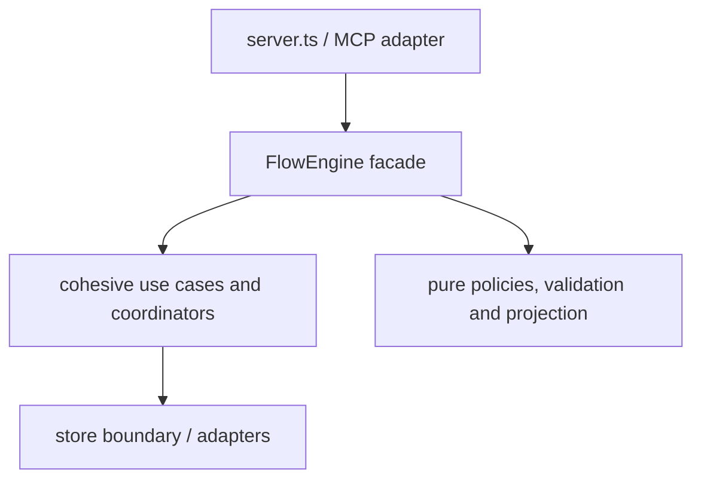

# FlowEngine evolutionary architecture

`LOCALIZER: PPIRTV-FLOW-ENGINE-RESPONSIBILITY-BALANCE`

This is the living public map for editing `src/flow-engine.ts`. It explains
where responsibilities belong, how earlier extractions were performed and what
proof every future editor must provide.

### FE-2026-11-09-ONDA6-PPIRTV-CHECKIN-SHRINK — SHRINK

Onda 6 (Trilho `2026-11-09-onda6-ppirtv-checkin`, flow 3917; GO único do dono com mesa QUESTIONADORES-ATIVADO; fotografia declarada com RESPIRA antes do corte): a família de **apresentação de status `ppirtv_checkin`/`ppirtv_checkout`** mora fora do monólito — `src/ppirtv-checkin.ts` (696L). 23 funções + 2 consts em 3 blocos contíguos: check-in/out (`ppirtvCheckIn/Out`, `checkInTrailAlignment`, `compactPpirtvCheckout`), accountability (evidence/learning/loop/memory/utility + irmãs internas), evidence-quality (acompanha o `evidenceCheckoutAccountability` migrante) e work-progress (`progressText`/`validate`/`events`/`summary`) + `memoryMiningStatus`. Bloco **autônomo** (zero função não-migrante consumida — probe antes do corte); motor importa 13 símbolos. Motor 6156→**5503 (−652L líquido)** com zero símbolo novo; suíte 848+4=852 sem editar teste; **vacina Onda 5 paga no primeiro uso** (varredura anti-import-morto pegou 2 mortos antes do commit). Ficam: eixo memory-v2/promotion (onda futura) e utils do motor (`progressReceipt`, `assertPhase`, `normalizeSuggestedCooperators`, `materialActiveCredits`, `memoryWriterRuntimeSummary`, `collectTempFiles`).

### FE-2026-11-09-ONDA7-MEMORY-PROMOTION-SHRINK — SHRINK (última onda da maratona)

Onda 7 (Trilho `2026-11-09-onda7-memory-promotion`, flow 3952; GO único do dono): a **política de candidatos/promoção de memória v2** mora fora do monólito — `src/memory-promotion.ts` (458L). 33 símbolos (32 funcs + `V2CommittedBoundaryError`) em bloco contíguo de 432L: resolução de candidatos, IDs/receipts v2, escopo confinado, promotion, decisão de escrita, ledger de candidatos. `errorMessage` → **lang-utils** (fonte única). Motor 5342→**4933 (−409L)** *(emenda adversarial: baseline real 5341, delta −408, range l.4837-5268)*; suíte 848+4=852 sem editar teste; vacina TOTAL pegou 9 mortos antes do commit; camping com janela acumulada defacc1→corte. **Com esta onda a maratona de famílias TERMINA: resta apenas o núcleo de orquestração, por desenho.**

### FE-2026-11-09-ONDA6-PPIRTV-CHECKIN-SHRINK — emenda adversarial (2026-11-09)

Adversarial 0 P1/3 P2/10 P3 consolidada ANTES do verdict: **42 imports mortos cortados** (8 mortificados pelo corte desta onda + **34 acumulados das Ondas 1-5** que nenhuma varredura pegou — a vacina da Onda 5 só olhava o bloco novo; agora varre todos os blocos, parser por bloco completo); monólito 5503→**5341**. Contagens reconciliadas: baseline real 6155L (`wc -l`; 6156 era linha fantasma), import do motor = 12 símbolos (`checkInTrailAlignment` foi cortado pela vacina e o contador textual ficou pré-corte), mensagem do b5d5f95 dizia 25 imports (real 23). **Nota de imutabilidade**: o record ONDA6 selado carrega um campo `__stash__: true` — artefato do script de preparação do ledger que vazou para o JSON final; sem produtor nem consumidor (nenhuma máquina lê/escreve); o record é imutável pós-selo, portanto a emenda é textual NESTE documento, e a regra para o futuro é serializar records por whitelist de campos conhecidos.

### FE-2026-11-09-ONDA5-FISCAL-BLOCKERS-SHRINK — SHRINK

Onda 5 (Trilho `2026-11-09-onda5-fiscal-blockers`, flow 3874; GO único do dono; eixo indicado pelo oráculo clean-code — SRP cap. 10: "uma razão de mudar"; *organizing for change*): a política de **diagnóstico de bloqueio fiscal + ações diretas** mora fora do monólito — `src/fiscal-blockers.ts` (995L). ~48 símbolos: família librarian completa, blocker-diagnostics, memory-mining-blocked, ações diretas (nextRequiredActionFor e irmãs), loop/escalation, `hasReviewEvidence` + `FISCAL_POLICY_DEPS`, `statusValue`, tipos (`BlockerDiagnostics`, `RecallVisualStatus`, `MemoryMiningV2Summary`, `V2MemoryCandidateResolution`). `requireText`/`nowIso` → **lang-utils** (fonte única). Motor 7072→**6170 (−902L)** com zero símbolo novo; suíte 848+4=852 sem editar teste. Ficam: `evaluateFiscalPolicy` + helpers diretos (a avaliação), check-in/graphify, promotion-scope (eixos futuros). *(Emenda 2026-11-09, adversarial consolidada 0 P1/2 P2/8 P3: contagens reconciliadas por medição — baseline real 7071L, delta **−901L**; 50 símbolos top-level movidos (44 no selo AST + consts `FISCAL_POLICY_DEPS`/`MEETING_RESOLVABLE_BLOCKERS` não-AST + 4 tipos omitidos da lista do selo); 25 imports mortos do corte mecânico cortados na emenda.)*

### FE-2026-11-09-CURA6-SEAL-REMAINING — nota cronológica (sem record: fiscal puro)

Cura-6 (Trilho `2026-11-09-cura6-seal-remaining`, flow 3834; GO único do dono no veredito do $oraculo-clean-code — Rule 1 para o fiscal): segunda cura 100% fiscal (motor intocado, camping NOT_APPLICABLE, sem record). Fecha os 3 P2 da adversarial cura-5: (A) `LEDGER_PREFIX_RECORD_REMOVED:{id}` — record selado removido em ledger encolhido tinha reason próprio falso (`BASE_LEDGER_UNREADABLE` por TypeError engolido); (B) `birthRecords = chainRecords ?? [declaration]` — TODOS os records da chain nascem conferidos (blob+linhagem), não só o tail; (C) vacinas de invariância do `canonicalJson` (E discriminante com RED-por-mutação: stringify cru fabrica `LEDGER_HISTORY_MUTATED`; D integração). P3s Provide Context: `COMMIT_SEAL_TARGET_MISSING` distinto de `COMMIT_SEAL_COMMIT_NOT_FOUND` (o rev-list discrimina commit inexistente × commit-sem-target — o seal-diff lê pais PRIMEIRO, blob depois, cada try com seu enum); enums do B2 e do loop LEDGER_PREFIX unificados com o vocabulário do selo. 3 REDs baseline 1ed5dcb → GREEN; suíte 846+4=850. Episódio-ouro da mesa viva: a 1ª vacina (D) não vigiava nada — a mutação canonicalJson→stringify NÃO a derrubava (as chaves reordenadas eram DELETADAS antes da comparação); vacina se PROVA por mutação antes de contar como rede.

### FE-2026-11-09-CURA5-SEAL-ERROR-PATH — nota cronológica (sem record: fiscal puro)

Cura-5 do P1 da adversarial cura-4 (Trilho `2026-11-08-cura5-seal-diff-crash`, flow 3805; lição `REGRESSAO-ERROR-PATH-TRY-CATCH` — diff que move try/catch EXIGE RED do caminho de erro): **primeira cura 100% fiscal** — `src/flow-engine.ts` intocado, camping `NOT_APPLICABLE`, sem record no ledger por desenho (records são por mudança do motor). No validador: (1) **P1 crash** — o `rev-list` de linhagem do seal-diff mora no MESMO `try` do `rev-parse` do blob (commit inexistente devolve `COMMIT_SEAL_COMMIT_NOT_FOUND` estruturado em vez de crashar o CLI sem receipt — regressão do 8ad367a); (2) **P2 blob do nascimento** — o path de declaração (B2) confere `commit:TARGET` contra o `head_blob` declarado (`COMMIT_SEAL_BLOB_MISMATCH:{id}` — linhagem honesta + blob mentiroso era selo verde); (3) **P2 deselagem** — guard do LEDGER_PREFIX olha o PAR (`after.commit || before.commit` com `recordChanged`): remover o commit de record selado em diff de motor reprova `COMMIT_SEAL_COMMIT_MISSING:{id}`; (4) **P2 canônico** — `canonicalJson` (chaves ordenadas recursivas) nas 3 comparações de record (LEDGER_PREFIX, `preservedPrefix`, `COMMIT_SEAL_RECORD_CHANGED`): re-serialização com outra ordem de chaves não fabrica nem esconde mudança. 3 REDs no baseline c7b2ed6 → GREEN; suíte 842+4=846. Aprendizado de fixture: o `--head WORKTREE` é o que faz o seal-diff ler o worktree sujo (default `head=HEAD` ignora), e o declaration só é selecionado quando `base_blob`/`head_blob` casam o par do diff — fixture que não casa o par exercita a massa `DECLARATION_FIELD_REQUIRED`, não o caminho de selo.

### FE-2026-11-08-CURA4-SEAL-LINEAGE-UNICO — EXCEPTION integrity

Cura-4 dos P1s da adversarial cura-3 (Trilho `2026-11-08-cura4-seal-lineage-unico`, flow 3778; ordem do livro confirmada pelo $oraculo-clean-code: Rule 1 rede antes da pá, F4/G9 enterrar morto, G5 helper único): **`sealLineageReasons(after, before, parents)`** é a fonte ÚNICA de linhagem consumida pelos 3 gates — LEDGER_PREFIX dispara quando o record ENTRA ou MUDA no diff (motor-laundering fechado: parent removido com commit inalterado reprova `COMMIT_SEAL_PARENT_REMOVED` mesmo em diff de motor, RED B1), path de declaração confere record NOVO com commit (fabricado reprova, RED B2), seal-diff sem continue-cego (blob mismatch não fica mascarado). **`selectorIsReplayable`** = `selectorRunsAsRegex` + self-match (irmão colidente fechado); **grandfathering DECLARADO** em `LEGACY_SELECTOR_EXEMPT` (id CURA2; replay bootstrap verde com isenção visível, RED C). **F4**: `providedSatisfied` enterrado (0 call sites; comentário falso do laudo saiu junto — cap. 4). **G5**: `backfillReattachLedger` único com ordem unificada reattach→flow_created→goal_started nos 2 caminhos do `startGoal` (aceito pelo dono); imports do motor consolidados. **Dialetos pinados**: teste novo prova que o MESMO input misto `[123,"a.ts"]` coage no dialeto verdict (`reviewedChangedFilesForVerdict`) e é REJEITADO no strict (`strictPathArray`) — unificação silenciosa quebra teste. Bug latente: `importSpecifier(consumer, undefined)` lançava no catch do bootstrap → falso `PRODUCT_CONSUMER_NOT_FOUND` para EXCEPTION sem destination (guard adicionado). 4 REDs no baseline 7d5b67b → GREEN; suíte 839+4=843 sem editar teste.

### FE-2026-11-08-ONDA4-GATE-RESOLUTION-SHRINK — SHRINK

Onda 4 da maratona (Trilho `2026-11-08-onda4-gate-resolution`, flow 3751): o que restava do eixo gate-resolution no monólito migra para `src/gate-resolution.ts` (646→784L) — **11 símbolos**: wrappers de requisito (`hasRequirement`, `officialGoalNeedsCanonicalVerdict` — este com 7 consumers no motor (emenda adversarial Onda 4: o "9" era contagem de linha do baseline incluindo a definição e o call interno que migrou), exportado), atestação de review (`reviewEvidenceRequested`, `structuredReviewAttestationRequested`) e a família de coerência review×changed_files do VERDICT (`changedFilesMatchReview`, `reviewedChangedFilesForVerdict`, `reviewRemainsCurrent`, `verdictHistoryIndex` + **renomes anti-colisão** `canonicalVerdictChangedFiles`/`verdictChangedFilesSnapshotAt`/`verdictChangedFilesAfterEvent`). **Variantes irmãs de EVIDENCE coabitam SEM unificação** — emenda adversarial Onda 4: os CANONICALIZADORES são semanticamente equivalentes (probe 16 casos divergent=0); a divergência REAL mora na coerção de dados de evento (`toStringArray` coercivo × `reviewPathArray` predicado que descarta não-array) e na comparação (`changedFilesMatchReview` canonicaliza × `sameReviewPaths` compara cru) — unificar essas mudaria comportamento (laudo 2026-10-17); a `stringArray` LOCAL do destination é predicado-guard e recebe a conversora de lang-utils sob alias `toStringArray` (semânticas distintas coexistindo com nome próprio). `needsReviewCoherence` PERMANECE no motor (orquestração que chama fiscal — desenho do mapa Onda 0). **Higiene EST-20261108-ADV-ONDA3 itens 1-4 no mesmo corte (ESCOTEIRO-ONDA)**: header do meeting-policy reescrito, `researchLoopSequence`/`emergencyLoopSequence`/`badLoopReviewSequence`/`cooperatorSkillResolution` des-exportados (consumo in-module), par morto `hasMaterialMeetingOrRegress`+`hasMaterialMeeting` removido com rg de ausência de consumidor, imports duplicados consolidados, `truthy` privada do gate-resolution renomeada `providedSatisfied` (dialeto PROVIDED: array vazio = presente = true; nota do laudo). Motor **7223→7097 (−126L)**; suíte 835+4=839 sem editar teste.

### FE-2026-11-08-CURA3-SELO-PARENT-OBRIGATORIO — EXCEPTION integrity

Cura-3 dos P1/P2s da adversarial da cura-2 (10/10; Trilho `2026-11-08-cura3-selo-parent-obrigatorio`, flow 3719): **P1 seletor-regex** — `vitest -t` trata o seletor como REGEX; título com parênteses literais casa `includes()` mas roda **0 testes com exit 0** no replay (falso verde; o seletor do record CURA2 rodava 22 skipped/0). Helper `selectorRunsAsRegex` integrado nos DOIS gates de record e no path de declaração (`evidence_selectors` → `EVIDENCE_SELECTOR_REGEX_INVALID:{file}`; `red_evidence` → `RED_SELECTOR_REGEX_INVALID:{path}::{selector}`) — reprova somente quando substring acha E regex não casa (caracteres regex em seletor exato do título não reproduzem falso positivo). **P2 omissão de parent** — selagem vira opt-out fechado: `evaluateCommitSealDiff` exige `parent_commit` em record que ganha `commit` (`COMMIT_SEAL_PARENT_MISSING:{id}`), reprova remoção em seal-diff (`COMMIT_SEAL_PARENT_REMOVED:{id}`), e o path de declaração `LEDGER_PREFIX` confere a **linhagem** (blob + `sealedParentReasons` com pais do rev-list) de records selados no mesmo diff do motor — a rota same-commit que validava só blob fechou. **P2 backfill-terminal** — o early-return `reused && flowIsTerminal` do `startGoal` ganha o mesmo backfill do re-attach do branch comum (`ensureLedgerTransitionRecorded` alimentado pelo `history` persistido): a trilha do ledger não depende de qual caminho devolveu o status. Higiene: assert do backfill comum pina `_recovered` com `toHaveLength(1)`, typo P2/P2, prosa truncada do MD curada. 3 REDs provados no baseline → GREEN 38/38; suíte 835+4=839.

### FE-2026-11-08-ONDA3-MEETINGS-POLICY-SHRINK — SHRINK (pays FE-DEBT-006)

> **Emenda documental (adversarial Onda 3, conferida na sessão dona 2026-11-08)**: contagens reconciliadas — o record (imutável) lista **47** `removed_symbols`/`symbol_mappings` (a régua do validador não coleta `VariableStatement`; a `USER_PROFILE_POINTER` const movida fica fora da lista); **48** declarações top-level moram hoje em `meeting-policy.ts` (47 símbolos + 1 const); **54** declarações top-level saíram do monólito no diff todo (47 meeting-policy + 4 lang-utils + 2 fiscal + 1 const — o `behavior_preserved_by` do record); e o delta de linhas medido é **8179→7210 (−969)**, não −970 (o "49" da prosa original não corresponde a nenhuma contagem reproduzível). A prosa do record JSON é imutável por contrato (`LEDGER_HISTORY_MUTATED`); esta nota é a verdade documental. Nota correlata: `consumers: ["src/server.ts"]` do record aponta o consumidor de produto INDIRETO — o importador direto é `src/flow-engine.ts`; records futuros listam o importador direto (convenção dos irmãos).

Onda 3 da maratona (Trilho `2026-11-08-onda3-meetings-policy`, flow 3693; o corte gordo): a política PURA de meetings/required_cooperation sai do monólito **inteira** — 49 símbolos top-level para `src/meeting-policy.ts` (941L): sinais required_cooperation, material, diagnóstico, participantes, kind/type, ledger-data, apply/assert, **família sequencer completa** (`requiredCooperationSequence`, `loopEscalationAction`, `loopMeetingSequence`, `researchLoopSequence`, `emergencyLoopSequence`, `badLoopReviewSequence`, `reviewRequiredSequence`, `LoopMonitor` — a dependência cruzada de `loopMeetingSequence` com as irmãs refutou a exclusão inicial por "outros eixos": separar seria meio-cluster), resolução de skills de cooperação, cooperators e checkout de cooperação. Por fonte única acompanharam: `unique/truthy/stringArray/uniqueCooperators` → `src/lang-utils.ts` (consumidor duplo motor+policy, zero ciclo) e `latestFiscalBlockEvent`/`MEMORY_MINING_BLOCKED_VERDICT_REASON` → `verdict-fiscal-policy.ts`. **Monólito 8180→7210 (−970L, −12%)** com zero símbolos adicionados (AST diff); suíte 832+4=836 sem editar teste; mensagens byte a byte. **Camping SHRINK `pays_debt_id=FE-DEBT-006` — a dívida sai do ledger como aberta.** Fachada de IO (openMeeting/recordMeeting/closeMeeting + Unlocked) fica como cola.

### FE-2026-11-08-CURA2-VALIDADOR-SELO-VIVO — EXCEPTION integrity

Cura-2 do P1 da adversarial do corte de cura (Trilho `2026-11-08-cura2-validador-selo-vivo`, flow 3667): o `sealedParentReasons` vivia **só no replay de bootstrap** — caminho morto desde o manifesto do ledger existir (prova executada: rodada real devolvia `PASS` com `ledger_bootstrap: null`). Agora o **selo vivo** (`evaluateCommitSealDiff`) confere a linhagem: record selado cujo `parent_commit` não casa nenhum pai real do rev-list reprova `COMMIT_SEAL_PARENT_MISMATCH:{id}` (RED com fixture git de selagem falsa que o baseline aceitava). O predicado de casamento vira **fonte única** (`parentMatchesCommit`) consumido pelo helper, pelo replay e pela seleção de pai — `selectedParent` é sempre um **full sha** do array de pais (o prefixo armazenado nunca vai cru ao rev-parse); merge com pai armazenado mentiroso emite só MISMATCH (`COMMIT_PARENT_REQUIRED` reservado à ausência); bootstrap ganha a isenção de EXCEPTION sem `destination_module` (simetria com o path de declaração — o próprio record CURA era vítima potencial). No motor: **backfill do re-attach** — quando o append do ledger falha depois do save, o reuso confere o history persistido × ledger e completa a trilha via `ensureLedgerTransitionRecorded` (`spt_traceability_reattached_recovered`, `recovery_reason: state_persisted_ledger_missing`; RED: retry deixava o ledger permanentemente sem o evento). Higiene: regex `.*`/s do teste trocada por `[^;]*` (não cruza critérios), seção da cura movida ao rodapé cronológico com a emenda documental do red_command para forma ASCII reproduzível (record imutável), commits curtos remanescentes (PATH-ATTRIBUTION/CONVERGENCIA) em full sha. 2 REDs → GREEN 35/35; suíte 832+4=836.

### FE-2026-11-08-CURA-ADVERSARIAL-LINHAGEM-LEDGER — EXCEPTION integrity

Corte de cura dos achados CONFIRMADOS das adversariais Onda 2 (5/5) e Onda 2b (10/10), conferidos por checagem determinística na sessão dona (Trilho `2026-11-08-cura-adversarial-linhagem-ledger`, flow 3637): **P1 2b** — o ledger do evento `spt_traceability_reattached` era escrito ANTES de `assertNoSecretLikeItems` e `saveFlow` (quebrando a invariante dos irmãos `goal_started`/`goal_reused`), deixando trilha falsa de re-attach que nunca persistiu e duplicando em retry; agora SOMENTE o `this.ledger` (append-only, sem compensação) move para depois do `saveFlow` (flag `reattachLedgerData`, actor `dex-code`) — o `history.push` permanece no bloco do re-bind, persistindo atomicamente com o flow. **P1 Onda 2** — helper puro `sealedParentReasons` no validador reprova `COMMIT_PARENT_MISMATCH` quando o pai armazenado não casa nenhum pai real, **inclusive em commit de pai único** (o ponto cego `parents[0]` vencia), aceitando prefixo não-ambíguo (≥7 hex, selos legados); **linhagem do ledger corrigida** em campos isentos de `stripSeal`: PATH-ATTRIBUTION `parent_commit` `5b66f56`→`0bdd375` full (pai real cujo blob é o próprio `base_blob` do record), CONVERGENCIA `parent_commit` e commit do ONDA2B em full sha. **Correção documental**: a prosa do record ONDA2B diz "(FE-DEBT-006 fechada)" mas o estado-machine da dívida é `open` até o SHRINK pagador — o JSON é imutável (LEDGER_HISTORY_MUTATED); a verdade é a entrada de dívida + este MD. Higiene: CAPACITY dedup, 3 gaps de teste, hoist `traceIndexFor`, un-export `SptTraceIndex`. 2 REDs provados → GREEN 33/33.

## Exact trigger

> Any diff that changes one line of `src/flow-engine.ts` enters the camping
> gate. Read-only consultation, diagnosis, review, CRG and trace return
> `NOT_APPLICABLE`.

Run:

```powershell
npm run check:flow-engine
node scripts/validate-flow-engine-boundary.mjs --help
```

The fiscal is read-only. It compares Git blobs and the declaration in
`flow-engine-evolution.json`; it never edits or manufactures an abstraction.
An explicit comparison cannot ignore a dirty target worktree.

## Target architecture



Dependency direction is downward. A collaborator must not import
`FlowEngine`. The facade preserves public API, error identity, ledger, store,
idempotency and compatibility while policy and new domain decisions live
outside it.

## Invariants

1. New policy, validation, projection, normalization, helper, branch and domain
   type are born outside `flow-engine.ts`.
2. The facade may retain orchestration glue while its seam is unsafe.
3. A new export requires a real product consumer or an external contract;
   an isolated unit test is not a product consumer.
4. One diff moves one cohesive responsibility. No broad rewrite, speculative
   DI, factory, interface or container.
5. A collaborator never reverse-imports `flow-engine.ts`.
6. Public behavior is compared before/after and the collaborator receives a
   direct causal test.
7. LOC is telemetry. Named responsibilities, symbols, decisions, dependency
   direction and product consumers decide the gate.
8. Every material delivery updates this document, the machine ledger and
   `CHANGELOG.md` in the same change.
9. The declared product consumer must use a runtime import of the facade or
   destination; the facade must use a runtime import of the destination.
   Type-only/unused imports and merely naming existing files are not evidence.

## Gate modes

| Mode | Passes when | Fails when |
| --- | --- | --- |
| `NOT_APPLICABLE` | target is absent from the diff | it is used to hide a real target change |
| `SHRINK` | named pre-existing symbols leave the facade, decisions do not grow, behavior is preserved and any open debt is paid | only comments/formatting/other responsibility were removed |
| `CONTAIN` | behavior lives in a collaborator and the facade gains only import/call/result or error adaptation | a hard decision is added/relocated, a helper, symbol, public surface or more than 20 nonblank glue lines enter |
| `EXCEPTION` | integrity, security, public compatibility or urgent hotfix; causal RED, rollback, expiry, at most 30 nonblank lines and two decisions | it follows another exception or lacks bounded proof |
| `FAIL` | — | declaration, structure, owner, consumer, evidence, changelog or debt payment is missing |

`CONTAIN` opens payable debt. A later `CONTAIN` cannot pass while that debt is
open. A bounded `EXCEPTION` may protect an urgent incident, but it does not pay
the debt and cannot be repeated consecutively.

Hard decisions are `if`, ternary, loops, `case` and `catch`; the fiscal tracks
their containing symbol and expression so deleting an unrelated branch cannot
compensate a new one. `&&`, `||` and `??` are separate guard telemetry:
`CONTAIN` permits at most one only as a named `value ?? fallbackCall()`
call/result adaptation; boolean guards are policy and fail.

## Machine declaration

Each real target diff adds one record to
`docs/architecture/flow-engine-evolution.json`. The fiscal matches
`base_blob` and `head_blob`; unrelated deletion cannot pay the record.
After this gate's introduction, the existing ledger is an immutable prefix:
one target diff appends exactly one record, chains from the preceding target
blob and cannot erase or reorder open debt. Only a validated `SHRINK` may set
`pays_debt_id`.

The one-time bootstrap is not a trust shortcut: the fiscal replays every
historical record from its Git blobs/commit, binds `base_blob` to the real
commit parent and rechecks SPT, destination,
runtime consumer edge, causal test selector, architecture and changelog. The
receipt reports `ledger_bootstrap.status`, record count and sealing.
For a merge commit, the record must name `parent_commit`, and it must be one of
the commit's actual parents.

Minimal `SHRINK` example:

```json
{
  "id": "FE-YYYY-MM-DD-SHORT-NAME",
  "mode": "SHRINK",
  "base_blob": "<git blob before>",
  "head_blob": "<git blob after>",
  "spt_path": ".agents/PLAN-TASKS/<trilho>.md",
  "responsibility": "One responsibility that moved",
  "owner": "$oraculo-refatoracao",
  "destination_module": "src/<cohesive-module>.ts",
  "consumers": ["src/server.ts"],
  "evidence": ["tests/<causal-test>.test.ts"],
  "evidence_selectors": {
    "tests/<causal-test>.test.ts": "exact test title or causal selector"
  },
  "changelog_marker": "unique delivered-change phrase",
  "architecture_marker": "FE-YYYY-MM-DD-SHORT-NAME",
  "removed_symbols": ["symbolThatLeftTheFacade"],
  "symbol_mappings": { "symbolThatLeftTheFacade": "symbolInDestination" },
  "same_responsibility": true,
  "behavior_preserved_by": ["tests/<before-after>.test.ts"],
  "pays_debt_id": "FE-DEBT-NNN"
}
```

Evidence paths must exist and include a causal test whose declared selector is
present in the file; `npm run check` executes that test suite. `CHANGELOG.md`
must add a new marker under `Unreleased`, and this document must add the new
`architecture_marker`. Debt records the responsibility that opened it, while
`payment_scope: any_verified_shrink` means any cohesive seam may pay the global
monolith balance — but only through every structural and causal `SHRINK` proof.
An `EXCEPTION` accepts only an ISO
date within 30 days or `next diff that touches src/flow-engine.ts` as expiry,
plus an actionable rollback and an existing `test-path::exact test title` RED
bound to the base blob, observed failure and reproduction command.

Useful blob commands:

```powershell
git rev-parse HEAD:src/flow-engine.ts
git hash-object src/flow-engine.ts
```

## Small-agent decision procedure

1. Is `src/flow-engine.ts` absent from the diff? Return `NOT_APPLICABLE`.
2. Is a named existing responsibility leaving it? Prepare `SHRINK`.
3. Is all new behavior already outside and only glue enters? Prepare
   `CONTAIN`, but first check for open debt.
4. Is this an urgent allowed incident? Prepare bounded `EXCEPTION`.
5. Otherwise stop with `FAIL`; do not guess, compress code or delete unrelated
   lines.
6. Run the fiscal and follow `reasons` plus `next_required_action`.

## Evolution already performed

| Record | Mode | Responsibility | Destination | Result |
| --- | --- | --- | --- | --- |
| `FE-2026-08-01-RECALL-CONSUMPTION` | `SHRINK` | recall reference normalization/validation | `src/memory/recall-consumption-contract.ts` | responsibility removed from facade |
| `FE-2026-08-02-SPT-PATH-DIAGNOSTICS` | `CONTAIN` | actionable `spt_path` diagnostics | `src/spt-path-diagnostics.ts` | new behavior contained; `FE-DEBT-001` later paid by `FE-2026-10-13-GOVERNED-TAG-CONTRACT` |
| `FE-2026-08-11-POST-VERDICT-MINING-GATE` | `EXCEPTION` | prevent terminal completion before post-verdict mining | `FlowEngine` terminal glue | bounded integrity guard with causal MCP RED |
| `FE-2026-10-13-GOVERNED-TAG-CONTRACT` | `SHRINK` | V2 promotion metadata policy (incl. governed tag assertion) | `src/memory/mining-policy.ts` | responsibility removed from facade; pays `FE-DEBT-001` |
| `FE-2026-10-15-FISCAL-BLOCK-TEACHING-MESSAGE` | `CONTAIN` | actionable fiscal-block teaching messages (split codes, state numbers, unblock route) | `src/error-envelope.ts` | glue-only message enrichment (delta 0); `FE-DEBT-002` open |
| `FE-2026-10-17-REVIEW-LOOP-FISCAL-SANE` | `EXCEPTION` | stamp review validity on `evidence_attached`, gate loop-monitor reset on it, truthful review snippet | `src/gate-resolution.ts` | bounded integrity hotfix with causal RED (incident 2026-10-17, ~60 invalid retries); expires next diff that touches `src/flow-engine.ts` |
| `FE-2026-10-18-GATE-INTEGRITY-TYPED-PHASES` | `SHRINK` | phase-transition policy (`phaseAdvanceAllowed`) extracted to the profile SSOT; mechanical fast-track and cross-profile return fail closed | `src/phase-profile.ts` | pays `FE-DEBT-002`; laudo 2026-10-17 F1/F2/F3 closed with causal RED |
| `FE-2026-10-18-GATE-INTEGRITY-F4F5F6` | `EXCEPTION` | secret-like rejection at the three entrypoints, stale-gate snapshot invalidation and snapshot-checked reuse | `src/gate-resolution.ts` | bounded integrity guard (laudo F4/F5) with causal RED; expires next diff that touches `src/flow-engine.ts` |
| `FE-2026-10-18-MEMORY-GATE-LOOP-SHRINK` | `SHRINK` | memory-mining policy predicates and loop-window math (append-only history, reconciliation-id guard) | `src/memory/mining-policy.ts` | 12 symbols leave the facade (-142 nonblank); pays no debt (`FE-DEBT-002` already paid by TYPED-PHASES); SPT memory-gate-loop-solubility, decisao A |
| `FE-2026-10-18-GATE-INTEGRITY-HARDENING-2` | `EXCEPTION` | fail-closed guards for the revalidation laudo (R1-R10: return direction, typed proof, review currency, secret choke points, declarative proof, inverted documental allowlist, preflight diagnostics) | `src/gate-resolution.ts` + `src/security/secret-redaction.ts` | causal RED (10/2) in `.agents/AUDITORIAS/EVIDENCIAS/2026-10-18-hardening2-red.log`; +12 nonblank, 2 symbols out (secret asserts to SSOT); SPT gate-integrity-hardening-2 |
| `FE-2026-10-18-GIT-CORROBORATION-COMMITS-SHRINK` | `SHRINK` | current-implementation fingerprint over the corroborated changed_files set; freeze `git_head_base` at first `goal_start`, corroborate commits via `git diff base..HEAD` at verdict, fail closed on orphan base, and exclude `.git/`/`.ppirtv/`/`.agents/` runtime noise from corroboration | `src/review-snapshot.ts` | symbol `flowWithCurrentImplementationFingerprint` leaves the facade; pays `FE-DEBT-003`; RED-first `tests/git-corroboration-commits.test.ts` 4/4 (commit-then-verdict burla NOVO-1 + falso positivo NOVO-2); SPT gate-integrity-hardening-3 |
| `FE-2026-10-18-GATE-INTEGRITY-HARDENING-3` | `EXCEPTION` | strict changed_files/deleted_files paths, current structured review on stale same-path review gates, and Git-diff corroboration at verdict | `src/gate-resolution.ts` + `src/review-snapshot.ts` | bounded integrity guard; RED probes A/A2/B/G; SPT gate-integrity-hardening-3; expires next diff that touches `src/flow-engine.ts` |
| `FE-2026-10-18-INPUT-NEVER-BLOCKING-F2-SHRINK` | `SHRINK` | input never-blocking front 2/3: deep `{"value": X}` unwrap at the single boundary, read-only tools never reject on form, persisted `provided` replay sanitized before merge, legacy-tolerant path normalization; spt_path classification substrate (`resolveSptPath`/`isDirectory`/`isFile`/`isInsideOrEqual`/`isSensitivePath`) leaves the facade | `src/input-unwrap.ts` + `src/spt-path-diagnostics.ts` | pays `FE-DEBT-001`; acceptance = consumer transcript replay `tests/consumer-replay-jumper.test.ts` 4/4 (goal_status full responds on dirty persisted gate; evidence_add wrapped arrays arrive flat); SPT input-nunca-bloqueante-frentes-2 |
| `FE-2026-10-26-VERDICT-FISCAL-POLICY-SHRINK` | `SHRINK` | verdict fiscal policy CCP tree (P1): fiscal nucleus (`evaluateFiscalPolicy`, `fiscalResult`/`requiredCoo`/`cooReason`, `fiscalMateriality`, `fiscalText`, `materialRiskText`, meeting triggers, `codeReviewRequired`, `hasReviewEvidence`, `recurringRisk`, `hasEnoughAttempts`, `regressLimitReached`) leaves the facade with explicit `FiscalPolicyDeps` bridges to neighbor axes until their own future cuts; facade keeps thin wrappers and call glue | `src/verdict-fiscal-policy.ts` | behavior preserved by suite 716|4 with zero test edits + probe A-F v2 6/6 on rebuilt dist; SPT verdict-fiscal-policy-tree |

`FE-2026-10-18-MEMORY-GATE-LOOP-SHRINK` removes the last in-facade mining
policy cluster: twelve predicates and helpers (`noMemoryWasPromoted`,
`memoryRequiredByFlow`, `memoryMiningCompletedWithNoCandidates`,
`memoryMiningStructurallyPromoted`, `memoryPostWriteValidationBlocks`,
`numericMemoryField`, `memoryIntentText`, `hasVerdictAfterLatestMemoryMining`,
`blockerSignature`, `loopWindowEvents`, `isLoopResetEvent`, type
`FiscalVerdictInput`) now live in `src/memory/mining-policy.ts`, the SSOT
already opened by `FE-2026-10-13-GOVERNED-TAG-CONTRACT`. The same visit lands
the decisao A fix for the insoluble memory-gate loop (SPT
memory-gate-loop-solubility): flow history is fully append-only — every
mining attempt appends its own `memory_mined` event — while idempotency lives
only in the V2 ledger keyed by reconciliation id, and `loopWindowEvents`
resets the escalation window only when the reconciliation id differs from the
previous mining (a duplicate re-mining after a positive verdict is not
progress; legacy events without an id still reset). Causal RED:
`.agents/AUDITORIAS/EVIDENCIAS/2026-10-18-memory-gate-loop-red.log`
(1 failed | 3 passed at base `695b439`); post-fix battery
`tests/memory-gate-loop.test.ts` (4 tests) plus the adapted recovery contract
in `tests/flow-engine-dex-memoria-v2.test.ts`; full suite 653 passed |
4 skipped. Pays no debt — `FE-DEBT-002` was already paid by
`FE-2026-10-18-GATE-INTEGRITY-TYPED-PHASES`.

`FE-2026-10-18-GATE-INTEGRITY-F4F5F6` is a bounded integrity exception (laudo
F4/F5, SPT gate-integrity-f4f5f6): the facade only gained pure-call guards —
`assertNoSecretLikePayload` at `createFlow`/`updateFlowFactsUnlocked`/
`startGoalUnlocked` (secret-like payload is rejected BEFORE persisting; the
`pipeline_evidence` attach now declares `satisfies: item.expected_evidence`),
plus `changed_files_snapshot` stamping, `invalidateStaleDownstreamGates` and
snapshot-checked `shouldReuseSavedGate`. All policy lives in
`src/gate-resolution.ts` (`gateSnapshotMatches`,
`invalidateStaleDownstreamGates`, `genericEvidenceSatisfied`). Causal RED:
F5 scenario D (`gate revisao passed + novo arquivo em changed_files
bloqueia o avanço sem nova revisao`) plus F4/F6 REDs in
`.agents/AUDITORIAS/EVIDENCIAS/2026-10-18-gate-integrity-f4f5f6-red.log`.
Pays no debt — `FE-DEBT-002` was later paid by `FE-2026-10-18-GATE-INTEGRITY-TYPED-PHASES`(stale claim fixed by hardening-2 on 2026-10-18).

`FE-2026-10-18-GATE-INTEGRITY-TYPED-PHASES` pays `FE-DEBT-002` through a
verified cohesive seam: phase-transition policy
(`phaseAdvanceAllowed`, plus `nextPhaseOrThrow` and `assertPhaseInProfile`)
now lives in `src/phase-profile.ts`, the declared SSOT for phase policy.
The mechanical fast-tracks in the facade consult the centralized
`changedFilesContainCode` catalog (`src/gate-resolution.ts`), so a
self-declared `mechanical` risk with code files keeps the full fiscal cycle
(laudo F3); cross-profile returns throw
`PPIRTV_INVALID_PHASE_FOR_PROFILE` before any mutation, unknown transitions
throw `PPIRTV_UNKNOWN_PHASE_TRANSITION`, and unknown phases never count as
terminal (laudo F2). Typed proof requirements (`PROVIDED_REQUIREMENT_KINDS`)
close laudo F1 in `src/gate-resolution.ts`. RED log and bateria live in
`tests/gate-integrity-hardening.test.ts` and
`.agents/AUDITORIAS/EVIDENCIAS/2026-10-17-gate-integrity-red.log`.

`FE-2026-10-17-REVIEW-LOOP-FISCAL-SANE` is a bounded integrity hotfix: the
incident of 2026-10-17 proved that an invalid review evidence resets the
loop-monitor window as false progress (count stayed 0 across ~60 identical
retries, escalation 6/8/9 unreachable). The validity computation lives in
`src/gate-resolution.ts` (`reviewEvidenceValidity`); the facade only stamps
the value on the event (`review_valid`, absent for non-review kinds —
retrocompatible: legacy events without the field keep resetting) and gates
`isLoopResetEvent` on `review_valid !== false`. The review snippet now lists
Pays no debt — `FE-DEBT-002` was later paid by `FE-2026-10-18-GATE-INTEGRITY-TYPED-PHASES`(stale claim fixed by hardening-2 on 2026-10-18).

`FE-2026-10-15-FISCAL-BLOCK-TEACHING-MESSAGE` pays no debt: the visit only
enriched the fiscal-block throw string with state numbers and split blocker
codes (metrics delta 0) while the projection responsibility lives in
`src/error-envelope.ts` (`PPIRTV-ERRO-QUE-ENSINA-ENVELOPE`). `FE-DEBT-002`
opens for the next fiscal-policy projection seam.

`FE-2026-10-13-GOVERNED-TAG-CONTRACT` pays `FE-DEBT-001` through a verified
cohesive seam (the fiscal accepts `payment_scope: any_verified_shrink`). The
2026-10-13 visit did not touch the post-verdict mining guard: that integrity
seam remains parked for its own causal Trilho (owner
`$oraculo-refatoracao`, `.agents/ESTACIONAMENTO.md`).

`FE-2026-10-18-GATE-INTEGRITY-HARDENING-2` (EXCEPTION, integrity) adds the
fail-closed guards demanded by the revalidation laudo of 2026-10-18:
`assertPhaseTransitionDirection` blocks forward `flow_return`/`goal_regress`
(`src/phase-profile.ts` SSOT), gate requirements carry `kind` and unknown or
mistyped proof fails closed, `GateRecord` stamps and rechecks
`implementation_fingerprint` for review-currency phases
(`reviewCurrencyAppliesToPhase`), contract-SPT risks pass the central secret
guard at the `validateSpt` choke point, approved `criterion_proof` satisfies
the generic evidence requirement, the documental allowlist is inverted
(extensionless build files are code), and `goal_gate_preflight` exposes the
promised `field`/`received`/`expected` diagnostic. All policy lives in
`src/gate-resolution.ts`, `src/phase-profile.ts` and
`src/security/secret-redaction.ts`; the facade keeps only guard calls
(+12 nonblank; the two local secret asserts moved to the redaction SSOT).
Causal RED: 10 failed / 2 passed at `598ae5d`
(`.agents/AUDITORIAS/EVIDENCIAS/2026-10-18-hardening2-red.log`), battery
`tests/gate-integrity-revalidation.test.ts` (13 tests), full suite 666
passed / 4 skipped. Expires: next diff that touches `src/flow-engine.ts`.


### Hardening-3 (2026-10-18)

FE-2026-10-18-GATE-INTEGRITY-HARDENING-3 is a bounded CONTAIN with
FE-DEBT-003 open. Policy moved to the SSOTs: strictPathArray /
mergePathFacts / reviewCurrencyMissing in src/gate-resolution.ts and
gitChangedFiles / withGitCorroboratedChangedFiles in
src/review-snapshot.ts. The facade keeps only call/result glue. RED probes
A/A2/B/G at .agents/AUDITORIAS/EVIDENCIAS/2026-10-18-hardening3-red.log;
battery tests/gate-integrity-hardening-3.test.ts covers R2/R3/R6. R5 remains
a documented decision: generic evidence still accepts a passed
criterion_proof; the review gate content binding is enforced by R3, not by
a phase-specific proof filter. A future contract can add that filter. R7 has
a documented post-commit seal exception: 598ae5d per-commit replay fails
because its record commit was added in 76e9c94; the cumulative replay and
76e9c94/947fdb4 replays PASS.

### Mining deposit visibility (2026-10-27)

FE-2026-10-27-MINING-DEPOSIT-VISIBILITY-CONTAIN is a glue-only CONTAIN with
FE-DEBT-004 open. The mining deposit visibility policy (when the summary
must expose the empty funnel via `nuggets_collected` +
`deposit_guidance`) lives in the SSOT `src/memory/mining-policy.ts`
(`EMPTY_MINING_DEPOSIT_GUIDANCE` + pure projection
`emptyMiningDepositGuidance`); the facade only projects the call into the
legacy summary/return and the `mineMemoryV2` summary/return — 8 nonblank
glue lines, zero new decision points, guards, symbols or exports in the
monolith. Causal RED: 9 failed / 0 passed preserved at
`.agents/AUDITORIAS/EVIDENCIAS/2026-10-27-mining-deposit-red.log`; suite
`tests/mining-deposit-visibility.test.ts` (9 tests, both writer paths +
unblock route + delphi build vocabulary). Debt FE-DEBT-004 (payable by any
verified shrink): move the mining summary/return projection fill out of the
facade into the mining SSOT when a safe seam exists. FE-DEBT-001/002/003
are already paid (`FE-2026-10-13-GOVERNED-TAG-CONTRACT`,
`FE-2026-10-18-GATE-INTEGRITY-TYPED-PHASES`,
`FE-2026-10-18-GIT-CORROBORATION-COMMITS-SHRINK`).

### Mining egress shrink (2026-10-28)

FE-2026-10-28-MINING-EGRESS-SHRINK pays FE-DEBT-004 (opened by the CONTAIN
FE-2026-10-27-MINING-DEPOSIT-VISIBILITY-CONTAIN). The whole mining unblock +
visibility egress policy cluster left the facade by Move Function:
`memoryMiningRequiredSequence` now lives in `src/memory/mining-policy.ts`
(pure policy — consumes only flow_id and the SSOT builders; facade call sites
`required_tool_sequence` and `executable_route` import it), and the
`nuggets_collected`/`deposit_guidance` pair collapsed into the single SSOT
helper `miningVisibilityEgress`, spread at the four facade projection points.
Behavior preserved by the live suite with zero test edits: BASELINE 725|4 at
`a678a1a`, network suites 222/222 (mining-deposit 9 + engine 198 +
mining-policy 15). No new debt: record `debt: null`; the camping gate for
sibling cuts (sub-eixo meetings) is unblocked again.

## FE-2026-10-29-ENV-SNAPSHOT-REDACTION-CONTAIN

PPIRTV-ENV-SNAPSHOT-001 (SPT `2026-10-29-env-snapshot-sensitive-redaction`):
the strict review-attestation route called `fingerprintReviewedImplementation`
directly (no redaction), so a frozen third-party `.env` still blocked
`attachEvidence kind=code_review` even after the SSOT gained the redaction
policy (emenda barata 2, found in T-2 GREEN). Both routes — current
`withCurrentImplementationFingerprint` and strict attestation — now share the
SSOT wrapper `strictReviewSnapshotFingerprint` in `src/review-snapshot.ts`;
the facade swap at the attestation site is pure delegation (no new decision,
symbol, or export in the monolith; net nonblank delta negative). The
declaration-of-provenance policy (`redactableSensitivePaths`) lives entirely
in the SSOT. Causal test: `tests/env-snapshot-sensitive.test.ts` ("vítima
end-to-end: flow com .env congelado destrava (gate revisão + verdict sem
SENSITIVE_PATH)"). Record mode CONTAIN, `glue_only: true`,
`destination_module: src/review-snapshot.ts`, opens payable debt
`FE-DEBT-005` (extract the strict-fingerprint option assembly from the
facade on the next verified SHRINK seam).

## Safe seam sequence

`FE-DEBT-001` was paid by `FE-2026-10-13-GOVERNED-TAG-CONTRACT`; `FE-DEBT-002` by
`FE-2026-10-18-GATE-INTEGRITY-TYPED-PHASES`. `FE-DEBT-003` is open (CONTAIN
`FE-2026-10-18-GATE-INTEGRITY-HARDENING-3`): extract the remaining path/review/Git
guard glue from the facade when a safe seam exists. The sequence below is a candidate map for future extractions,
selected one seam at a time by the active SPT, after fresh mapping and causal baseline:

1. work-progress contract;
2. pipeline-input contract;
3. one family of goal-fiscal policy;
4. blocker guidance or evidence-quality policy;
5. status/checkout projection;
6. meeting coordinator;
7. pipeline runner;
8. goal lifecycle;
9. memory-mining V2 last, because it is more coupled.

The sequence is a candidate map, not permission to extract automatically. The
active SPT selects exactly one seam.

## Ownership and maintenance

### FE-2026-11-02-FISCAL-SIGNALS-SHRINK

`countHistory` e `countRegressions` saem da fachada para o modulo fiscal com
semantica preservada. O relato de contagem passa pelo mesmo modulo, sob lock
existente; `recurring_risk` boolean adiciona declaracao auditada sem regex.
FE-DEBT-005 e paga por este seam coeso, conforme `any_verified_shrink`.
Provas: T26/T26b do engine, bateria fiscal adversarial e receipt do gate
`check:flow-engine`; nenhum novo armazenamento ou dependencia.

### FE-2026-11-05-VERDICT-LEARNING-FILTRO-FINDINGS (SHRINK)

SHRINK (issue #5.2, Trilho 2026-11-05-verdict-learning-filtro-findings): a
seleção de aprendizado do veredito (`deriveVerdictLearning` +
`isStrongLearningText`) saiu da fachada como módulo puro e coeso
`src/verdict-learning.ts` (tipos por import de mining-policy/domain; sem
ciclo; fachada ganha só o import e a chamada de l.2767). Comportamento do
corte: review_findings só viram gold_mining com texto forte (mesma regra do
rationale); a promoção cega criava candidatos de confiança baixa (2 gerados
ao vivo pelo flow 2950 — a prova do sintoma). RED 1/1 no baseline
(`tests/verdict-learning-filter.test.ts`); guard `mining-policy` verde sem
edição; porta explícita `verdict_gold_mining` inalterada.

### FE-2026-11-02-FISCAL-VERDICT-NAO-POSITIVO-INTEGRITY (EXCEPTION)

EXCEPTION integrity (revisao em dupla do merge 2e63c8c): verdict_recorded de
qualquer status fechava o relato de recorrencia — `nao_pronto` gravado desarmava
o fiscal e o positivo seguinte passava sem tentativas (falso-verde). A fachada
ganha so glue (+21 nonblank, +2 decisoes dentro do orcamento EXCEPTION): retem
`recurring_risk=false` do relato precoce e chama `reportRecurringRiskCleared`
apos gravar o veredito; a politica (scan positivo-only, dedup, builder do teto
terminal `close_flow_with_reservation`) mora em `src/verdict-fiscal-policy.ts`.
RED causal: 4 casos novos falham no baseline (blob 52d5e72), selector
`tests/fiscal-recurrence.test.ts::veredito rejeitado com false NAO persiste
sinal nem apaga pending true`; rollback = revert do commit; expira no proximo
diff que tocar a fachada. Nao paga divida; a janela lexical de materialidade
fica tabuada em PENDENTES (PPIRTV-FISCAL-MATERIALIDADE-LEXICAL-261102).

- Architecture/extraction owner: `$oraculo-refatoracao` with `$clean-code`
  (since 2026-10-14 by owner decision; the fiscal also accepts the legacy
  `$refactoring-fowler-rich` so the immutable ledger history keeps replaying).
- Changelog owner: `$projeto-manter-changelog`.
- Fiscal script: `scripts/validate-flow-engine-boundary.mjs`; product/CI
  maintainer surface, input Git refs/worktree, output
  `dex.flow-engine.boundary.receipt.v1` JSON.
- Update trigger: the same diff that touches `src/flow-engine.ts`.
- Removal condition: only after another deterministic project gate produces
  all exclusive evidence above and all documented consumers migrate.

### FE-2026-11-07-ISSUE10-VERDICT-DIAGNOSTICO — EXCEPTION urgent_hotfix (gate SPT v3 do verdict inteiro)

(Emenda 2ª revisão adversarial: o header dizia SHRINK, mas o camping real deste corte foi `EXCEPTION` urgent_hotfix — o ledger JSON é a verdade canônica; ver `docs/architecture/flow-engine-evolution.json`.) Extração do bloco coeso completo `l.2710-2730` do `goalVerdict` (traceability presente + provas citadas frescas + cobertura mínima com diagnóstico por critério — issue #10) para `assertSptV3PositiveVerdictCoverage` em `src/spt-traceability.ts`, o módulo da política SPT (nascimento real `11d5eb0`; 66ac042 apenas modificou — emenda da 2ª revisão aplicada no corpo). `missingCriterionCoverage` vira wrapper fino de `criterionCoverageDiagnostics` (zero duplicação) — removido no corte review-fixes seguinte. No mesmo corte (cola mínima): `goal_status` expõe `spt_contract_version`/`spt_traceability_present` e o re-bind do mesmo SPT v3 reata `spt_traceability` de flows órfãos. Anti-escoteiro: bloco de responsabilidade inteira, não símbolo solto; a onda densa EST-20261105-ONDA-DENSA-VERDICT-LEARNING segue como próximo bloco de decomposição.

### FE-2026-11-07-ISSUE10-REVIEW-FIXES — CONTAIN (FE-DEBT-006 aberta)

Correções da revisão adversarial (6 lentes) do corte anterior: `goal_status` lean (detail default) expõe `spt_contract_version`/`spt_traceability_present` (2 escalares no caminho que a frota pisa); estreitamento de `goal_binding` no call-site (a política exportada exige binding presente, sem `!` interno). Fora do monolito: envelope MCP de `SPT_V3_TRACEABILITY_MISSING` aponta `goal_start` (única rota que reata o mapa canônico — `goal_resume` não curava, mantinha o loop da issue #10); reason de 1 rodada (ER/task dona, ids citados, prova aprovada não citada, `|` entre provas, cap 4000); uma única passada de `criterionCoverageDiagnostics` (wrapper `missingCriterionCoverage` removido — zero consumers); +5 testes (órfão-no-verdict, misto, âncora de formato, lean, verde multi-critério). **FE-DEBT-006 (open)**: unificar sentinelas v3, evento de auditoria `spt_traceability_reattached`, pré-indexação O(C+E) e saneamento profundo de `evaluateExpectation` — pagável por qualquer SHRINK verificado, alvo natural: onda densa `EST-20261105`. (Emenda: proveniência do módulo destino corrigida para `11d5eb0`, nascimento real de `src/spt-traceability.ts`.)

### Emenda da 2ª revisão adversarial (9 lentes, 8 relatórios)

P1 consenso (architect+pragmatico+glm53): o envelope com `args:{flow_id}` sozinho ensinava payload que o schema de `goal_start` rejeita, e key nova criaria flow duplicado — agora `required_tool_sequence` goal_status (ler `goal_envelope.idempotency_key`) → spt_validate → goal_start completo. **Acréscimo P1 do workflow revisao-adversarial (2026-11-07, corte `2026-11-07-envelope-executavel-evidence-required`)**: a sequência acima ainda omitia `evidence_required` (obrigatório no schema vivo — provado por probe em servidor MCP); builders `recoverTraceabilityRequiredAction`/`goalStartRequiredAction` movidos para o SSOT `src/error-envelope.ts` (curados + vacinados por `validateSequenceSteps` com schema-index cobrindo `goal_start`/`spt_validate`); FE-DEBT-006 **ganha** a 3ª cópia da sequência (`flow-engine.ts:6087`, rota do teto terminal, sem `evidence_required`/`source`) — unificar no SSOT quando a onda densa tocar o monólito; flow-engine intocado neste corte (camping NOT_APPLICABLE). P2 consenso: teste "lean" exercia o branch full do engine (default do ENGINE é full; lean é default da camada MCP) — agora `detail:"lean"` explícito; `citedIds` hoisted (invariante do loop recalculado por critério inflava o cap 4000); reason ação-primeiro ("cite a prova já aprovada <id>" antes de "anexe" — a ordem anterior induzia re-anexo duplicado, o próprio loop da issue #10); export de `cappedCoverageDetails` sem consumidor externo removido; regex do misto ancorada no `evidence_id` real da aprovada; jornada completa da cura provada (re-bind → prova passed → verdict positivo no mesmo teste). Docs: contrato do envelope separou `SPT_INVALIDO` (rota `spt_validate`, não `goal_start`); header do corte anterior corrigido SHRINK→EXCEPTION (drift MD×ledger). Refutados na fonte: `debt.responsibility === declaration.responsibility` é exigência do validador (l.323), não defeito.

### FE-2026-11-07-ISSUE11-ATTRIBUTION — SHRINK

O requisito `requiresGoalEvidence` foi extraído integralmente para
`src/spt-traceability.ts`, preservando seu consumidor no veredito. A política
de atribuição mora em `src/review-scope-attribution.ts`. Evidências de
atribuição registram revisor, origem e justificativa por caminho. O servidor
congela a identidade dos caminhos excluídos e a base Git. O veredito verifica
esses vínculos e usa o conjunto atribuído para cobertura e fingerprint.
Mudança de conteúdo, caminho declarado na missão e acréscimo sem atribuição
continuam sujeitos ao gate. A referência da atribuição integra o veredito.
A extração paga FE-DEBT-006 pela regra `any_verified_shrink`; as pendências
de produto descritas nessa dívida mantêm seus testes e owners.

### FE-2026-11-07-ISSUE11-BLOCKED-VERDICT-SNAPSHOT — EXCEPTION (issue #11)

Fix com RED real (molde `commit-then-verdict` do relato da issue, 2 casos: commit pós-base e untracked pré-existente — RED 2/2 antes da cura, GREEN 6/6). Em worktree compartilhado, o `goal_verdict` corroborava com git ANTES da avaliação (l.2737-2739) e o `persistFiscalBlock` salvava o flow com o conjunto ampliado (4→6.475 paths; 2 flows reais presos — flow_1910_0027 e Linux-e-Servidores): a inflamação persistia no `flow.changed_files` e nenhuma review viável a cobria. **Cura**: no caminho de bloqueio, o engine cola `restoreBlockedVerdictSnapshot` (lógica nova FORA do monólito, `src/review-snapshot.ts`) — restaura `changed_files`/`deleted_files` do último gate aprovado com `changed_files_snapshot` (evidência histórica, sort por `checked_at`) e registra os acréscimos como `pending_review_additions` no evento de bloqueio (history+ledger, payload único fatorado). A AVALIAÇÃO do verdict permanece honesta com o conjunto corrente corroborado. **Recuperação pública no mesmo flow**: `goal_status` expõe `pending_review_additions` via `pendingReviewAdditionsFor` (também em review-snapshot.ts; lean=count+receita sob o teto <5KB, full=array para atribuição); a receita ensina a re-declarar acréscimos legítimos como `provided.changed_files` no próximo gate — alheios ficam como registro auditável. Ressalva declarada: a corroboração do POSITIVO segue avaliando o worktree inteiro (atribuição por gate é a rota de saída). flow-engine: apenas cola (~26 linhas).

### Emenda do smoke de régua do workflow (perfil rapido, runs dwfrun-75470f15+ffb1707d)

P1 do smoke (adversário, probe esbuild+oráculo; confirmado na fonte pela sessão dona): **4ª cópia da sequência no próprio SSOT** — `terminalReservationTail` (`src/error-envelope.ts`) ensinava `goal_start` sem `evidence_required`/`source` na rota composta do teto terminal (`review_required + attempt_regress_limit_reached`); nenhum teste cobria a rota. **CURADA neste corte** (Trilho `2026-11-07-envelope-familia-todas-rotas`): tail com `evidence_required: true` + `source`; builders trocam placeholder string por `true` literal (P2: verbatim falhava por TIPO em campo `z.boolean()`); schema-index movido para `tests/helpers/sequence-schema-index.ts` e **espelhado contra o tools/list real** no `mcp.test.ts` (required+type+enum por campo — evolução do servidor reprova a suíte, não a frota); index completado (enums de `requested_verdict_policy`/`risk_level`/`mode`, `flow_role`, `goal_verdict` integral com `residual_risks`, `flow_archive`) — o espelho caçou 2 drifts do index velho na 1ª rodada (`flow_id` das meetings é optional no vivo, não required). FE-DEBT-006 **mantém** a 3ª cópia (`flow-engine.ts:6087`) como única pendência da família. flow-engine intocado (camping NOT_APPLICABLE).


### FE-2026-11-07-ONDA1-GOAL-START-SSOT

EXCEPTION `public_compatibility` (Onda 1 do Trilho `2026-11-07-desmontagem-flow-engine-ondas`, FE-DEBT-006 item 3ª cópia): a rota do teto terminal (`close_flow_with_reservation`) ensinava `goal_start` com args locais **sem `evidence_required`/`source`** — reprovados pelo schema vivo; qualquer consumidor que copiasse a sequência do teto batia no falso-verde programado. Cura: `goalStartTaughtArgs` vira export do SSOT `src/error-envelope.ts` e o passo `order: 3` do motor consome o builder (diff líquido no monólito: 1 import + 1 linha; a lógica já morava fora desde a3d47c6). RED→GREEN: `tests/engine.test.ts` T24b — motor real (3 regressos → verdict bloqueado → `goal_status`) até a rota terminal, sequência validada pelo oráculo `validateSequenceSteps` com o schema-index espelhado (RED: `evidence_required` undefined na cópia; GREEN: `true` + `source` string + sequência aprovada). T24 inalterado; suíte do cluster 31/31. Fila da desmontagem: sentinela `engine:3792` → `evaluateExpectation` → meetings.


### FE-2026-11-07-PATH-ATTRIBUTION-REGRESSAO-C01

EXCEPTION `public_compatibility` (regressão C-01 da issue #11, comentário do dono com RED confirmado em 05e8563): `path_attribution` nasce como **rota pública** de aceitação de inclusão legítima no próprio `goal_verdict` — cada item `{path, sha256, justification}` é validado contra os `pending_review_additions` pela política pura `applyPathAttribution` (`src/review-snapshot.ts`: sha por arquivo, justificativa não vazia, caminho nos pendings, sensível ilegível); aceitos ampliam o snapshot legitimamente, o `implementation_fingerprint` do conjunto ampliado é atualizado, evento+ledger `path_attribution_applied` auditam e a revisão derivada (citada automaticamente) cobre o conjunto final. Triagem: sha divergente (`conteudo mudou`), caminho indeterminado ou sensível → `PATH_ATTRIBUTION_TRIAGE` e **nada é aplicado**. Sem atribuição, fiscalização padrão intacta (6 testes originais inalterados). Vacina: regressão C-01 + triagem (8/8 no arquivo; suíte 821+4=825). Schema MCP ganha o campo opcional com descrição da rota.


### FE-2026-11-07-ISSUE11-ATTRIBUTION (branch codex/issue11-review-attribution — registro no ledger da branch)

O trabalho da janela irmã (`review_scope_attribution`, binding v1, testes MCP stdio) entrou no main pela convergência `FE-2026-11-07-CONVERGENCIA-PR12` — o par de blobs dele descreve a janela da branch de origem (ver o commit da branch); no ledger do main, a janela completa do merge é o record de convergência.

### FE-2026-11-07-CONVERGENCIA-PR12 — EXCEPTION public_compatibility (supersede FE-2026-11-07-PATH-ATTRIBUTION-REGRESSAO-C01)

**Uma rota canônica** (GO do dono no veredito do $oraculo-pragmatico — NSR l.832): `review_scope_attribution` do PR12 é a única rota pública de atribuição — atestação de **revisor explícita** (reviewer/reason/source), `scope_classification: outside`, binding versionado v1 (git_head_base + fingerprint dos excluídos) **revalidado no verdict**; caminhos declarados protegidos; excluído mudou/caminho novo/alias/fp errado rejeitam (6 cenários MCP stdio). O `path_attribution` do 080abdd (ampliação de escopo com alheio) é **revertido** no mesmo corte — o record anterior fica superseded. Preservados: T24b (Onda 1/SSOT), records do ledger, cura schema-status. RED real da convergência: os 6 cenários MCP stdio falhavam nesta máquina por forma de path (8.3×longo) — assert curada por **identidade fs (dev+ino)**. **Validador de fronteira curado em 2 classes** com RED: (1) selagem retroativa (`sealed_retroactive`: record com commit ancestral do base é história, não corte novo); (2) `supersedes_record` (convergência explícita ignora o record que substitui) — a regra-mãe (EXCEPTION consecutivo) segue valendo. 12/12 + 20/20.


### FE-2026-11-08-ONDA2-SENTINELA-ADMISSAO-V3 — EXCEPTION public_compatibility

Onda 2 (GO PADRAO do dono, Trilho `2026-11-08-onda2-sentinela-admissao-v3`, FE-DEBT-006 sentinelas): a **admissão de `criterion_proof`** vira política pura do SSOT — `assertCriterionProofAdmission` em `src/spt-traceability.ts` (v2 → `SPT_V3_EVIDENCE_INVALID`; v3 sem mapa → `SPT_V3_TRACEABILITY_MISSING`; v3 com mapa → qualifica via `qualifyCriterionProof`; mensagens preservadas byte a byte). `attachEvidenceUnlocked` reduzido à chamada única — **zero checagem SPT_V3 inline no monólito** (rg prova). RED→GREEN 10/10 no arquivo do SSOT. Selagem pós-commit dos records da noite (CONVERGENCIA=4005482, PATH-ATTRIBUTION=080abdd) para o camping classificá-los retroativos. Fila: Onda 2b `evaluateExpectation` → Onda 3 meetings.

**Emenda cura-2 (2026-11-08)**: o `red_command` gravado no record carrega o seletor irmão em ASCII ("nao casa") — o título real do teste é acentuado, então aquele comando seleciona 0 testes; o seletor fiel é o `evidence_selectors` do próprio record. O selo vivo da linhagem (`COMMIT_SEAL_PARENT_MISMATCH`) foi integrado pela cura-2: no corte original o helper vivia só no replay de bootstrap (caminho morto).

### FE-2026-11-08-ONDA2B-REATTACH-EVENTO-INDICE — EXCEPTION integrity

Onda 2b (GO PADRAO do dono, Trilho `2026-11-08-onda2b-fecha-fe-debt-006`, **entrega os 2 últimos itens reais da FE-DEBT-006**): o re-bind que reata `spt_traceability` de flow órfão (l.704-710, cura da issue #10) deixa **trilha de auditoria** — evento `spt_traceability_reattached` no history E no ledger (`flow_id`, `spt_contract_fingerprint`, `recovered_by: goal_start_rebind`) via helper puro `sptTraceabilityReattachedEventData` + cola de 4 linhas no motor. Interrogação da dívida revelou: sentinela PAGA (Onda 2), `evaluateExpectation` JÁ extraída (issue #10, c2e22a2) — restavam o evento (inexistente) e a varredura linear. **Pré-indexação `SptTraceIndex`** (WeakMap cache): `qualifyCriterionProof`, `criterionCoverageDiagnostics` e o declarative consultam Maps O(1) construídos uma única vez em O(C+E) — **zero `.find` linear no caminho de qualificação** (rg exit 1 nos dois módulos); shape persistido `{requirements,tasks}` inalterado (o índice NÃO mora no objeto), flows antigos lidos do disco ganham o índice **lazy** na 1ª consulta, sem migração. Semântica de erro preservada (mesma mensagem para id inexistente e id fora do dono). RED provado (0 eventos no baseline 217c389) → GREEN 11/11; suíte 828+4=832. **Decisão do desenho com o fiscal**: o pagamento estrutural do record FE-DEBT-006 (`pays_debt_id`) fica agendado no **SHRINK verificado da Onda 3** — o validador exige símbolo removido + saldo negativo de linhas, e o diff da 2b é adição de trilha de auditoria (`payment_scope: any_verified_shrink`). Fila: Onda 3 meetings (o corte gordo, 954 membros).
